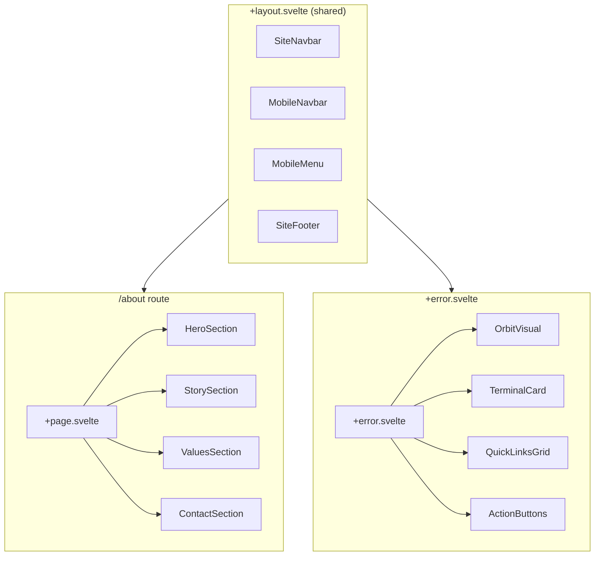

# Design Document: About & 404 Pages

## Overview

This design covers the replacement of the existing About page and 404 error page in the MetaCleaner marketing website with new, fully-featured redesigns. The About page introduces Hero (with stats), Story, Values, and Contact sections. The 404 page features an animated orbit visual, a terminal diagnostic card, action buttons, and a quick links grid.

Both pages integrate seamlessly with the existing shared layout (`+layout.svelte`) — they use the shared SiteNavbar, MobileNavbar, MobileMenu, and SiteFooter. Only minimal changes are required to shared components: adding an "About" NavLink to navigation and updating the contact link in the footer to point to `/about#contact`.

### Key Design Decisions

1. **Section-per-component pattern**: Each page section is a standalone Svelte component in `routes/about/sections/` and route-level `+error.svelte` respectively, following the project's existing architecture.
2. **No custom header/footer**: The mockup navbars/footers are reference-only — the real implementation uses the shared layout components.
3. **CSS-only animations**: The orbit visual and terminal card animations use CSS keyframes with `@keyframes` defined in a scoped `<style>` block, respecting `prefers-reduced-motion`.
4. **Form validation logic extracted**: Contact form validation is a pure function (`validateContactForm`) to allow unit and property-based testing.
5. **Paraglide i18n throughout**: All user-visible text goes through `$lib/paraglide/messages` — no hardcoded strings.
6. **Pixel-perfect from HTML mockups, consistent with existing pages**: The Svelte/Tailwind implementation must visually match the HTML design mockups in `.design/` while also fitting seamlessly into the existing site design. The new pages must use the same theme tokens (`layout.css`), max-width (`max-w-site`), padding patterns, and typography as the existing home/features/pricing pages. The mockup navbars and footers in the HTML files are ignored — the existing shared layout handles those. If any detail in the mockup conflicts with existing site conventions (e.g. a different max-width or font size), the existing site conventions win.
7. **Minimal changes to existing code**: Only the About link addition to SiteNavbar/MobileMenu and the footer contact link update touch existing components. No other existing code is modified.
8. **Brevo for email**: Contact form submissions are sent via the Brevo transactional email API (formerly Sendinblue). API key is stored in environment variable.

## Architecture



### File Structure

```
src/routes/
├── about/
│   ├── +page.svelte                 # About page (replaced)
│   ├── sections/
│   │   ├── HeroSection.svelte       # Hero with stats grid
│   │   ├── StorySection.svelte      # Company origin story
│   │   ├── ValuesSection.svelte     # Six value cards
│   │   └── ContactSection.svelte    # Contact form + info
│   └── components/
│       ├── StatCard.svelte          # Single stat item in hero grid
│       ├── ValueCard.svelte         # Single value card
│       ├── ContactInfoCard.svelte   # Contact details card
│       ├── ResponseTimeCard.svelte  # Response time notice
│       └── ContactForm.svelte       # Form with validation
├── +error.svelte                    # 404 page (replaced)
├── error/
│   ├── sections/
│   │   ├── OrbitVisual.svelte       # Animated orbit rings
│   │   ├── TerminalCard.svelte      # Diagnostic terminal
│   │   ├── QuickLinksGrid.svelte    # Quick navigation links
│   │   └── ActionButtons.svelte     # Home/Back/Support buttons
│   └── components/
│       └── QuickLinkCard.svelte     # Single quick link card

src/lib/
├── components/
│   ├── shared/
│   │   ├── SiteNavbar.svelte        # Modified: add About link, update Props type
│   │   └── MobileMenu.svelte        # Modified: add About link with icon
│   └── elements/
│       └── (existing elements reused: CtaButton, GradientText, NavLink, etc.)
├── shared/
│   └── sections/
│       └── SiteFooter.svelte        # Modified: Contact link → /about#contact
└── utils/
    ├── contactFormValidation.ts     # Pure validation function (testable)
    └── brevoClient.ts              # Brevo transactional email API client

messages/
├── en.json                          # Extended with about_ and error_404_ keys
└── cs.json                          # Extended with about_ and error_404_ keys
```

## Components and Interfaces

### About Page Components

#### HeroSection
```typescript
// No props — self-contained, uses Paraglide messages directly
// Renders: label, headline (GradientText), paragraph, badges, stats grid
```

#### StorySection
```typescript
// No props — self-contained
// Renders: eyebrow label, heading, gradient divider, 3 paragraphs
// Layout: lg:flex-row (1/3 + 2/3), below lg: flex-col
```

#### ValuesSection
```typescript
// No props — uses internal values array
// Renders: header (label, heading, subtitle) + 6 ValueCard components
// Grid: lg:grid-cols-3, sm:grid-cols-2, below sm: grid-cols-1
```

#### ValueCard
```typescript
interface Props {
  icon: string;           // Font Awesome class e.g. "fa-solid fa-lock"
  title: string;          // Localized via Paraglide
  description: string;    // Localized via Paraglide
  hoverColor: 'brand-blue' | 'brand-green' | 'brand-orange';
}
```

#### ContactSection
```typescript
// No props — self-contained with id="contact"
// Renders: header, ContactInfoCard, ResponseTimeCard, ContactForm
// Layout: lg:grid-cols-5 (2 info + 3 form), below lg: stacked
```

#### ContactForm
```typescript
// No props — manages internal form state
// State: name, email, subject, message, errors, isSubmitting, isSuccess
// Uses validateContactForm() for client-side validation
// On valid submission: sends email via Brevo transactional email API
// Brevo API key from env var (VITE_BREVO_API_KEY)
// Sends to configured recipient (e.g. hello@metacleaner.app)
// Uses Brevo's /v3/smtp/email endpoint (fetch POST from client or via server endpoint)
```

#### Brevo Email Integration
```typescript
// src/lib/utils/brevoClient.ts

interface ContactEmailPayload {
  senderName: string;
  senderEmail: string;
  subject: string;
  message: string;
}

async function sendContactEmail(payload: ContactEmailPayload): Promise<{ success: boolean; error?: string }>;
// Uses Brevo transactional email API (https://api.brevo.com/v3/smtp/email)
// API key: import.meta.env.VITE_BREVO_API_KEY
// Recipient: configured in env or hardcoded as hello@metacleaner.app
// Returns success/failure for UI feedback
```

### 404 Page Components

#### OrbitVisual
```typescript
// No props — purely decorative animated element
// CSS animations: outer ring 18s clockwise, inner ring 28s counter-clockwise
// Floating: 5s vertical motion
// Respects prefers-reduced-motion via CSS media query
```

#### TerminalCard
```typescript
interface Props {
  currentPath: string;  // From $page.url.pathname
}
// Displays 5 sequential diagnostic lines with 500ms delays
// Shows blinking cursor after lines appear
// Timestamp computed from current time
// Respects prefers-reduced-motion
```

#### ActionButtons
```typescript
// No props — uses Paraglide messages for labels
// 3 buttons: Home (href="/"), Go Back (history.back()), Support (href="/about#contact")
```

#### QuickLinksGrid
```typescript
// No props — uses internal links array
// 4 cards: Try Free (/), Features (/features), Pricing (/pricing), FAQ (/#faq)
// Each card: min 44×44px touch target
```

### Shared Component Modifications

#### SiteNavbar — Props type update
```typescript
interface Props {
  active?: 'home' | 'features' | 'pricing' | 'about' | 'faq';  // Added 'about'
}
// Add NavLink: href="/about", label=m.nav_about(), active={active === 'about'}
// Position: after Pricing, before FAQ
```

#### MobileMenu — Props type update
```typescript
interface Props {
  variant: 'drawer' | 'dropdown';
  active?: 'home' | 'features' | 'pricing' | 'about' | 'faq';  // Added 'about'
  open: boolean;
  onClose: () => void;
}
// Add About link with icon fa-solid fa-circle-info in both drawer and dropdown variants
```

#### SiteFooter — Link update
```typescript
// Desktop Company column: Contact link href changes from '#' to '/about#contact'
// Mobile footer links: Contact link href changes from '#' to '/about#contact'
```

#### +layout.svelte — activePage logic update
```typescript
const activePage = $derived.by(() => {
  const path = $page.url.pathname;
  if (path.startsWith('/features')) return 'features' as const;
  if (path.startsWith('/pricing')) return 'pricing' as const;
  if (path.startsWith('/about')) return 'about' as const;  // New
  return 'home' as const;
});
```

### Utility: Contact Form Validation

```typescript
// src/lib/utils/contactFormValidation.ts

interface ContactFormData {
  name: string;
  email: string;
  subject: string;
  message: string;
}

interface ValidationErrors {
  name?: string;
  email?: string;
  subject?: string;
  message?: string;
}

interface ValidationResult {
  valid: boolean;
  errors: ValidationErrors;
}

function validateContactForm(data: ContactFormData): ValidationResult;
```

Validation rules:
- `name`: required, max 100 characters
- `email`: required, max 254 characters, valid email format (RFC 5322 simplified)
- `subject`: required, max 150 characters
- `message`: required, max 2000 characters
- "Required" means non-empty after trimming

## Data Models

### Value Card Data

```typescript
interface ValueItem {
  icon: string;
  titleKey: string;      // Paraglide message key
  descriptionKey: string; // Paraglide message key
  hoverColor: 'brand-blue' | 'brand-green' | 'brand-orange';
}

// Static array defined in ValuesSection:
const values: ValueItem[] = [
  { icon: 'fa-solid fa-lock', titleKey: 'about_values_privacy_title', descriptionKey: 'about_values_privacy_desc', hoverColor: 'brand-blue' },
  { icon: 'fa-solid fa-eye-slash', titleKey: 'about_values_transparency_title', descriptionKey: 'about_values_transparency_desc', hoverColor: 'brand-green' },
  { icon: 'fa-solid fa-universal-access', titleKey: 'about_values_accessibility_title', descriptionKey: 'about_values_accessibility_desc', hoverColor: 'brand-orange' },
  { icon: 'fa-solid fa-code', titleKey: 'about_values_opensource_title', descriptionKey: 'about_values_opensource_desc', hoverColor: 'brand-blue' },
  { icon: 'fa-solid fa-shield-halved', titleKey: 'about_values_security_title', descriptionKey: 'about_values_security_desc', hoverColor: 'brand-green' },
  { icon: 'fa-solid fa-lightbulb', titleKey: 'about_values_innovation_title', descriptionKey: 'about_values_innovation_desc', hoverColor: 'brand-orange' },
];
```

### Quick Link Data

```typescript
interface QuickLink {
  icon: string;
  label: string;       // From Paraglide
  href: string;
  hoverBorder: string; // Tailwind border color class
}

const quickLinks: QuickLink[] = [
  { icon: 'fa-solid fa-cloud-arrow-up', label: m.error_404_link_try_free(), href: '/', hoverBorder: 'hover:border-brand-blue/40' },
  { icon: 'fa-solid fa-star', label: m.error_404_link_features(), href: '/features', hoverBorder: 'hover:border-brand-green/40' },
  { icon: 'fa-solid fa-tag', label: m.error_404_link_pricing(), href: '/pricing', hoverBorder: 'hover:border-brand-orange/40' },
  { icon: 'fa-solid fa-circle-question', label: m.error_404_link_faq(), href: '/#faq', hoverBorder: 'hover:border-brand-blue/40' },
];
```

### Contact Form State

```typescript
interface ContactFormState {
  name: string;
  email: string;
  subject: string;
  message: string;
  errors: ValidationErrors;
  isSubmitting: boolean;
  isSuccess: boolean;
  submitError: string | null;
}
```

### Stat Data (Hero)

```typescript
interface StatItem {
  value: string;
  label: string;      // From Paraglide
  colorClass: string; // Tailwind text color
}

const stats: StatItem[] = [
  { value: '50K+', label: m.about_hero_stat_users(), colorClass: 'text-white' },
  { value: '2M+', label: m.about_hero_stat_files(), colorClass: 'text-brand-green' },
  { value: '100%', label: m.about_hero_stat_local(), colorClass: 'text-brand-blue' },
  { value: '4.9★', label: m.about_hero_stat_rating(), colorClass: 'text-brand-orange' },
];
```

### i18n Message Keys

New keys added to `messages/en.json` and `messages/cs.json`:

**About page keys (prefix: `about_`)**:
- `about_hero_label`, `about_hero_title_line1`, `about_hero_title_line2`, `about_hero_description`
- `about_hero_badge_founded`, `about_hero_badge_location`
- `about_hero_stat_users`, `about_hero_stat_files`, `about_hero_stat_local`, `about_hero_stat_rating`
- `about_story_label`, `about_story_heading`
- `about_story_p1`, `about_story_p2`, `about_story_p3`
- `about_values_label`, `about_values_heading`, `about_values_subtitle`
- `about_values_privacy_title`, `about_values_privacy_desc`
- `about_values_transparency_title`, `about_values_transparency_desc`
- `about_values_accessibility_title`, `about_values_accessibility_desc`
- `about_values_opensource_title`, `about_values_opensource_desc`
- `about_values_security_title`, `about_values_security_desc`
- `about_values_innovation_title`, `about_values_innovation_desc`
- `about_contact_label`, `about_contact_heading`, `about_contact_subtitle`
- `about_contact_info_heading`, `about_contact_email_label`, `about_contact_security_label`
- `about_contact_address_label`, `about_contact_company_id_label`
- `about_contact_response_title`, `about_contact_response_desc`
- `about_contact_form_heading`
- `about_contact_form_name_label`, `about_contact_form_name_placeholder`
- `about_contact_form_email_label`, `about_contact_form_email_placeholder`
- `about_contact_form_subject_label`, `about_contact_form_subject_placeholder`
- `about_contact_form_message_label`, `about_contact_form_message_placeholder`
- `about_contact_form_submit`
- `about_contact_form_success`
- `about_contact_form_error`
- `about_contact_form_error_required`, `about_contact_form_error_email`, `about_contact_form_error_max_length`

**404 page keys (prefix: `error_404_`)**:
- `error_404_badge` (e.g. "Error 404 — Page Not Found")
- `error_404_heading`, `error_404_description`
- `error_404_btn_home`, `error_404_btn_back`, `error_404_btn_support`
- `error_404_links_label`
- `error_404_link_try_free`, `error_404_link_features`, `error_404_link_pricing`, `error_404_link_faq`
- `error_404_terminal_title`, `error_404_terminal_live`
- `error_404_terminal_status`, `error_404_terminal_privacy`, `error_404_terminal_suggestion`
- `error_404_terminal_secure`, `error_404_terminal_server_ok`

**Navigation keys**:
- `nav_about` (already may exist, ensure it does)

**SEO keys** (already existing, verify):
- `meta_about_title`, `meta_about_description`
- `error_404_title`

## Correctness Properties

*A property is a characteristic or behavior that should hold true across all valid executions of a system — essentially, a formal statement about what the system should do. Properties serve as the bridge between human-readable specifications and machine-verifiable correctness guarantees.*

### Property 1: Valid contact form data passes validation

*For any* contact form input where name is a non-empty non-whitespace string of ≤100 characters, email is a valid email format string of ≤254 characters, subject is a non-empty non-whitespace string of ≤150 characters, and message is a non-empty non-whitespace string of ≤2000 characters, the `validateContactForm` function SHALL return `{ valid: true, errors: {} }`.

**Validates: Requirements 4.4, 4.8**

### Property 2: Empty or whitespace-only required fields fail validation

*For any* contact form input where at least one required field (name, email, subject, or message) is empty or contains only whitespace characters, the `validateContactForm` function SHALL return `{ valid: false }` with a non-empty error message for that field.

**Validates: Requirements 4.8**

### Property 3: Over-length fields fail validation

*For any* contact form input where at least one field exceeds its maximum character length (name > 100, email > 254, subject > 150, or message > 2000), the `validateContactForm` function SHALL return `{ valid: false }` with a non-empty error message for that field.

**Validates: Requirements 4.4, 4.8**

### Property 4: Invalid email format fails validation

*For any* string that does not match the email format pattern (missing `@`, missing domain, invalid characters), when provided as the email field with all other fields valid, the `validateContactForm` function SHALL return `{ valid: false }` with a non-empty error for the email field.

**Validates: Requirements 4.4, 4.8**

## Error Handling

### Contact Form Errors

| Error Scenario | Handling |
|---|---|
| Required field empty | Inline error message below the field, form not submitted |
| Email format invalid | Inline error message below email field |
| Field exceeds max length | Inline error message below the field |
| Server/network error on submit | Error message displayed near form, all input preserved |
| Submission success | Success message displayed, form can be cleared |

### 404 Page Error Handling

| Scenario | Handling |
|---|---|
| 404 status | Full 404 page with orbit visual, terminal card, links |
| Non-404 error status | Simplified error display with status code, generic heading, and home button (fallback behavior) |
| `history.back()` with no history | Button still renders; browser handles gracefully (stays on page) |

### Animations & Reduced Motion

All CSS animations on both pages respect `prefers-reduced-motion: reduce` by setting animation/transition durations to 0ms. This is handled via a CSS media query in the component's `<style>` block:

```css
@media (prefers-reduced-motion: reduce) {
  .orbit-ring, .float-anim, .terminal-line, .blink, .status-dot {
    animation-duration: 0ms !important;
    transition-duration: 0ms !important;
  }
  .terminal-line {
    opacity: 1 !important;
  }
}
```

## Testing Strategy

### Unit Tests (Vitest)

**Contact form validation** (`src/lib/utils/contactFormValidation.test.ts`):
- Example tests for specific valid/invalid inputs
- Edge cases: boundary lengths (100, 101 chars for name), Unicode characters, whitespace-only strings
- Email format: valid emails, missing @, missing domain, double @, etc.

**Terminal card timestamp** (if extracted as utility):
- Verify timestamp formatting

### Property-Based Tests (Vitest + fast-check)

The `validateContactForm` pure function is suitable for property-based testing since it has clear input/output behavior with a large input space.

**PBT library**: `fast-check` (already used in the monorepo's CLI project)

**Configuration**: Minimum 100 iterations per property test.

**Tests** (`src/lib/utils/contactFormValidation.property.test.ts`):

- **Feature: about-and-404-pages, Property 1: Valid contact form data passes validation**
  Generate random valid form data (non-empty strings within length limits, valid email format) → assert validation returns `{ valid: true }`.

- **Feature: about-and-404-pages, Property 2: Empty or whitespace-only required fields fail validation**
  Generate form data with at least one field being whitespace-only → assert validation returns `{ valid: false }` with error on that field.

- **Feature: about-and-404-pages, Property 3: Over-length fields fail validation**
  Generate form data with at least one field exceeding max length → assert validation returns `{ valid: false }` with error on that field.

- **Feature: about-and-404-pages, Property 4: Invalid email format fails validation**
  Generate strings without valid email structure → assert validation returns `{ valid: false }` with email error.

### Component Tests (Vitest + Browser)

- HeroSection renders all expected elements (badges, stats, heading)
- ValuesSection renders 6 value cards
- ContactSection renders form fields with correct attributes
- ContactForm shows inline errors on invalid submission
- 404 page renders error badge, 404 number, action buttons, quick links
- OrbitVisual renders ring elements
- TerminalCard renders 5 diagnostic lines
- SiteNavbar includes About link in correct position
- MobileMenu includes About link with icon

### E2E Tests (Playwright)

- Navigate to `/about` → verify all 4 sections render
- Submit contact form with empty fields → verify inline errors
- Submit contact form with valid data → verify success message
- Navigate to non-existent route → verify 404 page renders
- Click "Back to Home" on 404 → verify navigation to `/`
- Click footer Contact link → verify navigation to `/about#contact`
- Test responsive layouts at mobile and desktop viewports
- Verify language switch updates About and 404 page content
