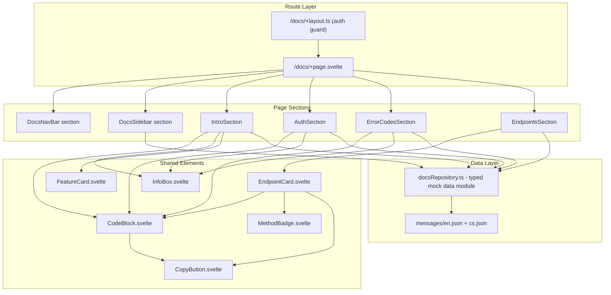

# Design Document: API Documentation Page

## Overview

This feature adds an authenticated `/docs` page to the MetaCleaner app (`frontend/metacleaner-app/`) that displays comprehensive API documentation. The page combines introductory content (Introduction, Authentication, Error Codes) with detailed endpoint reference cards (Upload, Clean, Status, Download, Metadata, Delete) in a single responsive layout.

The page uses a sticky sidebar with scrollspy on desktop (lg+), collapses to a single-column layout on mobile, and renders all content from a local typed mock data module via the Paraglide i18n system. No HTTP requests are made for documentation content.

**Key design decisions:**
- Content is sourced from a single `docsRepository.ts` module with typed interfaces, making future backend migration a single-module change
- The sidebar uses Intersection Observer API for scrollspy rather than scroll event listeners (better performance, no throttling needed)
- Endpoint cards use native HTML `<details>`-style collapse via Svelte 5 `$state` toggle (no animation library)
- Code blocks are a reusable shared element (`CodeBlock.svelte`) since the pattern appears 15+ times

## Architecture



**Data flow:** The `docsRepository.ts` module exports typed getter functions that call `tx()` for translatable strings. Each section component imports the relevant data slice and renders it. Locale switches trigger reactivity through Svelte 5's `$state` in `locale.svelte.ts`, causing `tx()` calls to re-evaluate.

## Components and Interfaces

### Route Structure

```
src/routes/docs/
├── +layout.ts          # Auth guard (guardProtectedRoute('/docs'))
├── +page.svelte        # Page shell: sidebar + main content area
├── sections/
│   ├── DocsIntroSection.svelte
│   ├── DocsAuthSection.svelte
│   ├── DocsErrorCodesSection.svelte
│   └── DocsEndpointsSection.svelte
└── components/
    ├── DocsSidebar.svelte
    ├── EndpointCard.svelte
    ├── QuickStartFlow.svelte
    └── ErrorTable.svelte
```

### Shared Elements (new, in `src/lib/shared/elements/`)

| Component | Purpose |
|-----------|---------|
| `CodeBlock.svelte` | Syntax-highlighted code container with CopyButton |
| `CopyButton.svelte` | Clipboard copy with 2s checkmark confirmation |
| `InfoBox.svelte` | Color-variant alert box (blue/green/orange/red) |
| `MethodBadge.svelte` | HTTP method pill (POST blue, GET green, DEL red) |
| `FeatureCard.svelte` | Icon + title + description grid card |

### Component Interfaces

```typescript
// CodeBlock.svelte
interface CodeBlockProps {
  code: string;          // Plain text for clipboard
  class?: string;
}

// CopyButton.svelte
interface CopyButtonProps {
  text: string;          // Text to copy to clipboard
  class?: string;
}

// InfoBox.svelte
interface InfoBoxProps {
  variant: 'blue' | 'green' | 'orange' | 'red';
  icon?: string;         // Font Awesome icon class (e.g. 'fa-circle-info')
  class?: string;
}

// MethodBadge.svelte
interface MethodBadgeProps {
  method: 'GET' | 'POST' | 'DEL' | 'PATCH' | 'PUT';
  size?: 'sm' | 'md';   // sm = sidebar, md = endpoint card
}

// FeatureCard.svelte
interface FeatureCardProps {
  icon: string;
  iconColor: string;     // e.g. 'brand-green'
  title: string;
  description: string;
}

// EndpointCard.svelte
interface EndpointCardProps {
  endpoint: EndpointData;
  initialOpen?: boolean;
}

// DocsSidebar.svelte
interface DocsSidebarProps {
  sections: SidebarSection[];
  endpoints: SidebarEndpoint[];
  activeId: string;
  onNavigate: (id: string) => void;
}
```

### NavBar Integration

The existing `NavBar.svelte` and `MobileHamburgerMenu.svelte` will be extended with a "Docs" navigation item:

- **Desktop NavBar**: Add a link between existing nav items (after API Keys) visible only when authenticated
- **Mobile hamburger menu**: Add a "Docs" entry with `fa-book` icon following the existing pattern

The `/docs` page uses the existing NavBar with `showBackButton: true`, `backHref: '/'`, and `backLabel` from i18n — matching the pattern used by `/reports` and `/api-keys`. The page renders within the existing shared `+layout.svelte` (with the standard NavBar showing user dropdown, language switcher, etc.), NOT with a custom docs-specific navbar. The "API" badge and version indicator are displayed within the page content area, not in the NavBar.

### Scrollspy Implementation

```typescript
// Inside +page.svelte
let activeId = $state('sec-intro');
let observer: IntersectionObserver | null = null;

onMount(() => {
  const sections = document.querySelectorAll('[data-section-id]');
  observer = new IntersectionObserver(
    (entries) => {
      // Find the topmost visible section
      const visible = entries
        .filter(e => e.isIntersecting)
        .sort((a, b) => a.boundingClientRect.top - b.boundingClientRect.top);
      if (visible.length > 0) {
        activeId = visible[0].target.getAttribute('data-section-id') ?? activeId;
      }
    },
    { rootMargin: '-80px 0px -60% 0px', threshold: 0 }
  );
  sections.forEach(s => observer!.observe(s));
  return () => observer?.disconnect();
});
```

The `rootMargin` accounts for the sticky navbar height (top: -80px) and activates when a section enters the top 40% of the viewport.

## Data Models

### Documentation Data Types

```typescript
// src/lib/repositories/docsRepository.ts

export interface DocsSection {
  id: string;
  icon: string;
  titleKey: string;
  subtitleKey: string;
}

export interface FeatureCardData {
  icon: string;
  iconColor: string;
  titleKey: string;
  descriptionKey: string;
}

export interface QuickStartStep {
  number: number;
  titleKey: string;
  descriptionKey: string;
  codeSnippets: { text: string; color: string }[];
  isLast?: boolean;
}

export interface CodeExample {
  id: string;
  code: string;         // Plain text (for clipboard)
  displayHtml: string;  // Highlighted segments for rendering
}

export interface ErrorEntry {
  status: number;
  code: string;
  descriptionKey: string;
  solutionKey: string;
}

export interface EndpointParam {
  name: string;
  type: string;
  required?: boolean;
  default?: string;
  descriptionKey: string;
}

export interface EndpointResponse {
  status: number;
  labelKey: string;
  variant: 'success' | 'error';
  body: string; // JSON string
}

export interface EndpointData {
  id: string;
  method: 'GET' | 'POST' | 'DEL';
  path: string;
  descriptionKey: string;
  headers: CodeExample;
  params: EndpointParam[];
  optionsParams?: EndpointParam[];  // Only for /files/clean
  statusValues?: string[];          // Only for /jobs/{job_id}/status
  curlExample: CodeExample;
  responses: EndpointResponse[];
}

export interface SidebarSection {
  id: string;
  icon: string;
  labelKey: string;
}

export interface SidebarEndpoint {
  id: string;
  method: 'GET' | 'POST' | 'DEL';
  label: string;
}

export interface DocsConfig {
  apiVersion: string;
  baseUrl: string;
}
```

### Data Module Exports

```typescript
// src/lib/repositories/docsRepository.ts
export function getDocsConfig(): DocsConfig;
export function getSidebarSections(): SidebarSection[];
export function getSidebarEndpoints(): SidebarEndpoint[];
export function getFeatureCards(): FeatureCardData[];
export function getQuickStartSteps(): QuickStartStep[];
export function getSupportedFormats(): string[];
export function getErrorEntries(): ErrorEntry[];
export function getEndpoints(): EndpointData[];
export function getCodeExamples(): Record<string, CodeExample>;
```

All getter functions internally call `tx()` for translatable content, making them reactive to locale changes via Svelte 5's reactivity system.

## Correctness Properties

*A property is a characteristic or behavior that should hold true across all valid executions of a system — essentially, a formal statement about what the system should do. Properties serve as the bridge between human-readable specifications and machine-verifiable correctness guarantees.*

### Property 1: Scrollspy single-active invariant

*For any* scroll position within the docs page content area (from the top of the first section to the bottom of the last section), the sidebar SHALL have exactly one navigation link in the active state at all times — never zero, never more than one.

**Validates: Requirements 4.4**

### Property 2: Endpoint card expand reveals complete content

*For any* endpoint in the documentation data set, expanding its card (toggling from collapsed to expanded) SHALL render all required sub-sections: a description paragraph, a request headers code block, a parameters table, a cURL example code block with copy button, and at least one success and one error response code block.

**Validates: Requirements 8.3, 8.4**

### Property 3: Copy button copies correct plain text

*For any* code block that has an associated copy button, clicking the copy button SHALL write to the clipboard the exact plain-text content of that code block (excluding HTML markup, syntax highlighting spans, and styling), and the written text SHALL be a non-empty string.

**Validates: Requirements 9.1**

### Property 4: i18n completeness — all docs keys resolve

*For any* translation key used in the docs data module, and *for any* supported locale (`cs` or `en`), calling the translation function with that key SHALL return a non-empty string that is NOT equal to the raw key itself.

**Validates: Requirements 10.2, 11.1**

### Property 5: Code block content is locale-independent

*For any* code block in the documentation data (base URL, cURL examples, JSON response bodies, authorization headers), and *for any* supported locale, the rendered code content SHALL be identical regardless of which locale is active.

**Validates: Requirements 11.4**

### Property 6: Info box variant styling correctness

*For any* info box color variant (blue, green, orange, red), the rendered component SHALL apply a background color at 8% opacity of the variant's brand color and a border color at 25% opacity of the variant's brand color, with a border-radius of 10px.

**Validates: Requirements 12.3**

## Error Handling

| Scenario | Handling |
|----------|----------|
| Clipboard API unavailable (HTTP context, older browser) | CopyButton fails silently — no error shown, button stays in default state |
| Clipboard write rejected (permissions) | Same as above — silent fail, default state |
| Auth token expired while on page | Auth store handles refresh transparently; if refresh fails, next navigation triggers auth guard redirect |
| Invalid locale value | `tx()` returns the key as fallback; `initLocale()` falls back to `'en'` |
| Missing translation key | `tx()` returns the raw key — visible during development as a signal to add the translation |
| IntersectionObserver unsupported | Scrollspy gracefully degrades — no active link highlighting, sidebar links still work for click-navigation |

No network requests are made for page content, so network errors do not apply to the docs page itself. Auth-related errors are handled by the global auth infrastructure.

## Testing Strategy

### Unit Tests (Vitest, server project)

- **docsRepository.ts**: Verify data structure completeness — all endpoints have required fields, all translation keys are non-empty for both locales
- **CopyButton logic**: Test clipboard interaction with mocked navigator.clipboard
- **Scrollspy logic**: Test active section calculation given mock IntersectionObserver entries

### Property-Based Tests (fast-check)

The following properties are tested using `fast-check` with minimum 100 iterations per test:

| Property | Generator Strategy |
|----------|-------------------|
| Property 1 (Scrollspy) | Generate random scroll offsets within page bounds, simulate IntersectionObserver entries |
| Property 2 (Endpoint expand) | Select random endpoint from data set, verify expanded content completeness |
| Property 3 (Copy button) | Generate all code blocks from data, verify clipboard write matches plain text |
| Property 4 (i18n completeness) | Generate all translation keys × both locales, verify non-empty non-key results |
| Property 5 (Code locale-independent) | Generate all code blocks × both locales, verify identical output |
| Property 6 (Info box variants) | Generate all 4 variants, verify CSS class/style correctness |

Each test is tagged: `// Feature: api-documentation, Property {N}: {description}`

**PBT Library:** `fast-check` (already in project devDependencies)
**Minimum iterations:** 100 per property test

### Component Tests (Vitest browser project)

- CodeBlock renders with correct classes and copy button
- InfoBox renders all 4 variants with correct colors
- EndpointCard toggles expand/collapse on click
- DocsSidebar highlights active link
- MethodBadge renders correct colors per method

### E2E Tests (Playwright)

- Auth guard redirects unauthenticated user to `/login?returnTo=/docs`
- Authenticated user sees full docs page
- Sidebar scroll-click navigates to correct section
- Responsive: sidebar visible at 1024px+, hidden below
- Copy button shows checkmark confirmation
- Language switch updates all text without scroll jump
- Endpoint cards expand/collapse on click
- NavBar shows "Docs" link when authenticated, hides when not
