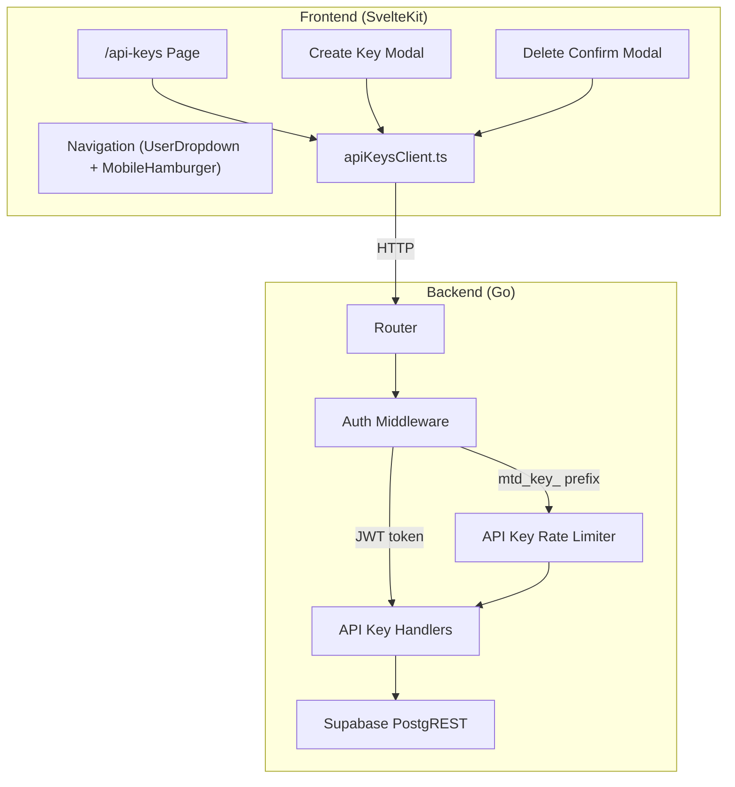
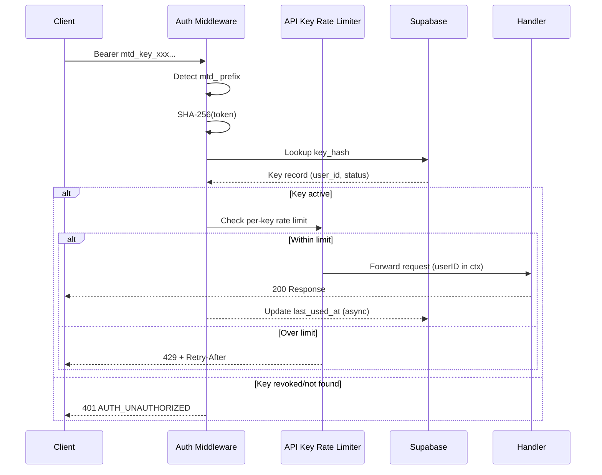
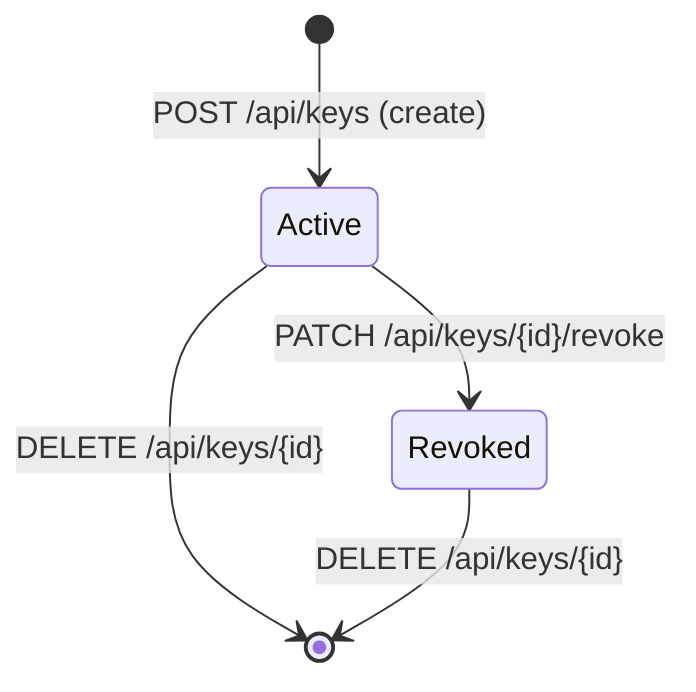

# Design Document: API Keys Management

## Overview

This design covers the full-stack implementation of API key management for MetaCleaner. It introduces a new `/api-keys` frontend route for key lifecycle management (create, list, revoke, delete), extends the backend auth middleware to authenticate requests via API key Bearer tokens (prefix-based routing), adds per-key rate limiting, and updates navigation components.

The design follows existing architectural patterns: Go backend with flat `source/` package, SvelteKit frontend with 3-tier component hierarchy (elements → components → sections), Supabase PostgREST for persistence, and Paraglide for i18n.

### Visual Design Reference

The frontend implementation MUST match the visual design mockups located in:

- **Desktop**: `frontend/metacleaner-app/.design/metacleaner-apikeys-desktop.html`
- **Mobile**: `frontend/metacleaner-app/.design/metacleaner-apikeys-mobile.html`

These HTML files are the authoritative source for layout, spacing, colors, typography, and component structure of the API Keys page. All sections, modals, and interactive elements must be implemented to match these mockups pixel-for-pixel using the project's Tailwind CSS 4 theme tokens.

## Architecture



### Request Flow for API Key Authentication



## Components and Interfaces

### Backend Components

#### 1. API Key Handlers (`source/apikey_handlers.go`)

Factory functions returning `http.HandlerFunc`, following the existing handler pattern:

```go
// POST /api/keys — Create a new API key
func HandleCreateAPIKey(cfg Config, db *SupabaseClient) http.HandlerFunc

// GET /api/keys — List all API keys for authenticated user
func HandleListAPIKeys(db *SupabaseClient) http.HandlerFunc

// DELETE /api/keys/{id} — Permanently delete an API key
func HandleDeleteAPIKey(db *SupabaseClient) http.HandlerFunc

// PATCH /api/keys/{id}/revoke — Revoke an active API key
func HandleRevokeAPIKey(db *SupabaseClient) http.HandlerFunc
```

#### 2. API Key Rate Limiter (`source/apikey_rate_limiter.go`)

Per-key token bucket rate limiter, similar to `AuthRateLimiter` but keyed by API key ID:

```go
type APIKeyRateLimiter struct {
    mu       sync.Mutex
    limiters map[string]*rateLimiterEntry  // key_id -> limiter
    rpm      int                           // requests per minute (default 120)
}

func NewAPIKeyRateLimiter(rpm int) *APIKeyRateLimiter
func (rl *APIKeyRateLimiter) Allow(keyID string) (allowed bool, retryAfter int)
```

#### 3. Auth Middleware Extension (`source/auth_middleware.go`)

The existing `AuthMiddleware.Middleware` method is extended with prefix-based routing:

```go
// Updated Authenticate method:
// 1. Extract Bearer token
// 2. If token starts with "mtd_key_" → API key validation
// 3. Otherwise → existing JWT validation
func (m *AuthMiddleware) Authenticate(r *http.Request) (string, error)
```

New method for API key validation:

```go
func (m *AuthMiddleware) validateAPIKey(token string) (userID string, keyID string, err error)
```

The middleware stores both `userID` and `keyID` in context for rate limiting downstream.

#### 4. API Key Models (`source/apikey_models.go`)

```go
type APIKey struct {
    ID         string     `json:"id"`
    UserID     string     `json:"user_id"`
    Name       string     `json:"name"`
    KeyHash    string     `json:"-"`
    KeyPrefix  string     `json:"key_prefix"`
    KeySuffix  string     `json:"key_suffix"`
    Status     string     `json:"status"`
    Note       string     `json:"note,omitempty"`
    CreatedAt  time.Time  `json:"created_at"`
    LastUsedAt *time.Time `json:"last_used_at,omitempty"`
    RevokedAt  *time.Time `json:"revoked_at,omitempty"`
}

type CreateAPIKeyRequest struct {
    Name    string `json:"name"`
    Note    string `json:"note,omitempty"`
}

type CreateAPIKeyResponse struct {
    Key     string `json:"key"`      // Full plaintext key (returned only once)
    APIKey  APIKey `json:"api_key"`  // Stored record (without hash)
}
```

#### 5. Key Generation (`source/apikey_handlers.go`)

```go
func generateAPIKey() (plaintext string, hash string, prefix string, suffix string, err error)
```

Logic:
1. Generate 32 cryptographically random bytes via `crypto/rand`
2. Hex-encode to 64 characters
3. Prepend prefix: `mtd_key_`
4. Compute SHA-256 hash of the full plaintext key
5. Extract prefix (first 8 chars) and suffix (last 4 chars)

#### 6. Router Registration

New routes added to `NewRouter()`:

```go
// API Key management (authenticated)
mux.Handle("POST /api/keys", HandleCreateAPIKey(cfg, db))
mux.Handle("GET /api/keys", HandleListAPIKeys(db))
mux.Handle("DELETE /api/keys/{id}", HandleDeleteAPIKey(db))
mux.Handle("PATCH /api/keys/{id}/revoke", HandleRevokeAPIKey(db))
```

### Frontend Components

#### 1. API Client (`$lib/clients/apiKeysClient.ts`)

```typescript
export interface ApiKey {
  id: string;
  name: string;
  key_prefix: string;
  key_suffix: string;
  status: 'active' | 'revoked';
  note?: string;
  created_at: string;
  last_used_at: string | null;
  revoked_at: string | null;
}

export interface CreateKeyRequest {
  name: string;
  note?: string;
}

export interface CreateKeyResponse {
  key: string;
  api_key: ApiKey;
}

export async function createApiKey(req: CreateKeyRequest): Promise<CreateKeyResponse>;
export async function listApiKeys(): Promise<ApiKey[]>;
export async function deleteApiKey(id: string): Promise<void>;
export async function revokeApiKey(id: string): Promise<ApiKey>;
```

#### 2. Page Route (`src/routes/api-keys/`)

```
src/routes/api-keys/
├── +page.svelte              # Page shell (loads data, manages state)
├── sections/
│   ├── PageHeaderSection.svelte    # Title + "Create new key" button
│   ├── UsageSummarySection.svelte  # 2 stat cards
│   ├── SecurityInfoSection.svelte  # Info box about key security
│   ├── KeysListSection.svelte      # Key list with key rows
│   └── UsageGuideSection.svelte    # Code examples (accordion on mobile, grid on desktop)
└── components/
    ├── KeyRow.svelte               # Individual key row with actions
    ├── CreateKeyModal.svelte       # Create key form + key reveal
    ├── DeleteConfirmModal.svelte   # Deletion confirmation dialog
    └── EmptyState.svelte           # No keys message + CTA
```

#### 2a. Reusable Component Mapping

The following existing shared elements and components MUST be reused — do NOT reimplement them:

| Design Element | Existing Component | Usage |
|---|---|---|
| Page title + subtitle | `$lib/shared/components/PageHeader.svelte` | Page header with title, description, and badge snippet for the "Create" button |
| Usage summary stat cards | `$lib/shared/components/StatCard.svelte` | 2 cards (active keys, rate limit) with `iconColor` and `label`/`labelMobile` |
| Icon containers (key icon in header, stat icons) | `$lib/shared/elements/IconContainer.svelte` | Green key icon in page header (`color="green"`, `size="xl"`, `shape="square"`), stat card icons are handled internally by StatCard |
| Status badges (Active, Revoked) | `$lib/shared/elements/Badge.svelte` | `color="green"` for Active, `color="red"` for Revoked |
| Section card wrapper (keys list, usage guide) | `$lib/shared/elements/Card.svelte` | Wraps the keys list section and usage guide section |
| Usage guide accordion (mobile) | `$lib/shared/elements/AccordionCard.svelte` | On mobile (<1024px), the usage guide uses AccordionCard with `borderColor="blue"` |
| Buttons (Create key, Delete, Cancel, etc.) | `$lib/shared/elements/Button.svelte` | `variant="primary"` for Create, `variant="danger"` for Delete confirm, `variant="secondary"` for Cancel |

**Rules:**
- All visual structure from the `.design/` mockups must be achieved by composing the above existing elements — no custom card, badge, or button primitives.
- Only route-specific components (KeyRow, CreateKeyModal, DeleteConfirmModal, EmptyState) should be new.
- The sections orchestrate existing elements into the mockup layout.
- Use existing Tailwind theme tokens (`navy-card`, `navy-lighter`, `brand-green`, `text-muted`, etc.) — no hardcoded colors.

#### 2b. Layout and Navigation Integration

The `/api-keys` page MUST use the existing global layout from `+layout.svelte` which already provides:
- **Header/NavBar** — the existing `NavBar` component (shown for all non-auth routes). Do NOT create a new header.
- **Page wrapper** — the existing `div.flex.min-h-screen.flex-col.bg-navy-main` wrapper. Do NOT duplicate it.

The page content sits inside `{@render children()}` of the layout, just like `/reports` or the home page. The navbar in the `.design/` mockups is for visual context only — it is already provided by the layout.

#### 2c. Modal Design Pattern

There is no existing shared modal component in the project. The `CreateKeyModal` and `DeleteConfirmModal` are new components but MUST follow a consistent pattern derived from the `.design/` mockups:

**Modal structure (both modals):**
```
- Fixed fullscreen backdrop: `fixed inset-0 z-50 flex items-center justify-center`
- Backdrop styling: `bg-navy-main/85 backdrop-blur-[4px]` (consistent with MobileHamburgerMenu overlay)
- Modal card: `bg-navy-card border border-gray-700 rounded-2xl w-full max-w-md p-7 shadow-2xl`
- Close via backdrop click (click outside dismisses)
- Close via Escape key
- Animated entrance (opacity + scale transition, 200ms)
```

**Button usage inside modals:**
- Use `Button` element with `variant="primary"` for confirm actions (Create, Delete)
- Use `Button` element with `variant="secondary"` for Cancel
- For Delete modal: use `variant="danger"` for the confirm button

**Consistency rules:**
- Modals use the same `navy-card` background, `border-gray-700` border, and `rounded-2xl` radius as the rest of the app's card surfaces.
- Form inputs inside CreateKeyModal use the same styling as `AuthTextInput` (navy-main bg, gray-700 border, rounded-xl, focus:border-brand-green).

#### 3. Navigation Updates

**UserDropdown.svelte** changes:
- Remove `onSettings` prop from interface
- Replace Settings `<a>` with API Keys `<a>` using `resolve('/api-keys')` and `fa-key` icon
- Use i18n key `common.nav.apiKeys`

**MobileHamburgerMenu.svelte** changes:
- Remove `onSettings` prop from interface
- Replace Settings `<button>` with API Keys `<a>` using `resolve('/api-keys')` and `fa-key` icon
- Use i18n key `common.nav.apiKeys`

#### 4. i18n Keys

New keys added to `messages/en.json` and `messages/cs.json`:

```json
{
  "common.nav.apiKeys": "API Keys" / "API klíče",
  "apiKeys.title": "API Keys" / "API Klíče",
  "apiKeys.subtitle": "Manage access keys for your application" / "Spravujte přístupové klíče pro vaši aplikaci",
  "apiKeys.createButton": "Create new key" / "Vytvořit nový klíč",
  "apiKeys.stats.activeKeys": "Active keys" / "Aktivní klíče",
  "apiKeys.stats.rateLimit": "Limit / minute" / "Limit / minuta",
  "apiKeys.security.title": "API key security" / "Bezpečnost API klíčů",
  "apiKeys.security.description": "..." / "...",
  "apiKeys.list.title": "Your API keys" / "Vaše API klíče",
  "apiKeys.list.keysCount": "{count} keys" / "{count} klíče",
  "apiKeys.emptyState.title": "No API keys yet" / "Zatím žádné API klíče",
  "apiKeys.emptyState.cta": "Create your first key" / "Vytvořte svůj první klíč",
  "apiKeys.createModal.title": "Create new key" / "Vytvořit nový klíč",
  "apiKeys.createModal.nameLabel": "Key name" / "Název klíče",
  "apiKeys.createModal.noteLabel": "Note (optional)" / "Poznámka (volitelné)",
  "apiKeys.createModal.success": "Key created successfully!" / "Klíč byl úspěšně vytvořen!",
  "apiKeys.createModal.copyWarning": "Copy the key now — it will only be shown once." / "Zkopírujte klíč nyní – zobrazí se pouze jednou.",
  "apiKeys.deleteModal.title": "Delete key?" / "Smazat klíč?",
  "apiKeys.deleteModal.warning": "This action is irreversible." / "Tato akce je nevratná.",
  "apiKeys.status.active": "Active" / "Aktivní",
  "apiKeys.status.revoked": "Revoked" / "Revokován",
  "apiKeys.guide.title": "How to use the API key" / "Jak použít API klíč",
  "apiKeys.error.loadFailed": "Failed to load API keys" / "Nepodařilo se načíst API klíče",
  "apiKeys.error.retry": "Retry" / "Zkusit znovu"
}
```

## Data Models

### Database Schema (migration004.sql)

```sql
-- Migration 004: API Keys table
CREATE TABLE api_keys (
    id UUID PRIMARY KEY DEFAULT gen_random_uuid(),
    user_id UUID NOT NULL REFERENCES auth.users(id) ON DELETE CASCADE,
    name TEXT NOT NULL CHECK (char_length(name) <= 100),
    key_hash TEXT NOT NULL UNIQUE,
    key_prefix TEXT NOT NULL,        -- First 8 chars (e.g., "mtd_key_")
    key_suffix TEXT NOT NULL,        -- Last 4 chars (e.g., "Kx9p")
    status TEXT NOT NULL DEFAULT 'active' CHECK (status IN ('active', 'revoked')),
    note TEXT CHECK (note IS NULL OR char_length(note) <= 500),
    created_at TIMESTAMPTZ NOT NULL DEFAULT NOW(),
    last_used_at TIMESTAMPTZ,
    revoked_at TIMESTAMPTZ
);

-- Fast lookup by hash during authentication
CREATE UNIQUE INDEX idx_api_keys_key_hash ON api_keys(key_hash);

-- Fast listing by user
CREATE INDEX idx_api_keys_user_id ON api_keys(user_id);

-- Enable Row Level Security
ALTER TABLE api_keys ENABLE ROW LEVEL SECURITY;

-- Users can only access their own keys (via service role for backend)
CREATE POLICY "Users can manage own keys"
    ON api_keys
    FOR ALL
    USING (user_id = auth.uid())
    WITH CHECK (user_id = auth.uid());
```

### API Key Lifecycle State Machine



### Key Format

| Component | Value | Length |
|-----------|-------|--------|
| Prefix | `mtd_key_` | 8 chars |
| Random body | hex-encoded 32 random bytes | 64 chars |
| Total | `mtd_key_` + 64 hex chars | 72 chars |
| Display hint | `mtd_key_••••...••••Kx9p` | prefix + dots + last 4 |

### API Endpoints Summary

| Method | Path | Auth | Rate Limited | Description |
|--------|------|------|:---:|-------------|
| POST | /api/keys | JWT | IP-based (existing) | Create new API key |
| GET | /api/keys | JWT | IP-based (existing) | List user's API keys |
| DELETE | /api/keys/{id} | JWT | IP-based (existing) | Delete an API key |
| PATCH | /api/keys/{id}/revoke | JWT | IP-based (existing) | Revoke an API key |

Note: API key management endpoints require JWT auth (session-based). The API key Bearer auth is used for other protected endpoints (upload, jobs, reports, etc.).

## Correctness Properties

*A property is a characteristic or behavior that should hold true across all valid executions of a system — essentially, a formal statement about what the system should do. Properties serve as the bridge between human-readable specifications and machine-verifiable correctness guarantees.*

### Property 1: Key Generation Format Correctness

*For any* generated API key, the plaintext string SHALL have: (a) the prefix exactly `mtd_key_`, (b) the total length of 72 characters (8-char prefix + 64 hex chars), (c) the SHA-256 hash of the plaintext matches the stored hash, and (d) the stored suffix equals the last 4 characters of the plaintext.

**Validates: Requirements 1.1, 1.2**

### Property 2: Invalid Creation Input Rejection

*For any* key name that is empty, whitespace-only, or exceeds 100 characters, the creation endpoint SHALL reject the request with HTTP 400 and the request state SHALL remain unchanged (no record stored).

**Validates: Requirements 1.6**

### Property 3: Non-Active Key Authentication Rejection

*For any* API key token (matching `mtd_key_` prefix) whose SHA-256 hash either does not exist in the database OR corresponds to a record with status "revoked", the auth middleware SHALL reject the request with HTTP 401 and error code AUTH_UNAUTHORIZED, without falling back to JWT validation.

**Validates: Requirements 3.4, 4.4, 5.3**

### Property 4: Token Routing by Prefix

*For any* Bearer token, if the token starts with `mtd_key_` the auth middleware SHALL route to API key validation; otherwise it SHALL route to JWT validation. The routing decision is determined solely by prefix match.

**Validates: Requirements 5.1, 5.4**

### Property 5: Active Key Grants Access with Correct Identity

*For any* API key token whose SHA-256 hash matches a stored record with status "active", the auth middleware SHALL set the corresponding user_id from that record into the request context, granting the request access to proceed.

**Validates: Requirements 5.2**

### Property 6: Revocation State Transition

*For any* API key with status "active", a revocation request SHALL transition the status to "revoked" and set `revoked_at` to a non-null timestamp. *For any* API key with status "revoked", a revocation request SHALL be rejected with HTTP 409.

**Validates: Requirements 4.2, 4.3**

### Property 7: Per-Key Rate Limit Independence

*For any* two distinct API keys A and B, exhausting the rate limit for key A (sending more than 120 requests/minute) SHALL NOT cause rate-limited responses for key B. Each key's quota is independent.

**Validates: Requirements 6.1, 6.2, 6.3**

### Property 8: Auth Before Rate Limit Ordering

*For any* request with an invalid or revoked API key token, the response SHALL be HTTP 401 regardless of how many prior requests were made with that key. Rate limit evaluation SHALL NOT occur for unauthenticated requests.

**Validates: Requirements 6.5**

## Error Handling

### Backend Error Codes

New error constants added to `errors.go`:

| Code | HTTP Status | Trigger |
|------|-------------|---------|
| `VALIDATION_ERROR` | 400 | Invalid key name or note |
| `API_KEY_NOT_FOUND` | 404 | Delete/revoke non-existent or other user's key |
| `API_KEY_ALREADY_REVOKED` | 409 | Revoke an already-revoked key |
| `AUTH_UNAUTHORIZED` | 401 | Invalid/revoked API key used for auth |
| `RATE_LIMIT_EXCEEDED` | 429 | API key rate limit exceeded |
| `DATABASE_ERROR` | 500 | Supabase operation failure |

### Frontend Error Handling

- **Network errors**: Caught in `apiKeysClient.ts`, surfaced as inline error messages in the relevant section (never full-page error).
- **Validation errors (400)**: Displayed inline in the Create Key Modal near the offending field.
- **Conflict (409)**: Toast or inline message indicating the key is already revoked.
- **Server errors (500)**: Generic inline error with retry button.
- **Clipboard failure**: Inline tooltip/message near the copy button indicating the copy failed.

### Async Last-Used Update

The `last_used_at` update is performed in a goroutine after the request is forwarded to the handler. If the DB update fails, the error is logged but does not affect the response.

```go
go func() {
    if err := db.UpdateAPIKeyLastUsed(keyID); err != nil {
        slog.Warn("failed to update api key last_used_at", "keyID", keyID, "error", err)
    }
}()
```

## Testing Strategy

### Backend Testing

**Property-based tests** (using `pgregory.net/rapid`):
- Key generation format validation (Property 1)
- Input validation rejection (Property 2)
- Token routing logic (Property 4)
- Rate limiter independence (Property 7)
- Auth-before-rate-limit ordering (Property 8)

Configuration: minimum 100 iterations per property test.
Tag format: `Feature: api-keys-management, Property {N}: {title}`

**Unit tests** (example-based):
- Handler responses for happy paths (create, list, revoke, delete)
- Middleware integration with mocked DB
- Revocation state transitions (Property 6)
- Active key context setting (Property 5)
- Non-active key rejection (Property 3)
- Error response format consistency

**Integration tests**:
- Full request cycle: create key → use key to access endpoint → verify access
- Revoke key → verify rejection
- Delete key → verify rejection
- Last-used timestamp update verification

### Frontend Testing

**Unit/Component tests** (Vitest):
- `CreateKeyModal`: form validation, key reveal after creation, copy button
- `DeleteConfirmModal`: displays key name, triggers delete on confirm
- `KeyRow`: correct rendering for active vs revoked states
- `apiKeysClient.ts`: request construction, error mapping
- Navigation components: API Keys link replaces Settings

**E2E tests** (Playwright):
- Full key lifecycle: navigate to /api-keys → create → copy → revoke → delete
- Responsive behavior: accordion on mobile, grid on desktop
- Error states: network failure → retry
- Empty state when no keys exist

### Property-Based Testing Library

- **Backend**: `pgregory.net/rapid` (already used in project)
- **Frontend**: Not applicable for this feature (UI-heavy, example-based tests are more appropriate)
