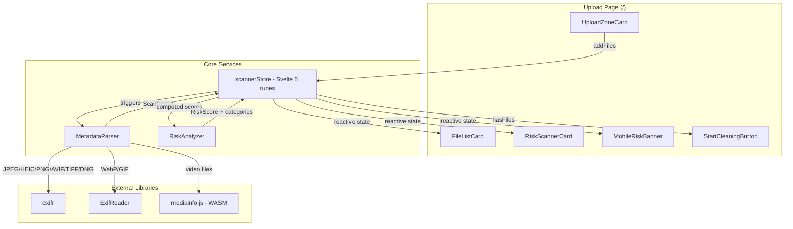
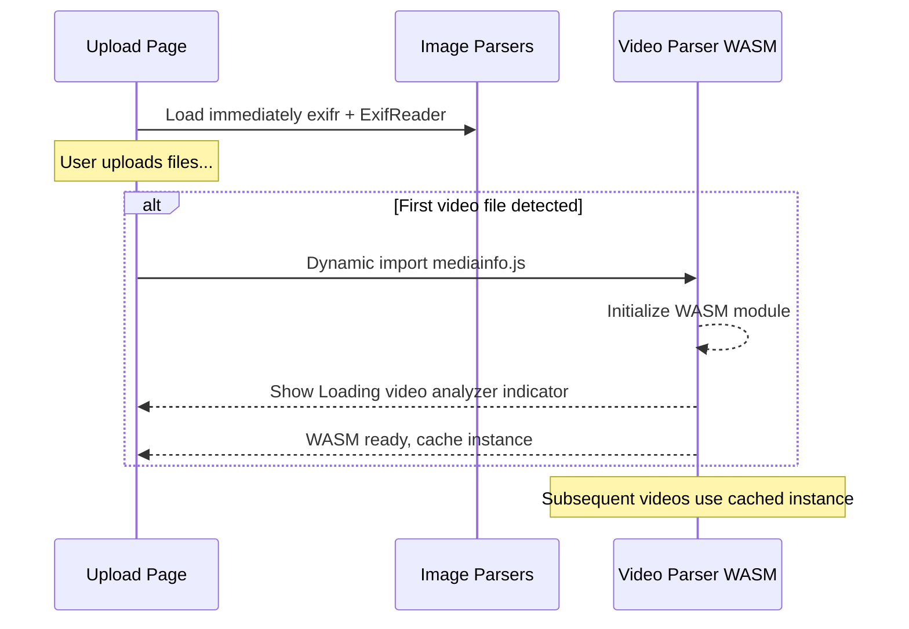

# Design Document: Client-Side Risk Scanner

## Overview

The Client-Side Risk Scanner merges the existing two-step flow (file upload at `/` and risk analysis at `/step2`) into a single unified page at `/`. When users upload files, metadata is extracted and analyzed entirely in the browser using JavaScript parsing libraries. The risk scanner panel dynamically appears alongside the upload zone, providing immediate privacy risk feedback without any server round-trip.

### Key Design Decisions

1. **`exifr`** as the primary image metadata parser (JPEG, HEIC/HEIF, PNG, AVIF, TIFF, DNG) — it supports progressive/partial reads (only first N bytes), handles EXIF/XMP/IPTC segments, and works in the browser (~45KB gzipped). It's the fastest JS EXIF library with selective tag reading.
2. **`ExifReader`** as the secondary image parser for formats `exifr` doesn't handle well — specifically WebP and GIF. Lightweight and complements exifr's coverage.
3. **`mediainfo.js`** for video metadata parsing — a WebAssembly port of MediaInfo (~2.5MB WASM) supporting ALL common video formats (MP4, MOV, AVI, MKV, WebM, WMV, FLV, 3GP, MPEG, OGV, MTS/M2TS). Lazy-loaded only when the first video file is detected. Supports progressive/chunked parsing and extracts format, codec, duration, bitrate, resolution, and embedded metadata tags.
4. **Svelte 5 runes** for reactive state management — a central `scannerStore` module using `$state` and `$derived` runes to hold file queue, scan results, and computed risk scores.
5. **Async chunked processing** — files are parsed sequentially via `requestIdleCallback` / microtask scheduling to avoid blocking the UI thread. For files >200MB, only header segments are read using `File.slice()`.
6. **Conditional panel rendering** — the risk scanner panel only renders when the file queue has ≥1 file, controlled by a simple `$derived` boolean.
7. **Lazy WASM loading** — the mediainfo.js WASM module (~2.5MB) is only loaded when the first video file is detected. On initial page load, only the lightweight image parsers (exifr + ExifReader) are loaded. The initialized mediainfo instance is cached for subsequent video files.

## Architecture



### Data Flow

1. User drops/selects files → `UploadZoneCard` calls `scannerStore.addFiles()`
2. Store adds files to `File_Queue` and triggers async parsing pipeline
3. `MetadataParser` reads metadata using `exifr` (JPEG/HEIC/PNG/AVIF/TIFF/DNG), `ExifReader` (WebP/GIF), or `mediainfo.js` (all video formats)
4. `ScanResult` is stored per file → `RiskAnalyzer` computes scores
5. Reactive `$derived` values propagate updated scores to UI components
6. User removes files → store recalculates; when empty, panel hides

## Components and Interfaces

### File Structure

```
src/
├── lib/
│   ├── scanner/
│   │   ├── scannerStore.svelte.ts    # Central reactive state (runes)
│   │   ├── metadataParser.ts         # File parsing orchestrator
│   │   ├── riskAnalyzer.ts           # Score computation logic
│   │   ├── types.ts                  # Shared TypeScript interfaces
│   │   ├── parsers/
│   │   │   ├── imageParser.ts        # Orchestrates exifr + ExifReader based on format
│   │   │   ├── videoParser.ts        # mediainfo.js wrapper with lazy WASM loading
│   │   │   └── formatDetector.ts     # Determines file type from extension/magic bytes
│   │   └── constants.ts              # Weights, thresholds, field mappings
│   └── repositories/
│       └── fileRepository.ts         # Updated with real scan data shape
├── routes/
│   ├── +page.svelte                  # Unified upload + risk scanner page
│   ├── sections/
│   │   ├── UploadZoneCard.svelte     # File upload drag-and-drop
│   │   ├── FileListCard.svelte       # File list with metadata indicators
│   │   ├── RiskScannerCard.svelte    # Desktop risk panel
│   │   └── MobileRiskBanner.svelte   # Mobile compact risk summary
│   └── components/
│       ├── DropZone.svelte           # Drag-and-drop area
│       ├── RiskScoreRing.svelte      # Circular score visualization
│       ├── RiskBreakdownBar.svelte   # Category breakdown bar
│       ├── BeforeAfterScore.svelte   # Before/after comparison
│       ├── FileListItemRisk.svelte   # Individual file list item
│       └── ScanProgressIndicator.svelte  # Per-file scanning state
```

### Core Interfaces

```typescript
// src/lib/scanner/types.ts

export type FileType = 'image' | 'video';
export type ImageFormat = 'jpeg' | 'png' | 'heic' | 'heif' | 'avif' | 'tiff' | 'dng' | 'webp' | 'gif';
export type VideoFormat = 'mp4' | 'mov' | 'avi' | 'mkv' | 'webm' | 'wmv' | 'flv' | '3gp' | 'mpeg' | 'ogv' | 'mts';
export type ScanStatus = 'pending' | 'scanning' | 'done' | 'error';
export type SeverityLevel = 'critical' | 'high' | 'medium' | 'low';

export interface RiskCategory {
  gps: number;          // 0-100
  deviceIdentity: number; // 0-100
  personalData: number;   // 0-100
  timestamps: number;     // 0-100
}

export interface MetadataField {
  key: string;
  value: string | number | boolean;
  category: keyof RiskCategory;
}

export interface ScanResult {
  fileId: string;
  status: ScanStatus;
  fields: MetadataField[];
  hasGps: boolean;
  device?: string;
  fieldCount: number;
  categoryScores: RiskCategory;
  fileScore: number;      // 0-100 per-file risk
  error?: string;
}

export interface QueuedFile {
  id: string;
  file: File;
  name: string;
  size: number;
  extension: string;
  type: FileType;
  format: ImageFormat | VideoFormat | null;
  scanResult: ScanResult | null;
}

export interface AggregatedRisk {
  overallScore: number;       // 0-100
  severity: SeverityLevel;
  categories: RiskCategory;
  fileCount: number;
  scannedCount: number;
  isScanning: boolean;
}
```

### Scanner Store Interface

```typescript
// src/lib/scanner/scannerStore.svelte.ts

export interface ScannerStore {
  // State (reactive)
  files: QueuedFile[];
  aggregatedRisk: AggregatedRisk;
  hasFiles: boolean;
  isScanning: boolean;

  // Actions
  addFiles(fileList: FileList): void;
  removeFile(fileId: string): void;
  clearFiles(): void;
}
```

### MetadataParser Interface

```typescript
// src/lib/scanner/metadataParser.ts

export interface ParseOptions {
  maxImageHeaderBytes: number;  // default 512KB
  maxVideoHeaderBytes: number;  // default 2MB
  fileSizeThreshold: number;    // default 200MB
}

export function parseFile(file: File, options?: Partial<ParseOptions>): Promise<ScanResult>;
```

### RiskAnalyzer Interface

```typescript
// src/lib/scanner/riskAnalyzer.ts

export function computeFileScore(fields: MetadataField[]): { score: number; categories: RiskCategory };
export function computeAggregatedRisk(results: ScanResult[]): AggregatedRisk;
export function classifySeverity(score: number): SeverityLevel;
```

## Data Models

### Risk Scoring Algorithm

The scoring system uses a weighted field-presence model:

**Category Scores (0–100 each):**

| Category | Fields Checked | Weight per Field |
|----------|---------------|-----------------|
| GPS | latitude, longitude, altitude | 33 each (presence = full score) |
| Device Identity | make, model, serial, software | 25 each |
| Personal Data | author, copyright, IPTC contact, XMP creator | 25 each |
| Timestamps | originalDateTime, digitizedDateTime, gpsTimestamp | 33 each |

**Per-File Score:**
```
fileScore = (gps * 0.40) + (deviceIdentity * 0.25) + (personalData * 0.20) + (timestamps * 0.15)
```

GPS is weighted highest because geolocation is the most significant privacy risk.

**Aggregated Score (across all files):**
Uses weighted maximum strategy — the overall score reflects the highest-risk file:
```
overallScore = max(fileScores)
```

**Severity Classification:**
- Critical: 75–100
- High: 50–74
- Medium: 25–49
- Low: 0–24

### Metadata Field Mapping

```typescript
const GPS_FIELDS = ['GPSLatitude', 'GPSLongitude', 'GPSAltitude', 'GPSPosition'];
const DEVICE_FIELDS = ['Make', 'Model', 'SerialNumber', 'Software', 'LensModel'];
const PERSONAL_FIELDS = ['Artist', 'Copyright', 'XPAuthor', 'Creator', 'ContactInfo'];
const TIMESTAMP_FIELDS = ['DateTimeOriginal', 'DateTimeDigitized', 'GPSDateStamp', 'CreateDate'];
```

### File Size Optimization

For files exceeding 200MB:
- Images: `file.slice(0, 524288)` (first 512KB — metadata is always at the beginning)
- Videos: `file.slice(0, 2097152)` (first 2MB — metadata headers are typically early in the file)

This ensures the parser never loads a full large file into memory.

### Supported Formats

**Images (exifr — primary parser):**
| Format | Extensions | Metadata Extracted |
|--------|-----------|-------------------|
| JPEG | .jpg, .jpeg | EXIF, XMP, IPTC |
| PNG | .png | Text chunks, XMP |
| HEIC/HEIF | .heic, .heif | EXIF from HEIF container |
| AVIF | .avif | EXIF, XMP |
| TIFF | .tiff, .tif | EXIF, XMP, IPTC |
| DNG | .dng | EXIF, XMP (Adobe RAW) |

**Images (ExifReader — secondary parser):**
| Format | Extensions | Metadata Extracted |
|--------|-----------|-------------------|
| WebP | .webp | EXIF, XMP |
| GIF | .gif | XMP, comment blocks |

**Videos (mediainfo.js — WASM parser):**
| Format | Extensions | Metadata Extracted |
|--------|-----------|-------------------|
| MP4 | .mp4, .m4v | Format, codec, duration, bitrate, resolution, embedded tags |
| MOV | .mov | Format, codec, duration, bitrate, resolution, embedded tags |
| AVI | .avi | Format, codec, duration, bitrate, resolution, embedded tags |
| MKV | .mkv | Format, codec, duration, bitrate, resolution, embedded tags |
| WebM | .webm | Format, codec, duration, bitrate, resolution, embedded tags |
| WMV | .wmv | Format, codec, duration, bitrate, resolution, embedded tags |
| FLV | .flv | Format, codec, duration, bitrate, resolution, embedded tags |
| 3GP | .3gp | Format, codec, duration, bitrate, resolution, embedded tags |
| MPEG | .mpg, .mpeg | Format, codec, duration, bitrate, resolution, embedded tags |
| OGV | .ogv | Format, codec, duration, bitrate, resolution, embedded tags |
| MTS/M2TS | .mts, .m2ts | Format, codec, duration, bitrate, resolution, embedded tags |

### Platform Compatibility

The client-side scanner works across all target platforms:

| Platform | Runtime | WASM Support | Notes |
|----------|---------|-------------|-------|
| Web | Modern browsers (Chrome, Firefox, Safari, Edge) | ✅ All modern browsers | Standard deployment |
| Android | Capacitor — Android WebView | ✅ Since Chrome 57+ | WASM bundled in app assets |
| iOS | Capacitor — WKWebView | ✅ Since iOS 11+ | WASM bundled in app assets |

**Key platform notes:**
- The mediainfo.js WASM file (~2.5MB) is bundled in Capacitor app assets, so no network download is needed on mobile.
- All parsing libraries (exifr, ExifReader, mediainfo.js) are pure JavaScript/WASM with no native dependencies, ensuring consistent behavior across platforms.
- File access on mobile uses Capacitor's filesystem plugin, which provides the same `File`/`Blob` API surface as web browsers.

### Lazy Loading Strategy

To optimize initial page load performance, parsing libraries are loaded progressively:



**Loading sequence:**
1. On initial page load, only `exifr` + `ExifReader` are loaded (lightweight, ~75KB combined gzipped)
2. When the first video file is detected in the upload queue, `mediainfo.js` is dynamically imported via `await import('mediainfo.js')`
3. During first WASM initialization, a brief "Loading video analyzer..." indicator is shown to the user
4. The initialized MediaInfo instance is cached in the scanner store for subsequent video files
5. If no video files are ever uploaded, the WASM module is never loaded — zero cost for image-only users

```typescript
// src/lib/scanner/parsers/videoParser.ts — lazy loading pattern
let mediaInfoInstance: MediaInfo | null = null;

export async function getMediaInfo(): Promise<MediaInfo> {
  if (mediaInfoInstance) return mediaInfoInstance;
  
  const MediaInfoFactory = (await import('mediainfo.js')).default;
  mediaInfoInstance = await MediaInfoFactory({ format: 'JSON' });
  return mediaInfoInstance;
}
```


## Correctness Properties

*A property is a characteristic or behavior that should hold true across all valid executions of a system — essentially, a formal statement about what the system should do. Properties serve as the bridge between human-readable specifications and machine-verifiable correctness guarantees.*

### Property 1: Category score computation is correct

*For any* risk category and *any* subset of the category's defined fields being present, the computed category score SHALL equal the sum of per-field weights for present fields, clamped to the range [0, 100].

**Validates: Requirements 4.2, 4.3, 4.4, 4.5**

### Property 2: Per-file risk score is bounded

*For any* valid set of metadata fields (including empty sets), the computed per-file risk score SHALL be a number in the range [0, 100].

**Validates: Requirements 4.1**

### Property 3: Severity classification is exhaustive and correct

*For any* risk score in [0, 100], `classifySeverity(score)` SHALL return exactly one of: "low" (0–24), "medium" (25–49), "high" (50–74), or "critical" (75–100).

**Validates: Requirements 4.7**

### Property 4: Aggregated score equals maximum file score

*For any* non-empty array of per-file risk scores, the aggregated overall risk score SHALL equal `Math.max(...fileScores)`. For an empty array, it SHALL equal 0.

**Validates: Requirements 4.6, 5.3**

### Property 5: File queue mutation preserves aggregation invariant

*For any* file queue state and *any* mutation (adding or removing a file), the resulting aggregated risk score SHALL equal the maximum score among all remaining files' scan results. Adding a file with score S to a queue with max M yields `max(M, S)`. Removing a file recalculates as `max(remaining scores)`.

**Validates: Requirements 5.1, 5.2**

### Property 6: Unsupported file formats yield empty scan results

*For any* file with an unsupported MIME type or extension, `parseFile(file)` SHALL return a ScanResult with `status: 'done'`, `fieldCount: 0`, `fields: []`, and `fileScore: 0` — without throwing.

**Validates: Requirements 2.6**

### Property 7: Corrupted files never crash the parser

*For any* byte sequence presented as a File blob (regardless of content), `parseFile(file)` SHALL either return a valid ScanResult or an error ScanResult (with `status: 'error'`), but SHALL never throw an unhandled exception.

**Validates: Requirements 2.7**

### Property 8: Large files read only header segments

*For any* file exceeding 200MB, the metadata parser SHALL read at most 512KB for image files and at most 2MB for video files, never the full file content.

**Validates: Requirements 7.3**

## Error Handling

### Parser Errors

| Scenario | Behavior |
|----------|----------|
| Unsupported file format | Return empty ScanResult (`status: 'done'`, 0 fields, score 0) |
| Corrupted/unreadable file | Return error ScanResult (`status: 'error'`, error message) |
| Library throws unexpectedly | Catch in wrapper, return error ScanResult |
| File.slice fails (permission) | Return error ScanResult with permission error |

### UI Error States

- Files with `status: 'error'` display a warning icon and "Could not scan" message in the file list
- Error files contribute 0 to the aggregated risk score (conservative — no false positives)
- The risk scanner panel still shows if at least one file scanned successfully
- If ALL files error, show a generic "Scanning failed" state instead of risk breakdown

### Edge Cases

- Empty File_Queue after clearing: reset all scores to 0, hide risk panel
- File added during active scan: queued and processed after current file completes
- Same file added twice: allowed (duplicate entries with unique IDs)
- Very large batch (50+ files): process sequentially with progress, no parallel overload
- Browser tab becomes inactive: parsing continues (using microtask scheduling, not requestAnimationFrame)

## Testing Strategy

### Property-Based Tests (fast-check)

The project will use **[fast-check](https://github.com/dubzzz/fast-check)** as the property-based testing library, integrated with Vitest.

**Configuration:**
- Minimum 100 iterations per property test
- Each test tagged with: `Feature: client-side-risk-scanner, Property {N}: {title}`
- Run via `vitest --run` (no watch mode)

**Properties to implement:**
1. Category score computation (pure function)
2. Per-file score boundedness (pure function)
3. Severity classification (pure function)
4. Aggregated score = max (pure function)
5. File queue mutation invariant (store logic with mocked scan results)
6. Unsupported format handling (parser wrapper with mock files)
7. Corrupted file resilience (parser wrapper with random bytes)
8. Large file header-only read (parser with mocked File.slice)

### Unit Tests (Vitest)

**Example-based tests for:**
- JPEG metadata extraction with known sample file (2.2)
- HEIC metadata extraction with known sample file (2.3)
- PNG metadata extraction with known sample file (2.4)
- MP4 metadata extraction with known sample file (2.5)
- WebP metadata extraction via ExifReader (2.8)
- GIF metadata extraction via ExifReader (2.9)
- AVIF metadata extraction via exifr (2.10)
- TIFF/DNG metadata extraction via exifr (2.11, 2.12)
- AVI/MKV/WebM metadata extraction via mediainfo.js (2.13, 2.14, 2.15)
- Upload zone hidden/shown based on file queue (1.1, 1.2, 1.4)
- Start Cleaning button enabled/disabled state (8.1, 8.2)
- Navigation on button click (8.3)
- Mobile banner visibility at different viewports (9.1)
- Scan progress indicator display (3.3)
- Format detection from extension and magic bytes
- Lazy WASM loading triggers only on first video file

### Integration Tests

- File upload → parse → score update pipeline (end-to-end flow)
- Batch upload processes all files incrementally (3.2)
- UI remains interactive during scanning (7.1)
- Score updates propagate to all UI components within 200ms (5.4, 9.3)

### Test File Structure

```
src/lib/scanner/
├── __tests__/
│   ├── riskAnalyzer.test.ts          # Properties 1-5 + unit tests
│   ├── metadataParser.test.ts        # Properties 6-8 + format-specific tests
│   ├── scannerStore.test.ts          # Store integration tests
│   ├── formatDetector.test.ts        # Extension/magic byte detection tests
│   └── fixtures/
│       ├── sample.jpg                 # Known EXIF data
│       ├── sample.heic                # Known EXIF data
│       ├── sample.png                 # Known text chunks
│       ├── sample.avif                # Known EXIF data
│       ├── sample.tiff               # Known EXIF data
│       ├── sample.webp               # Known EXIF data (ExifReader)
│       ├── sample.gif                # Known comment/XMP data (ExifReader)
│       ├── sample.mp4                 # Known video metadata
│       └── sample.mkv                 # Known video metadata (mediainfo.js)
```
