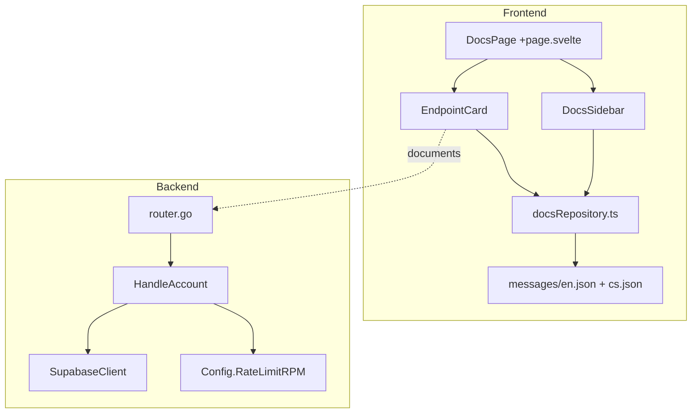

# Design Document: Complete API Documentation

## Overview

This feature expands the MetaCleaner API documentation page to cover all 11 public endpoints accessible via API key. The work spans three areas:

1. **Frontend data layer** — Rewrite `docsRepository.ts` to remove deprecated entries, correct paths for existing endpoints, and add full documentation for 5 new endpoints (Job Download, Job Progress, Reports List, Report Detail, Report PDF, Account, Health).
2. **Sidebar navigation** — Add a `group` property to `SidebarEndpoint`, introduce grouped section headers (File Processing, Reports, Account, System), and update `getSidebarSections()` with an "Endpoints" entry.
3. **Backend** — Implement a new `GET /api/account` handler that returns the authenticated user's credits, plan, and rate limit.
4. **i18n** — Add corresponding English and Czech translation keys for all new endpoint descriptions, parameters, responses, and sidebar group labels.

The existing UI components (EndpointCard, CodeBlock, DocsSidebar) remain unchanged — only the data they consume changes.

## Architecture



The architecture is straightforward:
- **Data flow (frontend):** `docsRepository.ts` exports typed arrays → page components render them. No runtime API calls from the docs page.
- **New endpoint (backend):** `HandleAccount` is a factory function returning `http.HandlerFunc`, following the established handler pattern. It uses `UserIDFromContext` for auth, queries `GetSubscriptionByUserID` and `GetCreditBalance` from the existing Supabase client, and reads `Config.RateLimitRPM` for the rate limit value.

### Design Decisions

| Decision | Rationale |
|----------|-----------|
| Keep data hardcoded in `docsRepository.ts` | Matches existing pattern; no backend docs API needed. All content is static reference documentation. |
| Add `group` property to `SidebarEndpoint` | Minimal interface change enables UI grouping without restructuring the sidebar component's rendering logic. |
| Backend `HandleAccount` reuses existing billing DB queries | `GetCreditBalance` and `GetSubscriptionByUserID` already exist and return exactly the data needed. No new DB schema required. |
| Rate limit value from `Config.RateLimitRPM` | Single source of truth — the same value the rate limiter actually enforces. |

## Components and Interfaces

### Frontend: Updated TypeScript Interfaces

```typescript
// Existing — add `group` property
export interface SidebarEndpoint {
  id: string;
  method: 'GET' | 'POST' | 'DEL';
  label: string;
  group: 'fileProcessing' | 'reports' | 'account' | 'system';
}
```

No other interface changes needed. `EndpointData` already supports all fields required (including `statusValues`, `optionsParams`).

### Frontend: Updated Exports from docsRepository.ts

| Function | Change |
|----------|--------|
| `getEndpoints()` | Remove `ep-metadata`, `ep-delete`. Update paths for `ep-upload`, `ep-clean`, `ep-status`. Expand `ep-download` to full detail. Add `ep-job-download`, `ep-job-progress`, `ep-reports-list`, `ep-report-detail`, `ep-report-pdf`, `ep-account`, `ep-health`. |
| `getSidebarEndpoints()` | Return 11 entries with `group` property, ordered by group. |
| `getSidebarSections()` | Add entry: `{ id: 'sec-endpoints', icon: 'fa-plug', labelKey: 'docs.sidebar.endpoints' }` |
| `getQuickStartSteps()` | Update paths: `/files/upload` → `/api/upload`, `/files/clean` → `/api/jobs`, `/jobs/{job_id}/status` → `/api/jobs/{id}`, `/files/{file_id}/download` → `/api/files/{id}/download` |

### Backend: New Handler

```go
// HandleAccount handles GET /api/account.
// Returns the authenticated user's credits, plan, and rate limit.
func HandleAccount(cfg Config, db *SupabaseClient) http.HandlerFunc {
    return func(w http.ResponseWriter, r *http.Request) {
        userID := UserIDFromContext(r.Context())
        if userID == "" {
            WriteError(w, http.StatusUnauthorized, ErrAuthUnauthorized, "authentication required")
            return
        }

        // Fetch credit balance
        subCredits, purchasedCredits, err := db.GetCreditBalance(r.Context(), userID)
        if err != nil {
            WriteError(w, http.StatusInternalServerError, ErrDatabaseError, "failed to retrieve account information")
            return
        }

        // Determine plan from subscription
        plan := "free"
        sub, err := db.GetSubscriptionByUserID(r.Context(), userID)
        if err != nil {
            WriteError(w, http.StatusInternalServerError, ErrDatabaseError, "failed to retrieve account information")
            return
        }
        if sub != nil && sub.Status == "active" {
            plan = sub.PlanID
        }

        w.Header().Set("Content-Type", "application/json")
        json.NewEncoder(w).Encode(map[string]interface{}{
            "credits_remaining": subCredits + purchasedCredits,
            "plan":             plan,
            "rate_limit_rpm":   cfg.RateLimitRPM,
        })
    }
}
```

**Route registration in `router.go`:**
```go
// GET /api/account
mux.Handle("GET /api/account", rateLimited(HandleAccount(cfg, db)))
```

This route sits inside the auth middleware chain (not in the exempt paths list), so JWT/API key auth is enforced automatically.

### i18n Key Structure

New keys follow the existing convention:

```
docs.endpoint.{name}.desc
docs.endpoint.{name}.param.{paramName}.desc
docs.endpoint.{name}.response.{variant}.label
docs.sidebar.group.fileProcessing
docs.sidebar.group.reports
docs.sidebar.group.account
docs.sidebar.group.system
docs.sidebar.endpoints
```

## Data Models

### Backend Response: GET /api/account

```json
{
  "credits_remaining": 150,
  "plan": "pro",
  "rate_limit_rpm": 10
}
```

| Field | Type | Description |
|-------|------|-------------|
| `credits_remaining` | integer | Sum of subscription + purchased credits |
| `plan` | string | One of: `"free"`, `"pro"`, `"proplus"` |
| `rate_limit_rpm` | integer | Requests per minute allowed for the user's API key |

### Backend Error Response: 401

```json
{
  "error": "AUTH_UNAUTHORIZED",
  "message": "authentication required",
  "timestamp": "2025-01-15T10:30:00Z"
}
```

### Frontend: Endpoint IDs (final 11)

| ID | Method | Path | Group |
|----|--------|------|-------|
| `ep-upload` | POST | `/api/upload` | fileProcessing |
| `ep-clean` | POST | `/api/jobs` | fileProcessing |
| `ep-status` | GET | `/api/jobs/{id}` | fileProcessing |
| `ep-job-progress` | GET | `/api/jobs/{id}/progress` | fileProcessing |
| `ep-job-download` | GET | `/api/jobs/{id}/download` | fileProcessing |
| `ep-download` | GET | `/api/files/{id}/download` | fileProcessing |
| `ep-reports-list` | GET | `/api/reports` | reports |
| `ep-report-detail` | GET | `/api/reports/{id}` | reports |
| `ep-report-pdf` | GET | `/api/reports/{id}/pdf` | reports |
| `ep-account` | GET | `/api/account` | account |
| `ep-health` | GET | `/api/health` | system |

## Correctness Properties

*A property is a characteristic or behavior that should hold true across all valid executions of a system — essentially, a formal statement about what the system should do. Properties serve as the bridge between human-readable specifications and machine-verifiable correctness guarantees.*

### Property 1: i18n key completeness

*For any* i18n key referenced in `getEndpoints()` (descriptionKey, params[].descriptionKey, optionsParams[].descriptionKey, responses[].labelKey), `getSidebarEndpoints()` (labelKey via group labels), and `getSidebarSections()` (labelKey), the key SHALL exist as a valid entry in both `messages/en.json` and `messages/cs.json`.

**Validates: Requirements 9.1**

### Property 2: Account endpoint returns correct computed state

*For any* valid authenticated user with subscription credits ≥ 0, purchased credits ≥ 0, a plan value from {"free", "pro", "proplus"}, and a positive rate limit RPM configuration value, the `GET /api/account` handler SHALL return a JSON response where `credits_remaining` equals the sum of subscription and purchased credits, `plan` matches the user's active subscription plan (or "free" if no active subscription), and `rate_limit_rpm` equals the configured server rate limit.

**Validates: Requirements 10.2**

## Error Handling

### Backend: GET /api/account

| Condition | Status | Error Code | Message |
|-----------|--------|-----------|---------|
| No valid auth credentials | 401 | `AUTH_UNAUTHORIZED` | "authentication required" |
| DB query failure (credits or subscription) | 500 | `DATABASE_ERROR` | "failed to retrieve account information" |
| Rate limit exceeded | 429 | `RATE_LIMIT_EXCEEDED` | "Rate limit exceeded" |

Error responses use the standard `ErrorResponse` format with `error`, `message`, and `timestamp` fields.

### Frontend: Docs Data

No runtime error handling needed — all documentation data is hardcoded. If an i18n key is missing, the Paraglide `tx()` helper returns the key itself as fallback (existing behavior).

## Testing Strategy

### Unit Tests (Example-Based)

**Frontend (`docsRepository.test.ts`):**
- Verify `getEndpoints()` returns exactly 11 entries
- Verify deprecated entries (`ep-metadata`, `ep-delete`) are absent
- Verify each endpoint has correct `id`, `method`, `path`
- Verify updated paths (`/api/upload`, `/api/jobs`, `/api/jobs/{id}`)
- Verify `ep-download` is no longer minimal (no `isMinimal`, no `placeholderKey`)
- Verify `ep-job-progress` includes `statusValues` with all 6 event types
- Verify `getSidebarEndpoints()` returns 11 entries with valid `group` values
- Verify sidebar ordering: fileProcessing → reports → account → system
- Verify `getSidebarSections()` includes the endpoints section
- Verify `getQuickStartSteps()` uses updated API paths

**Backend (`account_handler_test.go`):**
- Test 401 response when no auth header is provided
- Test 200 response with correct JSON shape for a user with active subscription
- Test 200 response returns plan "free" when no active subscription
- Test 500 response when DB returns an error

### Property Tests

**Frontend (`docsRepository.property.test.ts`):**
- **Property 1**: For all i18n keys referenced across all endpoint data and sidebar data, verify presence in both locale files
- Framework: Vitest + fast-check
- Min iterations: 100 (generating random subsets of the key pool for robustness)
- Tag: `Feature: complete-api-docs, Property 1: i18n key completeness`

**Backend (`account_property_test.go`):**
- **Property 2**: Generate random (subscriptionCredits, purchasedCredits, planID, rateLimitRPM) tuples. Mock DB to return these values. Call handler. Assert response fields match expected computation.
- Framework: `pgregory.net/rapid`
- Min iterations: 100
- Tag: `Feature: complete-api-docs, Property 2: Account endpoint returns correct computed state`

### Integration Tests

- Verify `GET /api/account` route is registered and accessible with valid auth
- Verify rate limiting is applied (send requests exceeding RPM, expect 429)

### What Is NOT Tested via PBT

- Static data shape (hardcoded arrays are deterministic — example tests suffice)
- i18n translation quality (requires human review)
- UI rendering of sidebar groups (covered by existing Storybook stories and E2E tests)

