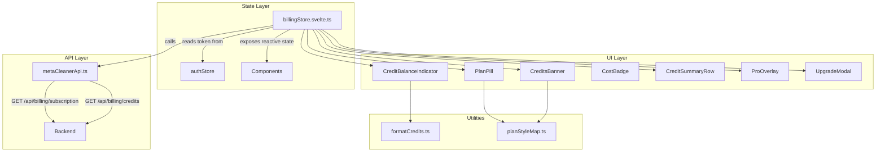

# Design Document: Credits and Subscription Overview

## Overview

This feature adds credit balance visibility, subscription plan display, credit cost awareness, and feature gating to the MetaCleaner frontend app. It introduces a reactive billing store (`billingStore.svelte.ts`) that consumes existing backend endpoints (`GET /api/billing/subscription`, `GET /api/billing/credits`), new UI components for displaying credit/plan info, modifications to existing components (NavBar, MobileHamburgerMenu, FileListItemRisk, Step2), and i18n additions for English and Czech.

The architecture follows the existing two-layer pattern: the API client layer gets new billing fetch functions, a billing store provides reactive state, and presentational components consume that state. Feature gating (Risk Scanner, Reports) uses derived state from the billing store to conditionally render overlays or modals.

### Design Decisions

| Decision | Rationale |
|----------|-----------|
| Separate `billingStore` from `authStore` | Auth store handles tokens/session; billing is a distinct concern with its own refresh logic and error states. The auth store already fetches subscription on login — billing store will coordinate with that. |
| Pure utility functions for formatting/mapping | Credit formatting, plan-to-style mapping, plural forms, and cost computation are pure functions — testable in isolation, used by multiple components. |
| Optimistic display on refresh | Per Req 9.5, we never show a spinner on credit refresh. The store keeps the last known value visible until a new value arrives. |
| Feature gating via derived state | Components read `billingStore.isPaidPlan` / `billingStore.isFreeUser` — simple boolean derivations avoid scattered plan-checking logic. |

## Architecture



### Refresh Triggers

The billing store refreshes credit balance in these scenarios:
1. After successful authentication (login / OAuth callback) — initiated by `authStore` calling `billingStore.refresh()`
2. After Stripe checkout success page navigation — detected via URL parameter
3. After a cleaning job completes — triggered by the cleaning service
4. Manual pull (future consideration for polling)

## Components and Interfaces

### New Components

| Component | Location | Tier | Description |
|-----------|----------|------|-------------|
| `CreditBalanceIndicator` | `src/lib/shared/components/` | Component | Pill showing credit count in NavBar + mobile navbar |
| `PlanPill` | `src/lib/shared/components/` | Component | Pill showing current plan in NavBar |
| `CreditsBanner` | `src/routes/sections/` | Section | Full-width banner with credit balance, progress bar, plan badge, upgrade CTA |
| `CostBadge` | `src/lib/shared/elements/` | Element | Small per-file credit cost badge |
| `CreditSummaryRow` | `src/routes/(step1)/components/` | Route component | Summary bar below file list showing total cost |
| `ProOverlay` | `src/routes/(step1)/components/` | Route component | Gradient overlay on Risk Scanner card for Free users |
| `UpgradeModal` | `src/lib/shared/components/` | Component | Modal shown on reports pages for Free users |

### New Store

| Module | Location | Purpose |
|--------|----------|---------|
| `billingStore.svelte.ts` | `src/lib/stores/` | Reactive billing state (credits, subscription, loading, error) |

### New Utilities

| Module | Location | Purpose |
|--------|----------|---------|
| `formatCredits.ts` | `src/lib/shared/utils/` | `formatCreditCount(n)` — formats number with 99,999+ cap |
| `planStyleMap.ts` | `src/lib/shared/utils/` | `getPlanStyle(planId, status)` — returns style config (colors, icon, label) |
| `creditPlural.ts` | `src/lib/shared/utils/` | `creditLabel(count, locale)` — returns correctly pluralized credit label |
| `creditCost.ts` | `src/lib/shared/utils/` | `computeTotalCost(files)` — computes total credits needed |

### Modified Components

| Component | Changes |
|-----------|---------|
| `NavBar.svelte` | Add `CreditBalanceIndicator` and `PlanPill` to desktop right-side area; pass billing state as props |
| `MobileHamburgerMenu.svelte` | Add credit section card, plan name display, and conditional upgrade CTA |
| `FileListItemRisk.svelte` | Add `CostBadge` to right-side area (before format badge) |
| `Step2FilesReady` section | Add `CreditsBanner` above file list, `CreditSummaryRow` below file list, disable Start Cleaning button when insufficient credits, add `CostIndicatorButton` to Start Cleaning button |
| `MobileBottomCta` | Add `CostIndicatorButton` pill and apply same disabled/insufficient state as desktop Start Cleaning button |
| `+page.svelte` (reports) | Wrap content in feature gate checking paid plan status |
| `+page.svelte` (report detail) | Wrap content in feature gate checking paid plan status |

### API Client Additions

```typescript
// Added to metaCleanerApi.ts

export interface SubscriptionResponse {
  plan_id: string;
  status: string;
  billing_period?: string;
  current_period_end?: string;
  subscription_credits: number;
  purchased_credits: number;
  total_credits: number;
}

export interface CreditsResponse {
  subscription_credits: number;
  purchased_credits: number;
  total_credits: number;
  transactions: CreditTransaction[];
}

export interface CreditTransaction {
  id: string;
  amount: number;
  type: string;
  credit_source: string;
  reference_id?: string;
  description?: string;
  created_at: string;
}

export async function getSubscription(): Promise<SubscriptionResponse> {
  const res = await apiFetch('/api/billing/subscription');
  if (!res.ok) throw await parseErrorResponse(res);
  return res.json();
}

export async function getCredits(): Promise<CreditsResponse> {
  const res = await apiFetch('/api/billing/credits');
  if (!res.ok) throw await parseErrorResponse(res);
  return res.json();
}
```

### Billing Store Interface

```typescript
// billingStore.svelte.ts

interface BillingState {
  // Reactive getters
  get credits(): number | null;           // total_credits (null = not loaded)
  get subscriptionCredits(): number;
  get purchasedCredits(): number;
  get planId(): string;                   // "free" | "pro" | "proplus"
  get planStatus(): string;               // "free" | "active" | "trialing" | "cancelled"
  get isLoading(): boolean;               // true only on initial fetch
  get hasError(): boolean;                // last fetch failed
  get isFreeUser(): boolean;              // derived: planId === "free" or status cancelled
  get isPaidPlan(): boolean;              // derived: status active/trialing and plan pro/proplus
  get monthlyAllowance(): number;         // Free=3, Pro=100, Pro+=100
  
  // Actions
  refresh(): Promise<void>;               // Fetch subscription + credits
  refreshCreditsOnly(): Promise<void>;    // Lightweight: fetch only credit balance
}
```

### Component Props Interfaces

```typescript
// CreditBalanceIndicator
interface CreditBalanceIndicatorProps {
  credits: number | null;
  isLoading: boolean;
  hasError: boolean;
  compact?: boolean;  // mobile: omit "credits" label
}

// PlanPill
interface PlanPillProps {
  planId: string;
  planStatus: string;
}

// CreditsBanner
interface CreditsBannerProps {
  credits: number;
  subscriptionCredits: number;
  monthlyAllowance: number;
  planId: string;
  planStatus: string;
  isPaidPlan: boolean;
}

// CostBadge
interface CostBadgeProps {
  cost: number;  // always 1 for now
}

// CreditSummaryRow
interface CreditSummaryRowProps {
  totalCost: number;
  fileCount: number;
  creditBalance: number | null;
}

// ProOverlay
interface ProOverlayProps {
  // No props needed — self-contained with i18n
}

// UpgradeModal
interface UpgradeModalProps {
  onDismiss: () => void;
}
```

## Data Models

### Plan Configuration (constant)

```typescript
export const PLAN_CONFIG = {
  free: { monthlyAllowance: 3, label: 'Free' },
  pro: { monthlyAllowance: 100, label: 'Pro' },
  proplus: { monthlyAllowance: 100, label: 'Pro+' }
} as const;
```

### Plan Style Map

```typescript
export interface PlanStyle {
  dotColor: string;      // Tailwind class for the 6px dot
  glowColor: string;     // Tailwind class for dot glow/shadow
  borderColor: string;   // Tailwind class for pill border
  bgGradient: string;    // Tailwind classes for background
  textColor: string;     // Tailwind class for label text
  icon: string;          // Font Awesome icon class (fa-lock or fa-star)
  label: string;         // Display text (Free, Pro, Pro+)
}

// Mapping:
// free/cancelled → gray scheme (fa-lock)
// pro active → blue scheme (fa-star)  
// proplus active → orange/gold scheme (fa-star)
```

### Credit Balance State Shape

```typescript
interface BillingData {
  subscriptionCredits: number;
  purchasedCredits: number;
  totalCredits: number;
  planId: string;
  planStatus: string;
  billingPeriod: string | null;
  currentPeriodEnd: string | null;
}
```

## Correctness Properties

*A property is a characteristic or behavior that should hold true across all valid executions of a system — essentially, a formal statement about what the system should do. Properties serve as the bridge between human-readable specifications and machine-verifiable correctness guarantees.*

### Property 1: Credit display formatting

*For any* non-negative integer `n`, `formatCreditCount(n)` SHALL return the string representation of `n` when `n <= 99999`, and SHALL return `"99,999+"` when `n > 99999`.

**Validates: Requirements 1.2**

### Property 2: Credit balance color scheme determination

*For any* credit balance value (non-negative integer), the color scheme function SHALL return `'warning'` when balance equals 0, and `'success'` when balance is greater than 0.

**Validates: Requirements 1.3, 1.4, 10.6**

### Property 3: Plan-to-style mapping consistency

*For any* combination of `planId` (from the set `{null, "free", "pro", "proplus"}`) and `status` (from the set `{null, "free", "active", "trialing", "cancelled"}`), `getPlanStyle(planId, status)` SHALL return the gray/lock style when plan is free/null/cancelled, blue/star style when plan is "pro" with active/trialing status, and orange/star style when plan is "proplus" with active/trialing status.

**Validates: Requirements 2.2, 2.3, 2.4, 10.2**

### Property 4: Progress bar ratio computation

*For any* pair of non-negative integers `(remaining, allowance)` where `allowance > 0`, the progress ratio SHALL equal `Math.min(remaining / allowance, 1)` clamped to the range `[0, 1]`. When `allowance` is 0, the ratio SHALL be 0.

**Validates: Requirements 3.2, 3.5**

### Property 5: Total credit cost computation

*For any* array of files where each file has a `type` field, `computeTotalCost(files)` SHALL return the count of files whose type is NOT `"unknown"`.

**Validates: Requirements 5.1, 5.2**

### Property 6: Insufficient credits determination

*For any* pair of non-negative integers `(totalCost, creditBalance)`, the insufficient credits predicate SHALL return `true` when `totalCost > creditBalance`, and `false` otherwise.

**Validates: Requirements 5.5, 6.1, 6.2, 6.5**

### Property 7: Czech credit plural forms

*For any* non-negative integer `n`, `creditLabel(n, 'cs')` SHALL return `"kredit"` when `n === 1`, `"kredity"` when `n >= 2 && n <= 4`, and `"kreditů"` otherwise (including 0 and 5+). For English, `creditLabel(n, 'en')` SHALL return `"credit"` when `n === 1` and `"credits"` otherwise.

**Validates: Requirements 11.3**

## Error Handling

### API Fetch Failures

| Scenario | Behavior |
|----------|----------|
| Initial subscription fetch fails | `billingStore.hasError = true`, `credits = null`. CreditBalanceIndicator hides itself (Req 1.8). Risk Scanner shows Pro_Overlay as fallback (Req 7.7). Reports show skeleton (Req 8.6). |
| Refresh fetch fails (previous data exists) | Keep last known values. Show warning icon next to CreditBalanceIndicator (Req 9.4). Do not clear existing data. |
| Network timeout | Same as fetch failure — retain last known state. |

### Edge Cases

| Case | Handling |
|------|----------|
| User logs out | `billingStore` clears all state (credits = null, plan = free). |
| Token expired during fetch | `apiFetch` handles token refresh transparently via the existing auth module. |
| Zero credits | Warning styling applied to CreditBalanceIndicator and mobile drawer credit section. Start Cleaning button disabled if files are selected. |
| Credits > 99,999 | Display as "99,999+" per formatting rule. |
| Unknown file type in list | CostBadge not shown, file excluded from cost computation. |

### Loading States

| State | Display |
|-------|---------|
| Initial load (no cached data) | Skeleton placeholder for CreditBalanceIndicator (matching pill dimensions). Reports pages show skeleton. |
| Refresh (cached data exists) | Previous value stays visible. No spinner (Req 9.5). |
| Refresh failure (cached data exists) | Previous value stays visible with a small warning icon adjacent to the pill (Req 9.4). |
| Subscription status loading on reports page | Full-page skeleton (Req 8.6). |

> **Note:** The em-dash placeholder (Req 9.6) is not used separately — a skeleton placeholder serves as the universal "no data yet" state. This avoids two different loading indicators and provides a consistent loading UX.

## Testing Strategy

### Unit Tests (Example-Based)

Focus on specific scenarios and edge cases:

- CreditBalanceIndicator renders correctly in authenticated/loading/error/zero states
- PlanPill renders correct style for each plan type
- CreditsBanner shows/hides upgrade CTA based on plan
- CostBadge visibility based on file type
- CreditSummaryRow warning state when insufficient credits
- ProOverlay renders all required elements
- UpgradeModal renders all required elements and handles dismiss
- Feature gating on reports pages
- billingStore refresh triggers and state transitions
- i18n keys existence in both locale files

### Property-Based Tests (fast-check)

The following pure utility functions will be tested with property-based tests using `fast-check`, minimum 100 iterations per property:

| Property | Module Under Test | Library |
|----------|-------------------|---------|
| P1: Credit display formatting | `formatCredits.ts` | fast-check |
| P2: Credit balance color scheme | `formatCredits.ts` | fast-check |
| P3: Plan-to-style mapping | `planStyleMap.ts` | fast-check |
| P4: Progress bar ratio | `creditCost.ts` | fast-check |
| P5: Total credit cost | `creditCost.ts` | fast-check |
| P6: Insufficient credits | `creditCost.ts` | fast-check |
| P7: Czech credit plurals | `creditPlural.ts` | fast-check |

Each property test will be tagged with a comment referencing the design property:
```typescript
// Feature: credits-and-subscription-overview, Property 1: Credit display formatting
```

### Integration Tests

- Credit balance refreshes after login
- Credit balance refreshes after cleaning job completion
- Reactive updates when files are added/removed (cost recalculation)
- Feature gating navigation behavior (Free user → reports → modal)

### Storybook Stories

Every new component gets co-located `.stories.svelte` files covering all visual states:
- CreditBalanceIndicator: loaded, loading (skeleton), zero credits (warning), high count, compact mode
- PlanPill: Free, Pro, Pro+, hover states
- CreditsBanner: Free with low credits, Pro (no CTA), zero credits, mobile compact
- CostBadge: standard (1 credit)
- CreditSummaryRow: normal, warning (insufficient), neutral (balance unknown)
- ProOverlay: full overlay with all elements
- UpgradeModal: full modal with all elements

### E2E Tests

- Full flow: login → verify credit indicator visible → navigate to reports → verify modal/content based on plan
- Full flow: upload files → verify cost badges → verify summary row → verify button state
