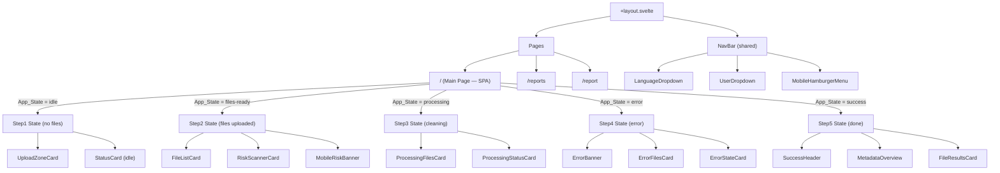

# Design Document: Design Alignment

## Overview

This design covers the realignment of the MetaCleaner SvelteKit 5 frontend with the reference HTML mockups in `.design/`. The work touches every app state (Steps 1–5, Reports list, Report detail) across desktop and mobile breakpoints, modifying existing components and introducing a small number of new ones.

The approach is incremental: each step/page is updated independently, working from shared infrastructure (animations, NavBar changes) outward to page-level sections.

A key architectural change: file uploads become real (reading actual File objects from the user's device) while server communication remains mocked via a service abstraction layer. This prepares the app for future backend integration without coupling the UI to mock data.

## Architecture

### High-Level Component Tree



### SPA State Machine

Steps 1–5 live on a **single route** (`/`). The page renders different sections based on a reactive `appState` store value:

```typescript
// src/lib/stores/appState.svelte.ts
type AppState = 'idle' | 'files-ready' | 'processing' | 'error' | 'success';

let appState = $state<AppState>('idle');

// Transitions:
// idle → files-ready       (user uploads files)
// files-ready → idle       (user removes all files)
// files-ready → processing (user clicks "Spustit čištění")
// processing → success     (all files cleaned successfully)
// processing → error       (cleaning fails for any file)
// processing → files-ready (user clicks "Zastavit" — cancel)
// error → files-ready      (user clicks "Zkusit znovu")
// error → idle             (user clicks "Vymazat vše")
// success → idle           (user clicks "Nahrát nové soubory")
```

The `+page.svelte` for route `/` conditionally renders:
```svelte
{#if appState === 'idle'}
  <Step1Idle />
{:else if appState === 'files-ready'}
  <Step2FilesReady />
{:else if appState === 'processing'}
  <Step3Processing />
{:else if appState === 'error'}
  <Step4Error />
{:else if appState === 'success'}
  <Step5Success />
{/if}
```

No route navigation occurs for state transitions — only the content area re-renders. The NavBar persists unchanged across all states.

### Layout Strategy

All states use a consistent responsive pattern within the single page:

| Breakpoint | Layout | Max-width | Padding |
|---|---|---|---|
| Mobile (<1024px) | Single column, stacked | 100% (480px content-max on some states) | px-4 |
| Desktop (≥1024px) | Two-column grid `55% / 43%` (Steps 1–4) or full-width cards (Step 5) | 1100px | px-6 |

The `lg:` Tailwind breakpoint (1024px) is the single responsive divider.

Reports and Report Detail are separate routes (`/reports`, `/report`) with their own full-width layouts.

## Components and Interfaces

### New Components

| Component | Location | Purpose |
|---|---|---|
| `StatusCardIdle` | `src/routes/sections/Step1Idle/StatusCardIdle.svelte` | Right-column placeholder when no files uploaded showing shield icon + "Čeká na soubory" |
| `MobileBottomCta` | `src/lib/shared/components/MobileBottomCta.svelte` | Fixed-bottom action bar used on mobile across multiple states |
| `MetadataTabSwitcher` | `src/routes/sections/Step5Success/MetadataTabSwitcher.svelte` | Tab buttons for before/after panel switching on mobile Step 5 |
| `Step1Idle` | `src/routes/sections/Step1Idle/Step1Idle.svelte` | Root section for idle state (no files) |
| `Step2FilesReady` | `src/routes/sections/Step2FilesReady/Step2FilesReady.svelte` | Root section for files-uploaded state |
| `Step3Processing` | `src/routes/sections/Step3Processing/Step3Processing.svelte` | Root section for processing state |
| `Step4Error` | `src/routes/sections/Step4Error/Step4Error.svelte` | Root section for error state |
| `Step5Success` | `src/routes/sections/Step5Success/Step5Success.svelte` | Root section for success state |

### Modified Components

| Component | Changes |
|---|---|
| **NavBar** | Remove `mobileStyle` prop — hamburger menu is used on ALL mobile pages. Add `showBackButton` / `backHref` / `backLabel` props for Reports/Report pages. Add `noPrint` class support. |
| **MobileHamburgerMenu** | Already exists. Ensure it contains: user info, language options with checkmarks, settings, logout — matching Step 1 mobile design. Icon toggles bars↔xmark. |
| **UploadZoneCard** | Split into two states: (1) full drop zone with file-arrow-up icon, category pills, and large hit area when no files; (2) compact "add more" zone with plus icon when files are present. Mobile text differs ("Klepněte pro výběr souborů" vs "Přetáhněte soubory sem"). Add drag-over highlight state (brighter border + background tint). Validate file type (JPG/PNG/HEIC/MP4/MOV only) and size (max 500 MB) — reject invalid files with error toast. No "Možnosti" button. |
| **FileListCard** | Add remove button (X icon) per file row — visible on hover (desktop) or always visible (mobile). Clicking removes that file from the store. If last file removed, transitions to idle state. Ensure GPS warning files have red border. |
| **RiskScannerCard** | Align risk bars, score ring, before/after grid, and CTA hint exactly with step2-desktop mockup. Connected to the real scannerStore (from `src/lib/scanner/scannerStore.svelte.ts` per client-side-risk-scanner spec) — displays live computed risk scores, severity badge, and category breakdown bars from actual file metadata analysis. |
| **MobileRiskBanner** | Implement as collapsible accordion with SVG score circle in header, chevron rotation, risk bars and before/after in expanded body. Data sourced from same scannerStore. |
| **ProcessingFilesCard** (step3) | Add overall progress bar with percentage/time-remaining. Per-file items show four states (completed/in-progress/waiting/failed). Red "Zastavit" button that cancels processing and transitions back to files-ready state. |
| **ProcessingStatusCard** (step3) | Animated shield icon with pulse-ring and spinning notch badge, live stats 3-column grid, activity log section. |
| **MobileStatusCard** (step3) | Compact version with inline animated icon + file label, live stats grid. |
| **ActivityLogAccordion** (step3) | Collapsed by default on mobile with chevron toggle. |
| **ErrorBanner** (step4) | Full-width banner with warning icon, title, error code badge, description, dismiss X. |
| **ErrorFilesCard** (step4) | Overall red progress bar ("Přerušeno"), per-file rows with four states, retry + clear buttons. |
| **ErrorStateCard** (step4) | Pulsing ring, shaking triangle, error detail grid, error type selector (radio list), log section. |
| **ErrorDetailAccordion** / **ErrorTypeAccordion** / **ErrorLogAccordion** (step4 mobile) | Independent expandable accordions. |
| **SuccessHeader** (step5) | checkPop animated icon, title, subtitle, action buttons, 100% badge. |
| **MetadataOverview** (step5) | Desktop: two-column before/after grid. Mobile: tab-switched panels inside an accordion. |
| **FileResultsCard** (step5) | Desktop: 2-column grid of file results. Mobile: stacked single-column. Download ZIP + View Report buttons. |
| **ReportsHeader** | Page header with history icon, title, subtitle, "Nové čištění" button. |
| **ReportsTable** (desktop) | Column headers (ID, Datum, Soubory, Pole, Typy, Status, Akce) with 12-column grid rows. |
| **ReportsList** (mobile) | Card-based list with report cards showing date/ID/status, time info, badges, and action buttons. |
| **ReportDetailHeader** | Report icon, title, date/file/field subtitle, PDF download + Print buttons. |
| **ReportChartCard** | Two-column layout: metadata distribution (bars + legend) and per-file breakdown. |
| **FileAccordionList** / **FileAccordionItem** | Expandable per-file accordions showing GPS/EXIF/XMP tables with red strikethrough values. |

### Shared Element Reuse

The existing element library covers most UI needs:

- `Badge` — status badges ("Vysoké riziko", "Zpracovávám", "Chyba")
- `Card` — card wrappers with border/shadow
- `Chip` — metadata type chips (GPS, EXIF, XMP)
- `ProgressBar` — overall/per-file progress bars
- `AccordionCard` — expandable sections
- `IconContainer` — icon circles with color variants
- `ToggleSwitch` — toggle switches (settings)
- `Button` — CTA and secondary buttons
- `StatCard` — summary stat boxes

### i18n Strategy

All user-facing text uses Paraglide JS via the `tx()` helper. No strings are hardcoded in templates.

**Message key naming convention** (dot-separated, by state/section):
```
step1.upload.title          → "Nahrát soubory"
step1.upload.dropPrimary    → "Přetáhněte soubory sem"
step1.upload.dropSecondary  → "nebo klikněte pro výběr ze zařízení"
step1.status.waiting        → "Čeká na soubory"
step2.risk.title            → "Risk Scanner"
step2.risk.highRisk         → "Vysoké riziko"
step3.processing.badge      → "Probíhá čištění..."
step3.processing.status     → "Zpracovávám"
step4.error.badge           → "Chyba zpracování"
step4.error.title           → "Proces čištění selhal"
step5.success.title         → "Čištění dokončeno!"
step5.success.badge         → "Úspěšně dokončeno"
common.startCleaning        → "Spustit čištění"
common.stop                 → "Zastavit"
common.retry                → "Zkusit znovu"
common.clearAll             → "Vymazat vše"
common.downloadZip          → "Stáhnout vše (ZIP)"
common.viewReport           → "Zobrazit report"
common.uploadNew            → "Nahrát nové soubory"
```

**Interpolation for dynamic values:**
```typescript
// messages/cs.json
{ "step5.stats.fieldsRemoved": "Odstraněno {count} metadat. polí" }

// usage
tx('step5.stats.fieldsRemoved', { count: result.fieldsRemoved })
```

Error messages from the mock service return i18n keys that the UI resolves via `tx()`.

### Component Props (Key Interfaces)

```typescript
// StatusCardIdle — new
interface StatusCardIdleProps {
  class?: string;
}

// NavBar — extended
interface NavBarProps {
  user: User | null;
  langOptions: Language[];
  logoHref?: string;
  compact?: boolean;
  showLangDropdown?: boolean;
  showBackButton?: boolean;
  backHref?: string;
  backLabel?: string;
  noPrint?: boolean;
}

// FileListItem — state variant
interface FileListItemProps {
  file: UploadedFile;
  state: 'default' | 'completed' | 'in-progress' | 'waiting' | 'failed' | 'skipped';
  progress?: number; // 0-100 for in-progress state
  fieldsRemoved?: number;
  onRemove?: () => void;
}

// MobileBottomCta — new
interface MobileBottomCtaProps {
  children: Snippet;
  class?: string;
}
```

## Data Models

### App State Store (SPA State Machine)

The entire cleaning workflow lives on route `/`. State transitions happen reactively without navigation:

```typescript
// src/lib/stores/appState.svelte.ts
type AppState = 'idle' | 'files-ready' | 'processing' | 'error' | 'success';

let appState = $state<AppState>('idle');

// Derived helpers
const isProcessing = $derived(appState === 'processing');
const hasFiles = $derived(appState !== 'idle');

// Actions
function transitionTo(state: AppState): void;
function reset(): void; // → 'idle', clears files + results
```

### Real File Upload Store

The file list is driven by **real uploaded files**, not mock/hardcoded data. The upload flow works as:

1. User selects/drags files → browser `File` objects are captured
2. Files are stored in a reactive Svelte store (`uploadStore`) which delegates to the `scannerStore` from the client-side-risk-scanner spec
3. File metadata (name, size, type, lastModified) is read directly from the `File` objects
4. Image thumbnails are generated via `URL.createObjectURL()` for preview
5. The file list displays only files the user has actually uploaded
6. The scannerStore automatically triggers metadata extraction + risk analysis for each added file

The `scannerStore` (from `src/lib/scanner/scannerStore.svelte.ts`, as defined in `.kiro/specs/client-side-risk-scanner/`) serves as the single source of truth for:
- File queue (QueuedFile[])
- Per-file scan results (ScanResult)
- Aggregated risk score and categories (AggregatedRisk)
- Scanning status per file

The `appState` store is separate and manages UI state transitions. It reads from `scannerStore.hasFiles` to determine whether to show idle or files-ready state.

```typescript
// Integration between stores:
// appState subscribes to scannerStore.hasFiles
const hasFiles = $derived(scannerStore.files.length > 0);

// When hasFiles becomes true → appState transitions to 'files-ready'
// When hasFiles becomes false → appState transitions to 'idle'
```

### Mock Service Layer

Server communication is mocked via a service interface that mirrors the future real API:

```typescript
// src/lib/services/cleaningService.ts — interface
export interface CleaningService {
  analyzeFiles(files: UploadedFileEntry[]): Promise<AnalysisResult>;
  startCleaning(files: UploadedFileEntry[], options: CleaningOptions): Promise<CleaningJob>;
  getJobStatus(jobId: string): Promise<JobStatus>;
  downloadResults(jobId: string): Promise<Blob>;
}

// src/lib/services/mockCleaningService.ts — mock implementation
export class MockCleaningService implements CleaningService {
  // Simulates analysis with random metadata field counts
  async analyzeFiles(files: UploadedFileEntry[]): Promise<AnalysisResult>;
  // Simulates cleaning with timed progress updates
  async startCleaning(files: UploadedFileEntry[], options: CleaningOptions): Promise<CleaningJob>;
  // Returns simulated progress/completion/error states
  async getJobStatus(jobId: string): Promise<JobStatus>;
  // Returns a dummy blob for download
  async downloadResults(jobId: string): Promise<Blob>;
}
```

The mock service:
- Generates realistic metadata field counts per file (random 8–47 fields)
- Simulates GPS presence based on image file types
- Progresses through files with configurable delays (500ms–2000ms per file)
- Can simulate errors (timeout, connection error) for Step 4 testing
- Returns mock report data for Steps 5 and Reports pages

To switch to real backend later, only the service implementation changes — all components consume the same interface.

### Existing Types (unchanged)

- `ProcessingFile` (from `types/processing.ts`) — extends UploadedFileEntry with status, progress, error info
- `Report` / `ReportDetail` (from `types/report.ts`) — report list items and detail data

### Route Cleanup

The following route directories SHALL be deleted since Steps 1–5 now live as state sections on `/`:
- `src/routes/step2/`
- `src/routes/step3/`
- `src/routes/step4/`
- `src/routes/step5/`

Remaining routes:
- `/` — Main Page (SPA with state machine)
- `/reports` — Report history list (mock data)
- `/report` — Report detail page (mock data)

### Report Navigation

- "Zobrazit report" button on Step5_State navigates to `/report` using SvelteKit `goto()`
- Report data is generated by MockCleaningService from the actual processed files
- "Zpět na čištění" on `/report` navigates to `/` which resets to idle state

## Error Handling

Error states are fully represented in Step 4. The design uses:

1. **Error Banner** — dismissible full-width banner with error code and description
2. **Error Visual** — animated icon (pulse-ring + shake) with failed file info
3. **Error Detail Box** — grid showing error code, time, file, phase
4. **Error Type Selector** — radio-style list (Cleaning Failed, Connection Error, Timeout)
5. **Error Log** — monospace timestamped entries

On mobile, these are split into independent AccordionCard instances for compact viewing.

Error data flows from the `cleaningStore` which tracks per-file processing results and emits error objects with code, message, file reference, and phase.

## Testing Strategy

### Why PBT Does Not Apply

This feature is a **UI rendering and layout alignment** task. It modifies component DOM structure, CSS classes, responsive behavior, and animation classes. There are no pure functions, data transformations, parsers, or algorithms being introduced. Property-based testing is not appropriate here.

Instead, the testing strategy relies on:
- **Component tests** (Vitest browser mode) for verifying correct rendering, props, and conditional logic
- **E2E tests** (Playwright) for verifying complete user flows, responsive layouts, and interactions

### Component Tests (Vitest)

Component tests verify that each component renders correctly for its various states and props.

**What to test:**
- Conditional rendering (e.g., `StatusCardIdle` shown when no files, hidden when files present)
- Status indicators (file row shows correct icon/color/text for each state)
- Responsive class application (e.g., `lg:hidden` / `lg:block` for mobile/desktop variants)
- Animation class presence (e.g., `check-pop`, `shake`, `spin-slow`, `pulse-ring`)
- NavBar mode switching (hamburger vs dropdowns vs avatar)
- Accordion expand/collapse state
- Bottom sheet open/close
- Button disabled/enabled states
- Text content from i18n keys

**Test structure:**
```
src/routes/sections/Step1Idle/__tests__/
src/routes/sections/Step2FilesReady/__tests__/
src/routes/sections/Step3Processing/__tests__/
src/routes/sections/Step4Error/__tests__/
src/routes/sections/Step5Success/__tests__/
src/routes/reports/sections/__tests__/
src/routes/report/sections/__tests__/
src/lib/shared/components/__tests__/
```

**Key test cases:**
1. `NavBar` — renders hamburger menu on ALL mobile pages, language+user dropdowns on desktop, back button on Reports/Report
2. `UploadZoneCard` — renders full drop zone when no files, compact when files present; shows drag-over highlight; rejects invalid files with error toast
3. `StatusCardIdle` — renders idle state with shield icon and "Čeká na soubory" badge
4. `FileListItem` — renders correctly for each of 5 states (completed/in-progress/waiting/failed/skipped); remove button removes file; last file removal transitions to idle
5. `ProcessingFilesCard` — shows overall progress bar, per-file statuses, "Zastavit" button cancels and returns to files-ready
6. `ErrorBanner` — renders error code, description, dismiss button; disappears on dismiss
7. `ErrorStateCard` — error type selector highlights active type
8. `SuccessHeader` — renders check-pop animation class on icon
9. `MetadataOverview` — desktop shows two columns, mobile shows tabs
10. `ReportsTable` — renders column headers and data rows correctly (mock data)
11. `MobileRiskBanner` — accordion expands/collapses, chevron rotates
12. `AppState transitions` — upload triggers idle→files-ready, start triggers files-ready→processing, cancel triggers processing→files-ready

### E2E Tests (Playwright)

E2E tests verify complete user flows across both viewport sizes. Since Steps 1–5 are states on a single page (`/`), E2E tests trigger state transitions via user interactions (upload files, click buttons) rather than navigating to different URLs.

**Viewport configurations:**
- Desktop: 1280×720
- Mobile: 375×667 (iPhone SE equivalent)

**Key test scenarios:**

1. **Step 1 → Step 2 transition (desktop)**: Upload files on `/`, verify page re-renders in-place to show file list + risk scanner without URL change
2. **Step 1 — Mobile hamburger menu**: Open/close menu on any mobile page, verify language options, icon animation
3. **File validation**: Upload invalid file (wrong type / too large), verify error toast appears and file is not added
4. **File removal**: Remove file from list, verify it disappears; remove last file, verify idle state returns
5. **Step 2 → Step 3 transition**: Click "Spustit čištění", verify processing state renders on same page
6. **Step 3 — Processing state (desktop)**: Verify spinner animations present, progress bars update, file states correct
7. **Step 3 — Mobile activity log accordion**: Toggle open/close
8. **Step 3 — Stop processing**: Click "Zastavit", verify returns to files-ready state with files intact
9. **Step 3 → Step 4 transition**: Mock service returns error, verify error state renders on same page
10. **Step 4 — Error display (desktop)**: Verify error banner, file states (completed/failed/skipped), retry button
11. **Step 4 — Mobile error accordions**: Each accordion independently expandable
12. **Step 4 → Step 2 transition**: Click "Zkusit znovu", verify files-ready state returns
13. **Step 3 → Step 5 transition**: Mock service completes, verify success state renders on same page
14. **Step 5 — Success results (desktop)**: Verify checkPop icon, stats row, before/after metadata, file results grid
15. **Step 5 — Mobile metadata tabs**: Switch between "Před čištěním" / "Po čištění" tabs
16. **Step 5 → Report navigation**: Click "Zobrazit report", verify navigation to `/report` with mock report data
17. **Reports — Desktop table** (`/reports`): Verify column headers, row data, filter buttons, search input (mock data)
18. **Reports — Mobile cards**: Verify card layout, scrollable filters, fixed bottom CTA
19. **Report Detail — Desktop** (`/report`): Verify charts section, file accordions, back button navigates to `/`
20. **Report Detail — Mobile**: Verify compact header, stat grid, file accordions expand/collapse
21. **URL stability**: Verify that during entire Step 1→2→3→4/5 flow, URL remains `/` (no route changes)
22. **Drag-over highlight**: Drag file over upload zone, verify visual highlight appears

**Run commands:**
- Component tests: `bun run test` (Vitest)
- E2E tests: `bun run test:e2e` (Playwright)

### Test Priorities

| Priority | Area | Rationale |
|---|---|---|
| High | State machine transitions | Core SPA flow — all states must transition correctly |
| High | File upload + validation | Real files must work, invalid files must be rejected |
| High | File removal + last-file edge case | Removing last file must return to idle |
| High | NavBar hamburger on mobile | Consistent across all pages |
| High | Responsive layout breakpoints | Two-column vs single-column is fundamental |
| Medium | Processing cancel (Zastavit) | Must cleanly return to files-ready |
| Medium | Animation classes | Visual polish, less likely to regress |
| Medium | Accordion interactions | Common interaction pattern |
| Medium | Report navigation + mock data | End-to-end flow completeness |
| Low | Exact text content | Covered by i18n system, unlikely to break |
