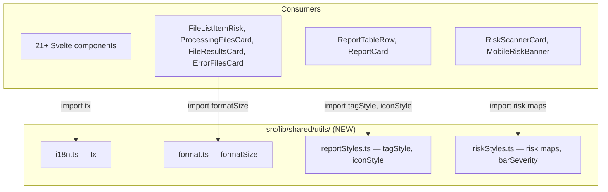

# Design Document

## Overview

This design covers an internal code quality refactoring of the MetaCleaner SvelteKit frontend. The goal is to consolidate duplicated utility functions into shared modules, resolve a type naming conflict, and fix three discrete bugs (accessibility, reactivity, and path resolution). No user-facing behavior changes.

**Key outcomes:**
- 4 new shared utility modules in `src/lib/shared/utils/`
- 1 type rename (`MetadataField` → `ReportMetadataField` in report types)
- 3 bug fixes (UserDropdown, appState store, AuthNavbar)
- Elimination of ~21 inline `tx()` declarations, ~4 inline `formatSize()` declarations, and duplicated style mappings

## Architecture

The refactoring stays within the existing frontend architecture. No new layers, services, or external dependencies are introduced.



### Affected Layers

| Layer | Change |
|-------|--------|
| `src/lib/shared/utils/` | New modules added |
| `src/lib/types/report.ts` | Type rename |
| `src/lib/stores/appState.svelte.ts` | Reactivity fix |
| `src/lib/shared/components/UserDropdown.svelte` | Accessibility fix |
| `src/routes/(auth)/components/AuthNavbar.svelte` | Path resolution fix |
| 21+ component files | Remove inline `tx()`, import shared |
| 4 component files | Remove inline `formatSize()`, import shared |
| 2 component files | Remove inline `tagStyle()`/`iconStyle()`, import shared |
| 2 section files | Remove inline risk utilities, import shared |

## Components and Interfaces

### 1. `src/lib/shared/utils/i18n.ts`

```typescript
import { locale } from '$lib/locale.svelte';
import * as m from '$lib/paraglide/messages';

/**
 * Reactive translation helper. Reads locale.current so Svelte tracks it as a dependency.
 * Supports both parameterized and parameterless messages.
 */
export function tx(key: string, params?: Record<string, unknown>): string {
  void locale.current;
  const fn = (m as unknown as Record<string, ((p: Record<string, unknown>) => string) | undefined>)[key];
  if (!fn) return key;
  return params && Object.keys(params).length > 0 ? fn(params) : (fn as unknown as () => string)();
}
```

**Design decision:** A single overloaded signature handles both parameterized (`tx('key', { count: 5 })`) and parameterless (`tx('key')`) calls. This unifies the two slightly different inline variants found in the codebase (some accept params, some don't).

### 2. `src/lib/shared/utils/format.ts`

```typescript
/**
 * Format bytes into a human-readable size string.
 * Returns KB for values < 1 MB, MB otherwise.
 */
export function formatSize(bytes: number): string {
  if (bytes <= 0) return '0.0 KB';
  if (bytes < 1024 * 1024) return `${(bytes / 1024).toFixed(1)} KB`;
  return `${(bytes / (1024 * 1024)).toFixed(1)} MB`;
}
```

**Design decision:** The zero/negative guard returns `"0.0 KB"` as specified in requirements. The existing inline implementations do not handle zero/negative, so this is a minor improvement.

### 3. `src/lib/shared/utils/reportStyles.ts`

```typescript
/**
 * Returns Tailwind classes for metadata tag badges (GPS, EXIF, XMP, etc.)
 */
export function tagStyle(tag: string): string {
  if (tag === 'GPS') return 'bg-brand-red/10 border-brand-red/20 text-brand-red';
  if (tag === 'EXIF') return 'bg-brand-orange/10 border-brand-orange/20 text-brand-orange';
  if (tag === 'XMP') return 'bg-brand-blue/10 border-brand-blue/20 text-brand-blue';
  return 'bg-navy-lighter text-text-muted';
}

/**
 * Returns Tailwind classes for report icon containers based on color.
 */
export function iconStyle(color: string): string {
  if (color === 'green') return 'bg-brand-green/10 border-brand-green/20 text-brand-green';
  if (color === 'orange') return 'bg-brand-orange/10 border-brand-orange/20 text-brand-orange';
  return 'bg-brand-blue/10 border-brand-blue/20 text-brand-blue';
}
```

### 4. `src/lib/shared/utils/riskStyles.ts`

```typescript
import type { SeverityLevel } from '$lib/scanner/types';

export type RingColor = 'red' | 'orange' | 'green' | 'blue';
export type BarSeverity = 'critical' | 'high' | 'medium' | 'low';

export const ringColorMap: Record<SeverityLevel, RingColor> = {
  critical: 'red',
  high: 'orange',
  medium: 'orange',
  low: 'green'
};

export const severityBadgeClass: Record<SeverityLevel, string> = {
  critical: 'border-brand-red/20 bg-brand-red/10 text-brand-red',
  high: 'border-brand-orange/20 bg-brand-orange/10 text-brand-orange',
  medium: 'border-brand-orange/20 bg-brand-orange/10 text-brand-orange',
  low: 'border-gray-700 bg-navy-lighter text-text-muted'
};

export const dotColorClass: Record<SeverityLevel, string> = {
  critical: 'bg-brand-red',
  high: 'bg-brand-orange',
  medium: 'bg-brand-orange',
  low: 'bg-gray-500'
};

export const severityTextClass: Record<SeverityLevel, string> = {
  critical: 'text-brand-red',
  high: 'text-brand-orange',
  medium: 'text-brand-orange',
  low: 'text-text-muted'
};

export const severityLabelKey: Record<SeverityLevel, string> = {
  critical: 'step2.risk.critical',
  high: 'step2.risk.high',
  medium: 'step2.risk.medium',
  low: 'step2.risk.low'
};

/**
 * Determine bar severity level from a 0-100 score value.
 */
export function barSeverity(value: number): BarSeverity {
  if (value >= 75) return 'critical';
  if (value >= 50) return 'high';
  if (value >= 25) return 'medium';
  return 'low';
}
```

**Design decision:** `severityTextClass` is included proactively — while not currently duplicated across components, it logically belongs with the other severity maps and `MobileRiskBanner` uses a variant of it.

### 5. Type Rename: `MetadataField` → `ReportMetadataField`

In `src/lib/types/report.ts`:
```typescript
// Before
export interface MetadataField { label: string; value: string; moreCount?: number; }

// After
export interface ReportMetadataField { label: string; value: string; moreCount?: number; }
```

All references to this type within `report.ts` (the `FileMetadataSection` interface) and consuming components will be updated to use `ReportMetadataField`.

The `MetadataField` in `src/lib/scanner/types.ts` (shape: `{ key, value, category }`) remains unchanged.

### 6. UserDropdown Accessibility Fix

Add `onclick` handlers and `onSettings`/`onLogout` callback props:

```typescript
interface Props {
  user: User | null;
  open?: boolean;
  onToggle?: () => void;
  onSettings?: () => void;  // NEW
  onLogout?: () => void;    // NEW
  wrapperId?: string;
}
```

The Settings and Logout `<div>` elements get:
- `onclick={() => onSettings?.()}` / `onclick={() => onLogout?.()}`
- Updated `onkeydown` to call the callback directly instead of `e.currentTarget.click()`

### 7. appState Store Reactivity Fix

```typescript
// Before — returns a function, consumers must call _currentState()
const _currentState = $derived((): AppState => { ... });

// After — returns the value directly via $derived.by()
const _currentState = $derived.by((): AppState => {
  if (_explicitState === 'idle' && scannerStore.hasFiles) return 'files-ready';
  if (_explicitState === 'files-ready' && !scannerStore.hasFiles) return 'idle';
  return _explicitState;
});
```

Internal consumers (`isProcessing`, `hasFiles`, `current` getter) change from `_currentState()` to `_currentState`.

### 8. AuthNavbar Path Resolution Fix

```svelte
<script lang="ts">
  import { resolve } from '$app/paths';
  import type { Pathname } from '$app/types';

  interface Props {
    rightText?: string;
    rightHref?: Pathname;   // Changed from string to Pathname
    rightLabel?: string;
  }
</script>

<!-- In template -->
<a href={resolve(rightHref)}>
```

## Data Models

No new data models are introduced. The only change is the rename of `MetadataField` → `ReportMetadataField` in `src/lib/types/report.ts`.

### Existing types (unchanged)

| Type | Location | Shape |
|------|----------|-------|
| `MetadataField` | `src/lib/scanner/types.ts` | `{ key, value, category }` |
| `ReportMetadataField` (renamed) | `src/lib/types/report.ts` | `{ label, value, moreCount? }` |
| `SeverityLevel` | `src/lib/scanner/types.ts` | `'critical' \| 'high' \| 'medium' \| 'low'` |
| `AppState` | `src/lib/stores/appState.svelte.ts` | `'idle' \| 'files-ready' \| 'processing' \| 'error' \| 'success'` |

### New types

| Type | Location | Shape |
|------|----------|-------|
| `RingColor` | `src/lib/shared/utils/riskStyles.ts` | `'red' \| 'orange' \| 'green' \| 'blue'` |
| `BarSeverity` | `src/lib/shared/utils/riskStyles.ts` | `'critical' \| 'high' \| 'medium' \| 'low'` |


## Correctness Properties

*A property is a characteristic or behavior that should hold true across all valid executions of a system — essentially, a formal statement about what the system should do. Properties serve as the bridge between human-readable specifications and machine-verifiable correctness guarantees.*

### Property 1: tx() key lookup and passthrough

*For any* string key and optional params object, calling `tx(key, params)` SHALL return either the result of invoking the corresponding message function (when the key exists in the messages module) or the original key string unchanged (when the key does not exist). When params is provided and non-empty, the message function is called with params; when params is omitted or empty, the message function is called without arguments.

**Validates: Requirements 1.1, 1.3, 1.4**

### Property 2: formatSize range correctness

*For any* number `bytes`: when bytes is positive and less than 1,048,576, `formatSize(bytes)` SHALL return `"${(bytes/1024).toFixed(1)} KB"`; when bytes is 1,048,576 or greater, it SHALL return `"${(bytes/1048576).toFixed(1)} MB"`; when bytes is zero or negative, it SHALL return `"0.0 KB"`.

**Validates: Requirements 2.2, 2.3, 2.4**

### Property 3: Style functions always return non-empty valid class strings

*For any* string input, `tagStyle(input)` and `iconStyle(input)` SHALL each return a non-empty string. Furthermore, for known inputs (GPS, EXIF, XMP for tagStyle; green, orange for iconStyle), the functions SHALL return their specific documented class strings; for all other inputs, they SHALL return the documented default class string.

**Validates: Requirements 3.3, 3.4, 3.6**

### Property 4: barSeverity threshold mapping

*For any* integer value in the range 0–100, `barSeverity(value)` SHALL return `'critical'` when value ≥ 75, `'high'` when value ≥ 50, `'medium'` when value ≥ 25, and `'low'` when value < 25.

**Validates: Requirements 4.2**

## Error Handling

This refactoring introduces minimal new error surface since it extracts existing logic without changing behavior.

| Scenario | Handling |
|----------|----------|
| Unknown message key passed to `tx()` | Returns the key string unchanged (passthrough fallback) |
| Zero or negative bytes passed to `formatSize()` | Returns `"0.0 KB"` |
| Unknown tag string passed to `tagStyle()` | Returns neutral default classes |
| Unknown color string passed to `iconStyle()` | Returns blue default classes |
| `onSettings`/`onLogout` callback not provided to UserDropdown | No-op on activation (optional chaining `?.()`) |
| `rightHref` not provided to AuthNavbar | Right-side link not rendered (existing guard) |

No exceptions are thrown by any of the new utility functions. They are pure, total functions that handle all possible inputs gracefully.

## Testing Strategy

### Property-Based Tests (fast-check)

The project already has `fast-check` as a dev dependency. Property tests will use `vitest` + `fast-check` with a minimum of 100 iterations per property.

| Property | Test File | Generator Strategy |
|----------|-----------|-------------------|
| P1: tx() key lookup | `src/lib/shared/utils/__tests__/i18n.test.ts` | `fc.string()` for keys, `fc.dictionary(fc.string(), fc.anything())` for params |
| P2: formatSize range | `src/lib/shared/utils/__tests__/format.test.ts` | `fc.integer()` and `fc.double()` covering negative, zero, small, and large values |
| P3: Style functions | `src/lib/shared/utils/__tests__/reportStyles.test.ts` | `fc.string()` for arbitrary inputs |
| P4: barSeverity thresholds | `src/lib/shared/utils/__tests__/riskStyles.test.ts` | `fc.integer({ min: 0, max: 100 })` |

Each property test will be tagged with:
```typescript
// Feature: frontend-code-quality-refactor, Property {N}: {title}
```

### Unit Tests (example-based)

| Area | Test File | Cases |
|------|-----------|-------|
| UserDropdown accessibility | `src/lib/shared/components/__tests__/UserDropdown.test.ts` | click/keydown invoke callbacks, no-op without callbacks |
| appState reactivity | `src/lib/stores/__tests__/appState.test.ts` | auto-correction logic, getter values per state |
| AuthNavbar resolve | Component test | href contains resolve() output |
| Type rename | `bun run check` | Zero TypeScript errors |

### Smoke Checks

- `bun run check` passes with zero errors (validates type rename, imports, Props types)
- `bun run lint` passes (validates no unused variables after removing inline functions)
- grep audit: no inline `tx()`, `formatSize()`, `tagStyle()`, `iconStyle()` remaining in component files

### Test Configuration

```typescript
// vitest property test example structure
import { describe, it, expect } from 'vitest';
import fc from 'fast-check';

describe('formatSize', () => {
  it('Property 2: formatSize range correctness', () => {
    // Feature: frontend-code-quality-refactor, Property 2: formatSize range correctness
    fc.assert(
      fc.property(fc.double({ min: -1000, max: 100_000_000, noNaN: true }), (bytes) => {
        const result = formatSize(bytes);
        if (bytes <= 0) return result === '0.0 KB';
        if (bytes < 1024 * 1024) return result === `${(bytes / 1024).toFixed(1)} KB`;
        return result === `${(bytes / (1024 * 1024)).toFixed(1)} MB`;
      }),
      { numRuns: 100 }
    );
  });
});
```
