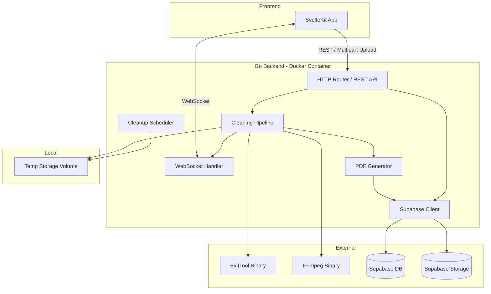
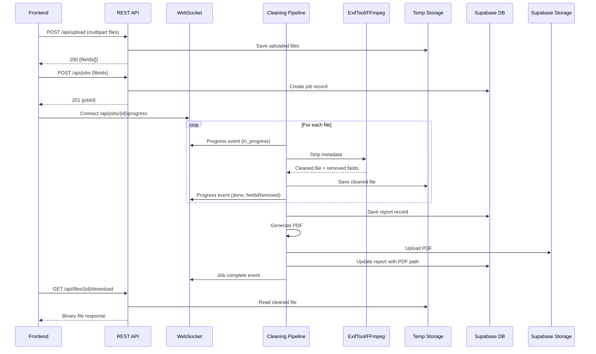

# Design Document: MetaCleaner Backend

## Overview

MetaCleaner Backend is a Go HTTP server that receives uploaded media files, strips their embedded metadata using ExifTool (images) and FFmpeg (videos) as subprocesses, and provides real-time progress updates over WebSocket. It persists cleaning job history and report metadata in Supabase (PostgreSQL), generates PDF reports stored in Supabase Storage, and temporarily holds original/cleaned files on local Docker storage for download.

The backend serves as the processing engine behind the SvelteKit frontend, exposing a REST API that matches the frontend's existing repository data shapes (ProcessingState, ProcessingResults, Report, ReportDetail).

### Key Design Decisions

| Decision | Rationale |
|---|---|
| Go with `net/http` (Go 1.22+ routing) | Built-in pattern matching with `{id}` path params eliminates need for chi dependency |
| ExifTool/FFmpeg as subprocesses | Proven tools with comprehensive format coverage; avoids reimplementing metadata parsing |
| Sequential file processing per job | Simplifies progress tracking and resource management; parallelism is per-job not per-file |
| Supabase via REST API | No need for a Go ORM; direct HTTP calls to Supabase PostgREST and Storage APIs |
| Local temp storage for cleaned files | Avoids Supabase Storage costs for ephemeral data; files auto-deleted after retention |
| WebSocket for progress | Real-time push without polling; matches frontend's existing ProcessingState shape |
| signintech/gopdf for PDF generation | Actively maintained Go library (2.7K stars), no external dependencies, produces compact PDFs |

## Architecture

### System Component Diagram



### Data Flow



## Components and Interfaces

### Project Directory Structure

```
backend/
├── main.go                  # Entry point, server setup, route registration
├── config.go                # Environment variable loading and validation
├── router.go                # HTTP route definitions, CORS, and rate limiting middleware
├── handlers.go              # HTTP request handlers (upload, jobs, files, reports, health)
├── websocket.go             # WebSocket connection management and progress broadcasting
├── pipeline.go              # Cleaning pipeline orchestration (ExifTool/FFmpeg subprocess calls)
├── pdf.go                   # PDF report generation (signintech/gopdf)
├── supabase.go              # Supabase DB and Storage client
├── cleanup.go               # Periodic temp file cleanup scheduler
├── models.go                # Data models and DTOs
├── errors.go                # Error types and consistent error response formatting
├── go.mod
├── go.sum
├── .env
├── .env.example
├── .dockerignore
├── Dockerfile
├── start-docker.sh
├── fly.toml
├── README.md
├── DOCS.md
├── scripts/
│   ├── deploy.sh            # Fly.io deploy: creates app if missing, sets secrets, runs fly deploy
│   └── build.sh
├── migrations/
│   └── 001_full_schema.sql  # Idempotent SQL schema for Supabase (CREATE TABLE IF NOT EXISTS)
└── tests/
    ├── pipeline_test.go
    ├── handlers_test.go
    ├── models_test.go
    ├── cleanup_test.go
    └── pdf_test.go
```

This flat structure (11 source files) is borderline but acceptable given each file has a clear single responsibility. If complexity grows, reorganize into `core/`, `services/`, `clients/` subdirectories.

### Component Responsibilities

| Component | File | Responsibility |
|---|---|---|
| Config | `config.go` | Load and validate env vars, expose typed config struct |
| Router | `router.go` | Register routes, apply CORS middleware, wire handlers |
| Handlers | `handlers.go` | Parse HTTP requests, call services, format responses |
| WebSocket | `websocket.go` | Manage WS connections per job, broadcast progress events |
| Pipeline | `pipeline.go` | Orchestrate file cleaning: invoke ExifTool/FFmpeg, parse output, track progress |
| PDF Generator | `pdf.go` | Generate cleaning report PDFs from job results |
| Supabase Client | `supabase.go` | HTTP client for Supabase DB (PostgREST) and Storage APIs |
| Cleanup | `cleanup.go` | Background goroutine that deletes expired temp files on a ticker |
| Models | `models.go` | Shared data structures (Job, File, Report, Progress events) |
| Errors | `errors.go` | Standardized error response struct and helper functions |

### Interface Definitions (Go)

```go
// Config holds all application configuration
type Config struct {
    Port             int
    FrontendOrigin   string
    MaxFileSize      int64  // bytes
    RetentionPeriod  time.Duration
    TempStoragePath  string
    SupabaseURL      string
    SupabaseAPIKey   string
    RateLimitRPM     int    // requests per minute per IP for upload endpoint
}

// CleaningPipeline orchestrates metadata stripping
type CleaningPipeline interface {
    ProcessJob(ctx context.Context, job *Job, progressFn func(ProgressEvent)) error
    CleanFile(ctx context.Context, file *FileRecord) (*CleaningResult, error)
}

// SupabaseClient handles all Supabase interactions
type SupabaseClient interface {
    // DB operations
    CreateJob(ctx context.Context, job *Job) error
    UpdateJob(ctx context.Context, job *Job) error
    GetJob(ctx context.Context, jobID string) (*Job, error)
    CreateReport(ctx context.Context, report *Report) error
    GetReport(ctx context.Context, reportID string) (*Report, error)
    ListReports(ctx context.Context) ([]ReportSummary, error)
    // Storage operations
    UploadPDF(ctx context.Context, reportID string, data []byte) (string, error)
    GetPDFSignedURL(ctx context.Context, path string) (string, error)
}

// WebSocketHub manages active connections
type WebSocketHub interface {
    Register(jobID string, conn *websocket.Conn)
    Unregister(jobID string, conn *websocket.Conn)
    Broadcast(jobID string, event ProgressEvent)
}
```

## API Design

### Endpoints

#### POST /api/upload

Upload one or more files for metadata cleaning.

**Request**: `multipart/form-data` with field `files` (multiple files)

**Response 200**:
```json
{
  "files": [
    {
      "id": "f-abc123",
      "name": "IMG_4821.jpg",
      "size": 3355443,
      "extension": "JPG",
      "type": "image",
      "format": "jpeg"
    }
  ]
}
```

**Errors**: 413 (file too large), 415 (unsupported format), 507 (disk full)

#### POST /api/jobs

Start a cleaning job for previously uploaded files.

**Request**:
```json
{
  "fileIds": ["f-abc123", "f-def456"]
}
```

**Response 201**:
```json
{
  "jobId": "job-xyz789",
  "status": "processing",
  "totalFiles": 2,
  "createdAt": "2025-06-02T10:22:00Z"
}
```

**Errors**: 404 (file not found), 400 (empty fileIds)

#### GET /api/jobs/{id}

Get current job status.

**Response 200**:
```json
{
  "jobId": "job-xyz789",
  "status": "completed",
  "totalFiles": 4,
  "filesCompleted": 4,
  "fieldsRemoved": 87,
  "totalTimeMs": 28,
  "createdAt": "2025-06-02T10:22:00Z",
  "completedAt": "2025-06-02T10:22:28Z"
}
```

#### GET /api/jobs/{id}/progress (WebSocket upgrade)

Establish WebSocket connection for real-time progress. See WebSocket Protocol section.

#### GET /api/files/{id}/download

Download a cleaned file.

**Response 200**: Binary file with `Content-Type` matching the file format and `Content-Disposition: attachment; filename="cleaned_IMG_4821.jpg"`

**Errors**: 404 (not found / expired), 409 (not ready)

#### GET /api/reports

List all cleaning reports.

**Response 200**:
```json
{
  "summary": {
    "totalReports": 12,
    "fieldsRemoved": 1248,
    "filesProcessed": 47,
    "gpsRemoved": 31
  },
  "reports": [
    {
      "id": "rpt-001",
      "reportId": "MCR-2025-0602-A1",
      "date": "2025-06-02T10:22:00Z",
      "duration": "28s",
      "fileCount": 4,
      "fileTypes": "JPG, HEIC, MP4",
      "type": "image",
      "gps": true,
      "fields": 87,
      "tags": ["GPS", "EXIF", "XMP"],
      "iconColor": "green"
    }
  ]
}
```

#### GET /api/reports/{id}

Get detailed report information.

**Response 200**:
```json
{
  "reportId": "MCR-2025-0602-A1",
  "date": "2025-06-02T10:22:00Z",
  "filesProcessed": 4,
  "fieldsRemoved": 87,
  "gpsLocationsRemoved": 3,
  "totalTimeMs": 28,
  "chartData": [
    { "label": "GPS", "fields": 9, "percentage": 10 },
    { "label": "EXIF", "fields": 51, "percentage": 59 },
    { "label": "XMP", "fields": 27, "percentage": 31 }
  ],
  "files": [
    {
      "name": "IMG_4821.jpg",
      "extension": "JPG",
      "sizeMB": "3.2",
      "format": "JPEG",
      "device": "Canon EOS R5",
      "type": "image",
      "iconColor": "green",
      "hasGps": true,
      "fieldsRemoved": 12,
      "metadata": {
        "gpsFields": [
          { "label": "GPS Latitude", "value": "50.0755° N" }
        ],
        "exifFields": [
          { "label": "Make", "value": "Canon" }
        ],
        "xmpFields": [
          { "label": "Creator", "value": "Jana N." }
        ],
        "totalRemoved": 12
      }
    }
  ]
}
```

**Errors**: 404 (report not found)

#### GET /api/reports/{id}/pdf

Download the PDF report.

**Response 302**: Redirect to Supabase Storage signed URL

**Errors**: 404 (report or PDF not found)

#### GET /api/health

Health check endpoint.

**Response 200**:
```json
{
  "status": "healthy",
  "exiftool": true,
  "ffmpeg": true,
  "database": true,
  "diskSpace": {
    "available": "4.2 GB",
    "total": "10 GB"
  }
}
```

### Error Response Format

All errors follow a consistent structure:

```json
{
  "error": "FILE_TOO_LARGE",
  "message": "File exceeds maximum allowed size of 500 MB",
  "timestamp": "2025-06-02T10:22:00Z"
}
```

## WebSocket Protocol

### Connection

Client connects to `ws://host/api/jobs/{jobId}/progress` after creating a job.

### Message Types (Server → Client)

#### File Progress Event
```json
{
  "type": "file_progress",
  "fileId": "f-abc123",
  "status": "in_progress",
  "progress": 45
}
```

#### File Complete Event
```json
{
  "type": "file_complete",
  "fileId": "f-abc123",
  "status": "done",
  "fieldsRemoved": 12,
  "gpsRemoved": true
}
```

#### File Error Event
```json
{
  "type": "file_error",
  "fileId": "f-abc123",
  "status": "error",
  "errorCode": "ERR_EXIFTOOL_FAILED",
  "message": "ExifTool returned non-zero exit code"
}
```

#### Job Progress Event
```json
{
  "type": "job_progress",
  "overallProgress": 62,
  "filesCompleted": 2,
  "totalFiles": 4,
  "fieldsRemoved": 30,
  "timeRemainingSeconds": 14,
  "currentFileId": "f-def456"
}
```

#### Job Complete Event
```json
{
  "type": "job_complete",
  "jobId": "job-xyz789",
  "filesProcessed": 4,
  "fieldsRemoved": 87,
  "gpsLocationsRemoved": 3,
  "totalTimeMs": 28,
  "reportId": "rpt-001"
}
```

### Connection Lifecycle

1. Client opens WebSocket after receiving jobId from POST /api/jobs
2. Server sends progress events as files are processed
3. Server sends job_complete when all files are done
4. Server closes the connection after job_complete
5. If client disconnects early, the job continues processing uninterrupted

## Data Models

### Supabase PostgreSQL Schema

```sql
-- Cleaning jobs table
CREATE TABLE cleaning_jobs (
    id UUID PRIMARY KEY DEFAULT gen_random_uuid(),
    status TEXT NOT NULL DEFAULT 'processing',  -- processing, completed, failed
    total_files INT NOT NULL,
    files_completed INT NOT NULL DEFAULT 0,
    fields_removed INT NOT NULL DEFAULT 0,
    gps_locations_removed INT NOT NULL DEFAULT 0,
    total_time_ms INT,
    created_at TIMESTAMPTZ NOT NULL DEFAULT now(),
    completed_at TIMESTAMPTZ
);

-- Individual file records within a job
CREATE TABLE job_files (
    id UUID PRIMARY KEY DEFAULT gen_random_uuid(),
    job_id UUID NOT NULL REFERENCES cleaning_jobs(id) ON DELETE CASCADE,
    file_name TEXT NOT NULL,
    file_extension TEXT NOT NULL,
    file_size_bytes BIGINT NOT NULL,
    file_type TEXT NOT NULL,  -- image, video
    format TEXT NOT NULL,     -- jpeg, png, mp4, etc.
    device TEXT,
    status TEXT NOT NULL DEFAULT 'waiting',  -- waiting, in_progress, done, error
    fields_removed INT NOT NULL DEFAULT 0,
    gps_removed BOOLEAN NOT NULL DEFAULT false,
    error_code TEXT,
    error_message TEXT,
    metadata_breakdown JSONB,  -- {gps: [...], exif: [...], xmp: [...], ...}
    processed_at TIMESTAMPTZ,
    created_at TIMESTAMPTZ NOT NULL DEFAULT now()
);

-- Cleaning reports (history)
CREATE TABLE cleaning_reports (
    id UUID PRIMARY KEY DEFAULT gen_random_uuid(),
    job_id UUID NOT NULL REFERENCES cleaning_jobs(id),
    report_id TEXT NOT NULL UNIQUE,  -- Human-readable: MCR-2025-0602-A1
    date TIMESTAMPTZ NOT NULL,
    files_processed INT NOT NULL,
    fields_removed INT NOT NULL,
    gps_locations_removed INT NOT NULL,
    total_time_ms INT NOT NULL,
    file_types TEXT NOT NULL,         -- "JPG, HEIC, MP4"
    dominant_type TEXT NOT NULL,      -- image or video
    has_gps BOOLEAN NOT NULL,
    tags TEXT[] NOT NULL,             -- ['GPS', 'EXIF', 'XMP']
    icon_color TEXT NOT NULL,         -- green, blue, orange
    chart_data JSONB NOT NULL,        -- [{label, fields, percentage}]
    pdf_path TEXT,                    -- Supabase Storage path, null if failed
    pdf_status TEXT NOT NULL DEFAULT 'pending',  -- pending, uploaded, failed
    created_at TIMESTAMPTZ NOT NULL DEFAULT now()
);

-- Indexes for common queries
CREATE INDEX idx_job_files_job_id ON job_files(job_id);
CREATE INDEX idx_cleaning_reports_date ON cleaning_reports(date DESC);
CREATE INDEX idx_cleaning_reports_job_id ON cleaning_reports(job_id);
```

### Go Data Models

```go
// Job represents a cleaning job
type Job struct {
    ID                  string    `json:"jobId"`
    Status              string    `json:"status"`
    TotalFiles          int       `json:"totalFiles"`
    FilesCompleted      int       `json:"filesCompleted"`
    FieldsRemoved       int       `json:"fieldsRemoved"`
    GPSLocationsRemoved int       `json:"gpsLocationsRemoved"`
    TotalTimeMs    int       `json:"totalTimeMs,omitempty"`
    CreatedAt           time.Time `json:"createdAt"`
    CompletedAt         *time.Time `json:"completedAt,omitempty"`
}

// FileRecord represents a file within a job
type FileRecord struct {
    ID                string          `json:"id"`
    JobID             string          `json:"jobId"`
    FileName          string          `json:"name"`
    FileExtension     string          `json:"extension"`
    FileSizeBytes     int64           `json:"sizeBytes"`
    FileType          string          `json:"type"`      // image, video
    Format            string          `json:"format"`    // jpeg, png, mp4...
    Device            string          `json:"device,omitempty"`
    Status            string          `json:"status"`    // waiting, in_progress, done, error
    FieldsRemoved     int             `json:"fieldsRemoved"`
    GPSRemoved        bool            `json:"gpsRemoved"`
    ErrorCode         string          `json:"errorCode,omitempty"`
    ErrorMessage      string          `json:"errorMessage,omitempty"`
    MetadataBreakdown *MetadataDetail `json:"metadata,omitempty"`
    ProcessedAt       *time.Time      `json:"processedAt,omitempty"`
}

// MetadataDetail holds per-category field breakdown
type MetadataDetail struct {
    GPSFields  []MetadataField `json:"gpsFields"`
    EXIFFields []MetadataField `json:"exifFields"`
    XMPFields  []MetadataField `json:"xmpFields"`
    ID3Fields  []MetadataField `json:"id3Fields,omitempty"`
    MP4Atoms   []MetadataField `json:"mp4Atoms,omitempty"`
    PNGChunks  []MetadataField `json:"pngChunks,omitempty"`
    TotalRemoved int           `json:"totalRemoved"`
}

// MetadataField is a single metadata key-value pair
type MetadataField struct {
    Label string `json:"label"`
    Value string `json:"value"`
}

// CleaningResult is returned by the pipeline after cleaning one file
type CleaningResult struct {
    FieldsRemoved     int
    GPSRemoved        bool
    MetadataBreakdown *MetadataDetail
    Device            string
}

// ProgressEvent is sent over WebSocket
type ProgressEvent struct {
    Type                string `json:"type"`
    FileID              string `json:"fileId,omitempty"`
    Status              string `json:"status,omitempty"`
    Progress            int    `json:"progress,omitempty"`
    FieldsRemoved       int    `json:"fieldsRemoved,omitempty"`
    GPSRemoved          bool   `json:"gpsRemoved,omitempty"`
    ErrorCode           string `json:"errorCode,omitempty"`
    Message             string `json:"message,omitempty"`
    OverallProgress     int    `json:"overallProgress,omitempty"`
    FilesCompleted      int    `json:"filesCompleted,omitempty"`
    TotalFiles          int    `json:"totalFiles,omitempty"`
    TimeRemainingSeconds int   `json:"timeRemainingSeconds,omitempty"`
    CurrentFileID       string `json:"currentFileId,omitempty"`
    JobID               string `json:"jobId,omitempty"`
    ReportID            string `json:"reportId,omitempty"`
    TotalTimeMs    int    `json:"totalTimeMs,omitempty"`
    GPSLocationsRemoved int    `json:"gpsLocationsRemoved,omitempty"`
}

// Report is the summary shown in report list
type ReportSummary struct {
    ID        string   `json:"id"`
    ReportID  string   `json:"reportId"`
    Date      string   `json:"date"`
    Duration  string   `json:"duration"`
    FileCount int      `json:"fileCount"`
    FileTypes string   `json:"fileTypes"`
    Type      string   `json:"type"`      // image, video
    GPS       bool     `json:"gps"`
    Fields    int      `json:"fields"`
    Tags      []string `json:"tags"`
    IconColor string   `json:"iconColor"` // green, blue, orange
}

// ReportDetail is the full report view
type ReportDetail struct {
    ReportID            string            `json:"reportId"`
    Date                string            `json:"date"`
    FilesProcessed      int               `json:"filesProcessed"`
    FieldsRemoved       int               `json:"fieldsRemoved"`
    GPSLocationsRemoved int               `json:"gpsLocationsRemoved"`
    TotalTimeMs    int               `json:"totalTimeMs"`
    ChartData           []ChartDataPoint  `json:"chartData"`
    Files               []ReportFileDetail `json:"files"`
}

// ChartDataPoint for metadata category breakdown chart
type ChartDataPoint struct {
    Label      string `json:"label"`
    Fields     int    `json:"fields"`
    Percentage int    `json:"percentage"`
}

// ReportFileDetail is a per-file breakdown in report detail
type ReportFileDetail struct {
    Name           string          `json:"name"`
    Extension      string          `json:"extension"`
    SizeMB         string          `json:"sizeMB"`
    Format         string          `json:"format"`
    Device         string          `json:"device"`
    Type           string          `json:"type"`
    IconColor      string          `json:"iconColor"`
    HasGPS         bool            `json:"hasGps"`
    FieldsRemoved  int             `json:"fieldsRemoved"`
    Metadata       *MetadataDetail `json:"metadata"`
}

// ErrorResponse is the standard error format
type ErrorResponse struct {
    Error     string `json:"error"`
    Message   string `json:"message"`
    Timestamp string `json:"timestamp"`
}
```

### Cleaning Pipeline Design

#### ExifTool Subprocess (Images)

```
# Read metadata (for report)
exiftool -json <input_file>

# Strip all metadata, produce cleaned file
exiftool -all= -o <output_file> <input_file>
```

The pipeline:
1. Runs `exiftool -json <file>` to read all metadata fields (used for the report)
2. Parses the JSON output, categorizes fields into GPS/EXIF/XMP
3. Runs `exiftool -all= -o <cleaned_path> <original_path>` to produce a clean copy
4. Records field counts by category

#### FFmpeg Subprocess (Videos)

```
# Strip all metadata (global + per-stream), copy streams without re-encoding
ffmpeg -i <input_file> -map_metadata -1 -map_metadata:s -1 -fflags +bitexact -flags:v +bitexact -flags:a +bitexact -c copy <output_file>
```

The pipeline:
1. Runs `ffprobe -v quiet -print_format json -show_format -show_streams <file>` to read metadata (global + per-stream)
2. Parses the JSON output, categorizes fields into ID3/MP4 atoms/other
3. Runs `ffmpeg -i <input> -map_metadata -1 -map_metadata:s -1 -fflags +bitexact -flags:v +bitexact -flags:a +bitexact -c copy <output>` to strip all metadata (global and per-stream) without adding encoder tags
4. Records field counts by category

#### Progress Estimation

Progress percentage per file is estimated based on:
- Image files: instant (ExifTool is fast), reported as 0% → 100% in one step
- Video files: estimated from file size (larger files take longer), tracked via FFmpeg stderr output parsing when available

### PDF Report Generation

Using `signintech/gopdf` library to generate cleaning report PDFs:

1. Header: "MetaCleaner Report" + report ID + date
2. Summary section: files processed, fields removed, GPS locations removed, total time
3. Category breakdown chart (simple bar chart)
4. Per-file detail table: file name, type, device, fields removed by category
5. Footer: page numbers

The PDF is generated in-memory (bytes buffer), then uploaded to Supabase Storage.

### File Storage and Cleanup Strategy

#### Temporary Storage Layout

```
/tmp/metacleaner/
├── uploads/
│   ├── {fileId}_original.{ext}    # Original uploaded file
│   └── ...
└── cleaned/
    ├── {fileId}_cleaned.{ext}     # Cleaned output file
    └── ...
```

#### Cleanup Process

- A background goroutine runs on a ticker (every 5 minutes)
- Scans both `uploads/` and `cleaned/` directories
- Deletes files older than the configured retention period (default: 1 hour)
- On startup, performs immediate cleanup of any files from previous container runs
- Logs each deletion with file ID and age

#### Storage Boundaries

| Data | Location | Lifetime |
|---|---|---|
| Uploaded original files | Local temp (`/tmp/metacleaner/uploads/`) | Retention period (1h default) |
| Cleaned files | Local temp (`/tmp/metacleaner/cleaned/`) | Retention period (1h default) |
| PDF reports | Supabase Storage | Permanent |
| Job records | Supabase DB | Permanent |
| Report metadata | Supabase DB | Permanent |


## Correctness Properties

*A property is a characteristic or behavior that should hold true across all valid executions of a system — essentially, a formal statement about what the system should do. Properties serve as the bridge between human-readable specifications and machine-verifiable correctness guarantees.*

### Property 1: File size validation

*For any* file size value, the validation function SHALL accept the file if and only if its size is strictly positive and less than or equal to the configured maximum (500 MB default), and reject it otherwise. Zero-byte files are rejected as they are never valid media inputs.

**Validates: Requirements 1.1, 1.3**

### Property 2: File format validation

*For any* file extension string, the format validation function SHALL accept the file if and only if its extension matches one of the supported formats (JPEG, PNG, HEIC, HEIF, AVIF, TIFF, DNG, WebP, GIF, MP4, MOV, AVI, MKV, WebM, WMV, FLV, 3GP, MPEG, OGV, MTS), case-insensitively.

**Validates: Requirements 1.2, 1.4**

### Property 3: Tool selection by file type

*For any* supported file format, the pipeline SHALL select ExifTool for image formats (JPEG, PNG, HEIC, HEIF, AVIF, TIFF, DNG, WebP, GIF) and FFmpeg for video formats (MP4, MOV, AVI, MKV, WebM, WMV, FLV, 3GP, MPEG, OGV, MTS), with no format assigned to both tools.

**Validates: Requirements 2.2, 2.3**

### Property 4: Metadata field categorization

*For any* metadata field key-value pair produced by ExifTool or FFprobe JSON output, the categorization function SHALL assign it to exactly one category (GPS, EXIF, XMP, ID3, MP4 atoms, or PNG chunks), and the sum of fields across all categories SHALL equal the total field count.

**Validates: Requirements 2.4, 2.7**

### Property 5: Job progress calculation

*For any* job state with N total files and M completed files (0 ≤ M ≤ N), the overall progress percentage SHALL equal floor(M / N × 100), and files completed SHALL never exceed total files.

**Validates: Requirements 3.5**

### Property 6: File expiration check

*For any* file creation timestamp and current time, the expiration function SHALL return true (expired) if and only if the difference between current time and creation time exceeds the configured retention period.

**Validates: Requirements 4.4**

### Property 7: Report summary statistics aggregation

*For any* list of cleaning reports, the computed summary statistics SHALL satisfy: totalReports equals the list length, fieldsRemoved equals the sum of individual report fields, filesProcessed equals the sum of individual report file counts, and gpsRemoved equals the count of reports where GPS was removed.

**Validates: Requirements 5.4**

### Property 8: Error response format consistency

*For any* error code string and message string, the error response formatter SHALL produce a JSON object containing exactly three fields: "error" (matching the input code), "message" (matching the input message), and "timestamp" (a valid RFC 3339 timestamp).

**Validates: Requirements 6.2**

## Error Handling

### Error Categories

| Error Code | HTTP Status | Trigger |
|---|---|---|
| `FILE_TOO_LARGE` | 413 | Upload exceeds 500 MB |
| `UNSUPPORTED_FORMAT` | 415 | File extension not in supported list |
| `INSUFFICIENT_STORAGE` | 507 | Disk write failure during upload |
| `FILE_NOT_FOUND` | 404 | Referenced file ID doesn't exist or expired |
| `FILE_NOT_READY` | 409 | Download requested for in-progress file |
| `JOB_NOT_FOUND` | 404 | Referenced job ID doesn't exist |
| `REPORT_NOT_FOUND` | 404 | Referenced report ID doesn't exist |
| `INVALID_REQUEST` | 400 | Malformed or missing request parameters |
| `DATABASE_ERROR` | 500 | Supabase DB query failure |
| `TOOL_EXECUTION_FAILED` | — | ExifTool/FFmpeg non-zero exit (internal, per-file) |
| `PDF_GENERATION_FAILED` | — | PDF creation or upload failure (internal) |
| `RATE_LIMIT_EXCEEDED` | 429 | Client exceeded upload rate limit |

### Error Handling Strategy

1. **Request validation errors** (400, 413, 415): Return immediately with descriptive error response
2. **Resource not found** (404): Return after checking DB/filesystem
3. **State conflicts** (409): Return when preconditions aren't met
4. **Infrastructure failures** (503, 507): Return with generic message, log full details server-side
5. **Per-file processing errors**: Mark individual file as failed, continue processing remaining files, include error in WebSocket event
6. **PDF failures**: Retry upload once, then save report without PDF path, mark pdf_status as "failed"

### Graceful Degradation

- If WebSocket disconnects mid-job → job continues, client can reconnect or poll GET /api/jobs/{id}
- If PDF upload fails after retry → report is still saved in DB, just without downloadable PDF
- If individual file fails → other files in the job still process, final report includes partial results

## Testing Strategy

### Property-Based Tests

Using the `rapid` library for Go property-based testing (github.com/flyingmutant/rapid).

Each property test runs a minimum of **100 iterations** with randomly generated inputs.

| Property | Test File | Tag |
|---|---|---|
| Property 1: File size validation | `tests/models_test.go` | Feature: metacleaner-backend, Property 1: File size validation |
| Property 2: File format validation | `tests/models_test.go` | Feature: metacleaner-backend, Property 2: File format validation |
| Property 3: Tool selection by file type | `tests/pipeline_test.go` | Feature: metacleaner-backend, Property 3: Tool selection by file type |
| Property 4: Metadata field categorization | `tests/pipeline_test.go` | Feature: metacleaner-backend, Property 4: Metadata field categorization |
| Property 5: Job progress calculation | `tests/models_test.go` | Feature: metacleaner-backend, Property 5: Job progress calculation |
| Property 6: File expiration check | `tests/cleanup_test.go` | Feature: metacleaner-backend, Property 6: File expiration check |
| Property 7: Report summary statistics | `tests/models_test.go` | Feature: metacleaner-backend, Property 7: Report summary statistics aggregation |
| Property 8: Error response format | `tests/models_test.go` | Feature: metacleaner-backend, Property 8: Error response format consistency |

### Unit Tests (Example-Based)

| Area | Test File | Coverage |
|---|---|---|
| Upload handler: multi-file processing | `tests/handlers_test.go` | Req 1.5 |
| Upload handler: disk failure → 507 | `tests/handlers_test.go` | Req 1.6 |
| Job creation with invalid file IDs → 404 | `tests/handlers_test.go` | Req 2.5 |
| Pipeline: subprocess failure → file marked failed, others continue | `tests/pipeline_test.go` | Req 2.6 |
| Download: in-progress file → 409 | `tests/handlers_test.go` | Req 4.2 |
| Download: expired file → 404 | `tests/handlers_test.go` | Req 4.3 |
| Report: non-existent ID → 404 | `tests/handlers_test.go` | Req 5.6 |
| Report: PDF upload failure → pdf_status "failed" | `tests/handlers_test.go` | Req 5.7 |
| Supabase: DB failure → 500 | `tests/handlers_test.go` | Req 10.5 |
| Supabase: Storage upload retry logic | `tests/handlers_test.go` | Req 10.6 |

### Integration Tests

| Area | Test File | Coverage |
|---|---|---|
| Full upload → clean → download flow | `tests/integration_test.go` | Req 1, 2, 4 |
| WebSocket progress events during job | `tests/integration_test.go` | Req 3.1-3.4 |
| WebSocket disconnect resilience | `tests/integration_test.go` | Req 3.6 |
| Report creation after job completion | `tests/integration_test.go` | Req 5.1-5.3 |
| Health endpoint with tools available | `tests/integration_test.go` | Req 8.1 |
| Cleanup removes expired files | `tests/integration_test.go` | Req 7.1 |

### Smoke Tests

| Area | Coverage |
|---|---|
| All REST endpoints respond (not 404) | Req 6.1 |
| CORS headers present | Req 6.3 |
| JSON content-type on responses | Req 6.5 |
| Startup fails without ExifTool/FFmpeg | Req 8.3 |
| Startup fails without Supabase connection | Req 8.4 |
| .env.example has all required keys | Req 8.5 |
| Docker image builds | Req 9.1 |
| Scripts exist and are executable | Req 9.2-9.4 |
