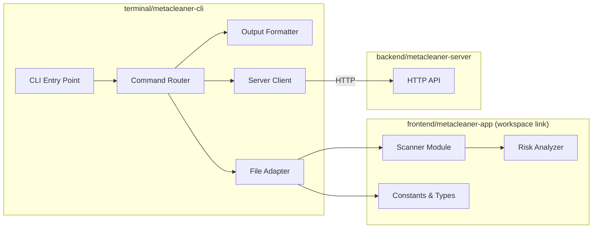
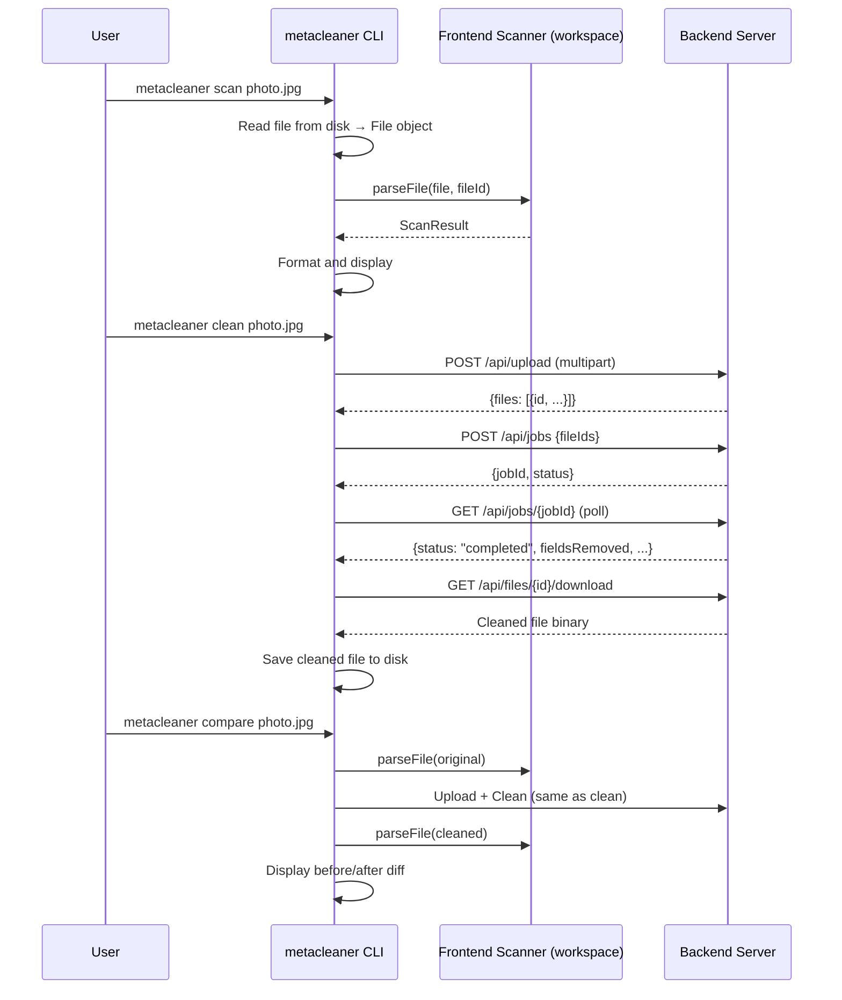

# Design Document: metadata-inspect-cli

## Overview

The `metacleaner-cli` is a TypeScript CLI tool executed via bun that provides three commands — `scan`, `clean`, and `compare` — for inspecting and cleaning file metadata. It reuses the frontend scanner modules directly via bun workspace link for metadata extraction and risk analysis, and communicates with the running Go backend server over HTTP for metadata cleaning operations.

**Key design decisions:**
- **Bun workspace link**: Scanner logic is imported directly from `frontend/metacleaner-app/src/lib/scanner/` — no code duplication
- **Server-based cleaning**: The CLI does not run exiftool/ffmpeg locally; it delegates cleaning to the backend server via its existing REST API (`POST /api/upload` → `POST /api/jobs` → poll → `GET /api/files/{id}/download`)
- **File adapter pattern**: The frontend scanner expects `File` objects (Web API), so the CLI provides a Node.js-to-File adapter to read files from disk and present them to the scanner
- **Minimal dependencies**: The CLI only adds a CLI argument parser; all metadata logic comes from the workspace-linked frontend package



## Architecture

### Command Flow



### Project Structure

```
terminal/metacleaner-cli/
├── src/
│   ├── index.ts              # Entry point, CLI bootstrap
│   ├── commands.ts           # Command router (scan, clean, compare, help, version)
│   ├── scanner.ts            # File adapter + scanning orchestration
│   ├── serverClient.ts       # HTTP client for backend API
│   ├── formatter.ts          # Output formatting (human-readable + JSON)
│   ├── progress.ts           # Progress indicator (spinner) for server operations
│   └── types.ts              # CLI-specific types and interfaces
├── tests/
│   ├── scanner.test.ts       # Scanner adapter tests
│   ├── formatter.test.ts     # Output formatting tests
│   ├── serverClient.test.ts  # Server client tests
│   ├── progress.test.ts      # Progress indicator tests
│   └── commands.test.ts      # Command integration tests
├── package.json
├── tsconfig.json
├── .env.example
└── README.md
```

### Technology Choices

| Concern | Choice | Rationale |
|---|---|---|
| Runtime | Bun | Already used by frontend; native TypeScript execution, fast startup |
| Arg parsing | Manual (minimal) | Only 3 commands + 7 flags; no need for heavy CLI framework |
| HTTP client | `fetch` (bun built-in) | No extra dependency needed, supports multipart |
| Scanner | Workspace import | Avoids duplication; guarantees parity with frontend |
| Progress | Manual spinner (stderr) | Simple character spinner with elapsed time; no external dependency |
| Testing | Vitest + fast-check | Consistent with frontend; property-based testing for formatters |
| Output | Stdout (text/JSON) | Standard CLI pattern; errors and progress to stderr |

## Components and Interfaces

### 1. CLI Entry Point (`src/index.ts`)

Parses process.argv, extracts command and flags, delegates to command router.

```typescript
interface CLIOptions {
  command: 'scan' | 'clean' | 'compare' | 'help' | 'version';
  files: string[];
  server: string;       // default: "http://localhost:8080"
  json: boolean;        // default: false
  verbose: boolean;     // default: false
  quiet: boolean;       // default: false
  output?: string;      // optional output path
  timeout: number;      // default: 60 (seconds)
}
```

### 2. Command Router (`src/commands.ts`)

Routes to the appropriate handler based on the parsed command.

```typescript
interface CommandResult {
  exitCode: number;     // 0 = success, 1 = risk detected, 2 = error
  results: FileResult[];
  summary?: AggregatedSummary;
}

interface FileResult {
  filePath: string;
  fileName: string;
  fileSize: number;
  format: string;
  scanResult?: ScanResult;     // from frontend scanner
  cleanResult?: CleanResult;   // from server
  compareResult?: CompareResult;
  error?: string;
}
```

### 3. File Adapter (`src/scanner.ts`)

Bridges the gap between filesystem files and the browser `File` API expected by the frontend scanner.

```typescript
// Reads a file from disk and creates a File-compatible object
function createFileFromPath(filePath: string): Promise<File>;

// Scans a single file using the frontend scanner module
function scanFile(filePath: string): Promise<ScanResult>;

// Scans multiple files, collecting results and continuing on individual failures
function scanFiles(filePaths: string[]): Promise<FileResult[]>;
```

### 4. Server Client (`src/serverClient.ts`)

Handles all HTTP communication with the backend server.

```typescript
interface ServerClient {
  // Check server health
  checkHealth(serverUrl: string): Promise<boolean>;
  
  // Upload files and get file IDs
  uploadFiles(serverUrl: string, filePaths: string[]): Promise<UploadedFile[]>;
  
  // Create a cleaning job
  createJob(serverUrl: string, fileIds: string[]): Promise<JobResponse>;
  
  // Poll job status until completed or timeout exceeded
  waitForJob(serverUrl: string, jobId: string, timeoutSeconds: number, progress: ProgressIndicator): Promise<JobStatus>;
  
  // Download cleaned file
  downloadFile(serverUrl: string, fileId: string, outputPath: string): Promise<void>;
}
```

### 5. Output Formatter (`src/formatter.ts`)

Formats results for display. Supports human-readable (with emojis), quiet (one-line), and JSON modes.

```typescript
interface FormatOptions {
  json: boolean;
  verbose: boolean;
  quiet: boolean;
}

// Format scan results for a single file
function formatScanResult(result: FileResult, options: FormatOptions): string;

// Format clean results for a single file
function formatCleanResult(result: FileResult, options: FormatOptions): string;

// Format comparison results for a single file
function formatCompareResult(result: FileResult, options: FormatOptions): string;

// Format aggregated summary for multiple files
function formatSummary(results: FileResult[], options: FormatOptions): string;

// Compute severity from score (reuses frontend classifySeverity)
function formatSeverity(score: number): string;
```

### 6. Progress Indicator (`src/progress.ts`)

Displays a spinner/progress bar on stderr while waiting for server operations. Automatically suppressed in `--quiet` and `--json` modes.

```typescript
interface ProgressIndicator {
  // Start the spinner with a message (e.g., "Cleaning photo.jpg...")
  start(message: string): void;

  // Update the spinner message (e.g., "Polling job abc123... 15s elapsed")
  update(message: string): void;

  // Stop and clear the spinner (called on job completion or failure)
  stop(): void;
}

// Factory that returns a no-op indicator when suppressed
function createProgressIndicator(options: FormatOptions): ProgressIndicator;
```

The progress indicator writes to stderr so it does not interfere with stdout output (especially important for JSON mode piping). It is rendered as a character-based spinner (e.g., `⠋⠙⠹⠸⠼⠴⠦⠧⠇⠏`) with elapsed time display.

## Data Models

### CLI-Specific Types (`src/types.ts`)

```typescript
import type { ScanResult, SeverityLevel } from 'metacleaner-app/src/lib/scanner/types';

// Result from the server cleaning operation
interface CleanResult {
  fieldsRemoved: number;
  gpsStripped: boolean;
  originalSize: number;
  cleanedSize: number;
  cleanedFilePath: string;
}

// Side-by-side comparison
interface CompareResult {
  before: ScanResult;
  after: ScanResult;
  fieldsRemovedCount: number;
  scoreBefore: number;
  scoreAfter: number;
  severityBefore: SeverityLevel;
  severityAfter: SeverityLevel;
  gpsRemovedInCleaning: boolean;
}

// Aggregated summary for multi-file operations
interface AggregatedSummary {
  totalFiles: number;
  successCount: number;
  errorCount: number;
  maxRiskScore: number;
  maxSeverity: SeverityLevel;
  gpsFileCount: number;
}

// Server upload response (matches backend UploadedFileInfo)
interface UploadedFile {
  id: string;
  name: string;
  size: number;
  extension: string;
  type: string;
  format: string;
}

// Server job response
interface JobResponse {
  jobId: string;
  status: string;
  totalFiles: number;
  createdAt: string;
}

// Server job status (polling response)
interface JobStatus {
  jobId: string;
  status: 'processing' | 'completed' | 'failed';
  totalFiles: number;
  filesCompleted: number;
  fieldsRemoved: number;
  gpsLocationsRemoved: number;
  totalTimeSeconds: number;
}
```

### Reused Types from Frontend (via workspace link)

The following types are imported directly from `metacleaner-app`:
- `ScanResult` — full scan output with fields, scores, GPS flag
- `MetadataField` — key/value/category tuple
- `RiskCategory` — category score breakdown (gps, deviceIdentity, personalData, timestamps)
- `SeverityLevel` — 'critical' | 'high' | 'medium' | 'low'
- `FileType` — 'image' | 'video' | 'unknown'
- `ImageFormat`, `VideoFormat` — union types for supported formats

### Exit Code Mapping

| Code | Meaning | Condition |
|---|---|---|
| 0 | Success | All operations OK, no critical/high risk |
| 1 | Risk detected | At least one file has critical or high severity |
| 2 | Runtime error | File not found, unsupported format, server unreachable, timeout exceeded |

## Correctness Properties

*A property is a characteristic or behavior that should hold true across all valid executions of a system — essentially, a formal statement about what the system should do. Properties serve as the bridge between human-readable specifications and machine-verifiable correctness guarantees.*

### Property 1: Scan formatter groups fields by category

*For any* array of MetadataField objects with mixed categories (gps, deviceIdentity, personalData, timestamps), when formatted in human-readable mode, the output SHALL contain distinct sections for each present category and every field SHALL appear under its correct category section.

**Validates: Requirements 1.1**

### Property 2: Scan formatter includes score and severity

*For any* ScanResult with a fileScore between 0 and 100, the formatted output SHALL contain the numeric score and the correct severity label (critical if ≥75, high if ≥50, medium if ≥25, low otherwise).

**Validates: Requirements 1.3**

### Property 3: Scan formatter includes conditional metadata when present

*For any* ScanResult where hasGps is true and GPS fields are present, the formatted output SHALL contain the GPS coordinate values. For any ScanResult where device is defined, the formatted output SHALL contain the device string.

**Validates: Requirements 1.4, 1.5**

### Property 4: Aggregation summary correctness

*For any* non-empty array of FileResult objects with scan results, the computed AggregatedSummary SHALL have maxRiskScore equal to the maximum fileScore across all results, gpsFileCount equal to the count of results with hasGps=true, and totalFiles equal to the array length.

**Validates: Requirements 1.6**

### Property 5: Default cleaned file path naming

*For any* file name with an extension (e.g. "name.ext"), when no --output is specified, the computed default output path SHALL equal "<name>_cleaned.<ext>" preserving the original extension.

**Validates: Requirements 2.3**

### Property 6: Clean formatter includes all required information

*For any* CleanResult object, the formatted clean output SHALL contain the fieldsRemoved count, the GPS stripped status (yes/no), and both the original and cleaned file sizes.

**Validates: Requirements 2.4**

### Property 7: Compare formatter includes all comparison data

*For any* CompareResult with before and after ScanResults, the formatted comparison output SHALL include the score change (before → after), GPS status change, device info change, and field count change.

**Validates: Requirements 3.1, 3.2**

### Property 8: JSON output round-trip

*For any* valid ScanResult object, formatting it as JSON and parsing the JSON back SHALL produce an object structurally equivalent to the original (all fields preserved with correct types).

**Validates: Requirements 5.2**

### Property 9: JSON multi-file output structure

*For any* array of N FileResult objects (N ≥ 1), the JSON output SHALL parse to an object containing a results array of length N and a summary object with correct totalFiles equal to N.

**Validates: Requirements 5.3**

### Property 10: Quiet mode single-line format

*For any* ScanResult, quiet mode formatting SHALL produce exactly one line per file containing the file name, numeric score, and severity label — with no additional information.

**Validates: Requirements 6.4**

### Property 11: Extension detection correctness

*For any* file extension present in the IMAGE_EXTENSIONS or VIDEO_EXTENSIONS maps, the format detection SHALL return the correct file type ('image' or 'video') and the correct canonical format string matching the map value.

**Validates: Requirements 7.1**

### Property 12: Exit code determination from results

*For any* array of FileResult objects: if any result has an error, the exit code SHALL be 2; otherwise if any result has a fileScore ≥ 50 (high/critical severity), the exit code SHALL be 1; otherwise the exit code SHALL be 0. Priority: error (2) > risk (1) > success (0).

**Validates: Requirements 10.1, 10.2, 10.3**

## Error Handling

### Error Categories

| Category | Condition | Behavior | Exit Code |
|---|---|---|---|
| File not found | Path doesn't exist on disk | Report error for that file, continue with remaining | 2 |
| Unsupported format | Extension not in IMAGE/VIDEO maps | Report error for that file, continue with remaining | 2 |
| Server unreachable | Connection refused/timeout to backend | Print connection error, fail command | 2 |
| Server error | Non-2xx response from backend API | Display error details, continue with remaining files | 2 |
| Timeout exceeded | Server polling exceeds --timeout value | Print timeout message with elapsed time and configured limit, exit | 2 |
| Scan error | Parser throws during metadata extraction | Report error for that file, continue with remaining | 2 |
| Flag conflict | Both --verbose and --quiet specified | Print usage error, exit immediately | 2 |
| Unknown command | Command not in scan/clean/compare/help/version | Show help text, exit | 2 |

### Error Output Format

Errors are written to stderr. In JSON mode, errors are included in the result objects with an `error` field.

```
❌ photo.xyz — Unsupported format ".xyz"
```

In JSON mode:
```json
{
  "filePath": "photo.xyz",
  "error": "Unsupported format \".xyz\""
}
```

### Graceful Degradation

- **Scan command**: Individual file errors don't halt batch processing. Successfully scanned files are displayed; errors are reported inline.
- **Clean command**: Server unreachable is a fatal error for the clean command. Individual file upload/clean failures are reported but don't halt other files.
- **Compare command**: If the server is unreachable, the compare command gracefully degrades to showing scan-only results with a note that comparison is unavailable.

### Server Health Check

Before attempting clean/compare operations, the CLI performs a lightweight health check (`GET /api/health`) to fail fast with a clear message rather than timing out on upload.

## Testing Strategy

### Unit Tests (example-based)

- **Command parsing**: Verify flag extraction, default values, unknown command handling
- **File adapter**: Verify File object creation from disk paths, error handling for missing files
- **Server client**: Mock HTTP responses, verify request construction and response parsing
- **Help output**: Verify all commands and flags are documented
- **Format detection**: Verify all listed image/video extensions are recognized

### Property-Based Tests (universal properties)

**Library**: fast-check (already a devDependency in the frontend workspace)

**Configuration**: Minimum 100 iterations per property test.

Each property test references its design property with a comment tag:
- **Feature: metadata-inspect-cli, Property 1: Scan formatter groups fields by category**
- **Feature: metadata-inspect-cli, Property 2: Scan formatter includes score and severity**
- **Feature: metadata-inspect-cli, Property 3: Scan formatter includes conditional metadata when present**
- **Feature: metadata-inspect-cli, Property 4: Aggregation summary correctness**
- **Feature: metadata-inspect-cli, Property 5: Default cleaned file path naming**
- **Feature: metadata-inspect-cli, Property 6: Clean formatter includes all required information**
- **Feature: metadata-inspect-cli, Property 7: Compare formatter includes all comparison data**
- **Feature: metadata-inspect-cli, Property 8: JSON output round-trip**
- **Feature: metadata-inspect-cli, Property 9: JSON multi-file output structure**
- **Feature: metadata-inspect-cli, Property 10: Quiet mode single-line format**
- **Feature: metadata-inspect-cli, Property 11: Extension detection correctness**
- **Feature: metadata-inspect-cli, Property 12: Exit code determination from results**

### Integration Tests

- **Scan end-to-end**: Scan a real JPEG file with known metadata, verify output matches expected fields
- **Clean end-to-end**: With a running backend server, upload and clean a file, verify cleaned file exists
- **Compare end-to-end**: Full compare workflow with a real file and running server

### Test Execution

```bash
# Run all tests
bun test

# Run property tests only
bun test --grep "Property"

# Run with coverage
bun test --coverage
```

