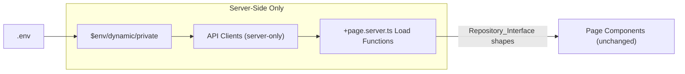
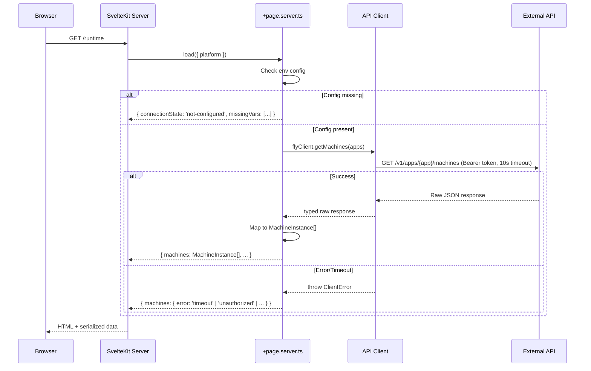

# Design Document: Monitoring Real API Integration

## Overview

This design replaces all hardcoded repository data in the MetaCleaner monitoring dashboard with live data fetched from external service APIs. The architecture introduces a three-layer data flow:

1. **API Client Layer** — One TypeScript module per external service (`src/lib/clients/`), responsible for authenticated HTTP communication and raw response typing.
2. **Server-Side Load Functions** — `+page.server.ts` files in each route that orchestrate client calls, map raw responses to existing `Repository_Interface` shapes, and handle errors per-section.
3. **Page Components** — Existing Svelte components receive data via SvelteKit's `data` prop instead of calling repository functions directly.

All secrets stay server-side (clients live in `src/lib/server/` or are only imported from `.server.ts` files). The dashboard gracefully degrades when services are unconfigured (shows "not connected") or errored (shows inline error with retry).



## Architecture

### Data Flow



### Module Layout

```
src/lib/
├── server/
│   ├── clients/
│   │   ├── types.ts              # Shared client types (ClientError, ClientConfig, SectionResult)
│   │   ├── flyClient.ts          # Fly.io Machines API
│   │   ├── cloudflareClient.ts   # Cloudflare Analytics GraphQL + REST
│   │   ├── stripeClient.ts       # Stripe REST API
│   │   ├── supabaseClient.ts     # Supabase PostgREST + Auth Admin
│   │   └── sentryClient.ts       # Sentry REST API
│   ├── mappers/
│   │   ├── flyMapper.ts          # Raw Fly responses → Repository interfaces
│   │   ├── cloudflareMapper.ts   # Raw CF responses → Repository interfaces
│   │   ├── stripeMapper.ts       # Raw Stripe responses → Repository interfaces
│   │   ├── supabaseMapper.ts     # Raw Supabase responses → Repository interfaces
│   │   └── sentryMapper.ts       # Raw Sentry responses → Repository interfaces
│   └── config.ts                 # Env var loading + validation + ServiceConfig types
├── repositories/                  # UNCHANGED — existing interfaces only
└── types/
    └── pageData.ts               # PageData types for each route's load return
```

### Route Load Functions

```
src/routes/
├── +page.server.ts               # Dashboard: Fly + Sentry + Supabase aggregation
├── dostupnost/+page.server.ts    # Availability: Fly health checks
├── chyby/+page.server.ts        # Errors: Sentry issues
├── databaze/+page.server.ts     # Database: Supabase PostgREST stats
├── runtime/+page.server.ts      # Runtime: Fly machines + deploys
├── edge/+page.server.ts         # Edge/CDN: Cloudflare analytics
├── performance/+page.server.ts  # Performance: Fly/CF metrics + Sentry
├── business/+page.server.ts     # Business: Stripe subscriptions
└── uzivatele/+page.server.ts    # Users: Supabase Auth admin
```

## Components and Interfaces

### API Client Layer (`src/lib/server/clients/`)

Each client is a set of pure async functions accepting a config object and returning typed raw responses. No class constructors — functional style matching SvelteKit patterns.

#### Shared Types (`types.ts`)

```typescript
export interface ClientConfig {
  token: string;
  baseUrl?: string;
  timeout?: number; // default 10_000ms
}

export class ClientError extends Error {
  constructor(
    public readonly service: string,
    public readonly statusCode: number | null,
    public readonly category: 'timeout' | 'unauthorized' | 'service_unavailable' | 'request_error',
    message: string
  ) {
    super(message);
  }
}

export type SectionResult<T> =
  | { status: 'ok'; data: T }
  | { status: 'not-configured'; missingVars: string[] }
  | { status: 'error'; error: { category: ClientError['category']; message: string } };
```

#### flyClient.ts

```typescript
export interface FlyClientConfig extends ClientConfig {
  org: string;
  apps: string[];
}

// Raw Fly.io API response types
export interface FlyMachineRaw {
  id: string;
  name: string;
  state: string;
  region: string;
  config: { guest: { cpus: number; memory_mb: number } };
  checks?: Array<{ status: string; name: string }>;
  created_at: string;
  updated_at: string;
  events?: Array<{ type: string; timestamp: number; status: string }>;
}

export async function getMachines(config: FlyClientConfig, app: string): Promise<FlyMachineRaw[]>;
export async function getMachinesForAllApps(config: FlyClientConfig): Promise<Map<string, FlyMachineRaw[]>>;
```

#### cloudflareClient.ts

```typescript
export interface CloudflareClientConfig extends ClientConfig {
  zoneId: string;
}

export interface CfAnalyticsRaw {
  httpRequests1dGroups: Array<{
    sum: { requests: number; cachedRequests: number; bytes: number; cachedBytes: number; threats: number };
    dimensions: { date: string };
  }>;
}

export interface CfGeoRaw {
  clientCountryMap: Array<{ clientCountryName: string; requests: number }>;
}

export interface CfFirewallEventRaw {
  action: string;
  clientIP: string;
  clientCountry: string;
  datetime: string;
  ruleId: string;
  source: string;
  userAgent: string;
}

export async function getAnalytics(config: CloudflareClientConfig): Promise<CfAnalyticsRaw>;
export async function getGeoDistribution(config: CloudflareClientConfig): Promise<CfGeoRaw>;
export async function getFirewallEvents(config: CloudflareClientConfig, limit?: number): Promise<CfFirewallEventRaw[]>;
```

#### stripeClient.ts

```typescript
export interface StripeClientConfig extends ClientConfig {} // token = STRIPE_SECRET_KEY

export interface StripeSubscriptionRaw {
  id: string;
  status: string;
  items: { data: Array<{ price: { id: string; unit_amount: number; recurring: { interval: string; interval_count: number } }; quantity: number }> };
  created: number;
  canceled_at: number | null;
  current_period_start: number;
}

export interface StripePriceRaw {
  id: string;
  product: string;
  unit_amount: number;
  nickname: string | null;
}

export async function getActiveSubscriptions(config: StripeClientConfig): Promise<StripeSubscriptionRaw[]>;
export async function getCanceledSubscriptions(config: StripeClientConfig, since: number): Promise<StripeSubscriptionRaw[]>;
export async function getPrices(config: StripeClientConfig): Promise<StripePriceRaw[]>;
```

#### supabaseClient.ts

```typescript
export interface SupabaseClientConfig {
  url: string;
  serviceKey: string;
  timeout?: number;
}

export interface SupabaseTableStatsRaw {
  table_name: string;
  row_count: number;
  total_bytes: number;
}

export interface SupabaseUserRaw {
  id: string;
  email: string;
  created_at: string;
  last_sign_in_at: string | null;
  app_metadata: { provider?: string; providers?: string[] };
}

export async function getTableStats(config: SupabaseClientConfig): Promise<SupabaseTableStatsRaw[]>;
export async function getUsers(config: SupabaseClientConfig, page?: number, perPage?: number): Promise<{ users: SupabaseUserRaw[]; total: number }>;
export async function queryTable<T>(config: SupabaseClientConfig, table: string, params?: Record<string, string>): Promise<T[]>;
```

#### sentryClient.ts

```typescript
export interface SentryClientConfig extends ClientConfig {
  org: string;
  project: string;
}

export interface SentryIssueRaw {
  id: string;
  title: string;
  culprit: string;
  shortId: string;
  status: string;
  level: string;
  type: string;
  firstSeen: string;
  lastSeen: string;
  count: string;
  metadata: { type?: string; value?: string; filename?: string };
}

export async function getRecentIssues(config: SentryClientConfig, limit?: number): Promise<SentryIssueRaw[]>;
export async function getIssueStats(config: SentryClientConfig): Promise<{ total: number; byLevel: Record<string, number> }>;
```

### Configuration Module (`src/lib/server/config.ts`)

```typescript
import { env } from '$env/dynamic/private';

export interface ServiceConfigs {
  fly: { configured: true; config: FlyClientConfig } | { configured: false; missingVars: string[] };
  cloudflare: { configured: true; config: CloudflareClientConfig } | { configured: false; missingVars: string[] };
  stripe: { configured: true; config: StripeClientConfig } | { configured: false; missingVars: string[] };
  supabase: { configured: true; config: SupabaseClientConfig } | { configured: false; missingVars: string[] };
  sentry: { configured: true; config: SentryClientConfig } | { configured: false; missingVars: string[] };
}

export function getServiceConfigs(): ServiceConfigs;
```

The function reads from `$env/dynamic/private` and validates presence/non-emptiness of each service's required variables. Returns a discriminated union per service.

### Mapper Layer (`src/lib/server/mappers/`)

Each mapper module contains pure functions that transform raw API responses into existing `Repository_Interface` types. No side effects, no I/O — only data transformation.

```typescript
// Example: flyMapper.ts
import type { MachineInstance, DeployEntry, ServiceCard } from '$lib/repositories';
import type { FlyMachineRaw } from '../clients/flyClient';

export function mapToMachineInstances(raw: Map<string, FlyMachineRaw[]>): MachineInstance[];
export function mapToDeployEntries(raw: FlyMachineRaw[]): DeployEntry[];
export function mapToServiceCards(raw: Map<string, FlyMachineRaw[]>): ServiceCard[];
```

### Page Data Types (`src/lib/types/pageData.ts`)

Each route's load function returns a typed object where each section is a `SectionResult<T>`:

```typescript
import type { SectionResult } from '$lib/server/clients/types';
import type { MachineInstance, DeployEntry, RuntimeStat /* etc */ } from '$lib/repositories';

export interface RuntimePageData {
  stats: SectionResult<RuntimeStat[]>;
  machines: SectionResult<MachineInstance[]>;
  deploys: SectionResult<DeployEntry[]>;
  errors: SectionResult<RuntimeErrorEntry[]>;
}
```

### Error/State Handling in Pages

Page components check `section.status` and render accordingly:

```svelte
{#if section.status === 'not-configured'}
  <NotConfiguredCard missingVars={section.missingVars} />
{:else if section.status === 'error'}
  <ErrorCard category={section.error.category} message={section.error.message} onRetry={...} />
{:else}
  <!-- Render actual data using section.data -->
{/if}
```

Two new shared UI components are introduced:
- `NotConfiguredCard.svelte` — displays missing env var names
- `SectionErrorCard.svelte` — displays error category with retry button

These are small, presentational components in `src/lib/shared/components/`.

## Data Models

### Environment Variables (Complete List)

| Variable | Service | Required | Purpose |
|----------|---------|----------|---------|
| `SUPABASE_URL` | Supabase | **Yes** | Base URL for PostgREST + Auth API |
| `SUPABASE_SERVICE_KEY` | Supabase | **Yes** | Service role key (bypasses RLS) |
| `FLY_API_TOKEN` | Fly.io | No | Bearer token for Machines API |
| `FLY_ORG` | Fly.io | No | Organization slug |
| `FLY_APPS` | Fly.io | No | Comma-separated app names |
| `CLOUDFLARE_API_TOKEN` | Cloudflare | No | Bearer token for CF APIs |
| `CLOUDFLARE_ZONE_ID` | Cloudflare | No | Zone ID for analytics |
| `SENTRY_AUTH_TOKEN` | Sentry | No | Bearer token for Sentry API |
| `SENTRY_ORG` | Sentry | No | Organization slug |
| `SENTRY_PROJECT` | Sentry | No | Project slug |
| `STRIPE_SECRET_KEY` | Stripe | No | Stripe secret key |

### Raw API Response → Repository Interface Mapping

#### Fly.io → Runtime Page

| Fly API Field | Repository Interface Field | Transformation |
|---|---|---|
| `machine.id` | `MachineInstance.id` | Direct |
| `machine.name` | `MachineInstance.name` | Direct |
| `machine.id` (first 8 chars) | `MachineInstance.displayId` | Substring |
| App name from request | `MachineInstance.app` | From iteration context |
| `machine.region` | `MachineInstance.region` | Append city name lookup |
| `machine.state` | `MachineInstance.status` | Map: "started" → "running", "stopped" → "stopped", else "error" |
| Computed from events | `MachineInstance.cpuPercent` | Estimate from machine size (no real-time CPU in Machines API) |
| `machine.config.guest.memory_mb` | `MachineInstance.ramDisplay` | Format as "X MB" |
| Computed from `created_at` | `MachineInstance.uptime` | Duration since last start event |

#### Cloudflare → Edge Page

| CF API Field | Repository Interface Field | Transformation |
|---|---|---|
| `cachedRequests / requests * 100` | `EdgeKpiStat[cacheHitRate].value` | Percentage calculation |
| `sum.requests` | `EdgeKpiStat[totalRequests].value` | Format with thousands separator |
| `cachedBytes` | `EdgeKpiStat[savedBandwidth].value` | Convert bytes → GB |
| `sum.threats` | `EdgeKpiStat[blockedThreats].value` | Direct count |
| `clientCountryMap` | `GeoDistribution[]` | Sort by requests desc, top 5 + "Other" |

#### Stripe → Business Page

| Stripe API Field | Repository Interface Field | Transformation |
|---|---|---|
| Sum of `subscription.items[].price.unit_amount` (normalized to monthly) | `BusinessKpiStat[mrr].value` | Aggregate + format as "$X" |
| Count of active subscriptions | `BusinessKpiStat[activeUsers].value` | Count |
| `canceled_last_30d / active_start_of_period * 100` | `BusinessKpiStat[churnRate].value` | Percentage |
| `MRR / active_count` | `BusinessKpiStat[newSubscriptions].value` | Division + format as "$X.XX" (ARPU) |
| Group by price → sum amounts | `PlanRevenue[]` | Group + percentage calculation |

#### Sentry → Errors Page

| Sentry API Field | Repository Interface Field | Transformation |
|---|---|---|
| `issue.lastSeen` | `ErrorLogEntry.time` | Format as HH:mm:ss |
| `issue.metadata.type` or level | `ErrorLogEntry.type` | Map to short codes (EXC, TMT, ERR, etc.) |
| `issue.title` | `ErrorLogEntry.message` | Direct |
| `issue.culprit` | `ErrorLogEntry.source` | Direct |
| `issue.status` | `ErrorLogEntry.statusKey` | Map: "unresolved" → active, "resolved" → resolved |

#### Supabase → Database Page

| Supabase API Field | Repository Interface Field | Transformation |
|---|---|---|
| `table_stats.total_bytes` | `TableSize.sizeLabel` | Format bytes to human-readable |
| `table_stats.total_bytes` relative | `TableSize.barWidth` | Percentage of largest table |
| Connection pool query | `DbKpi[activeConnections].value` | Direct from pg_stat |
| `table_stats.row_count` | Informational | Used for subtext |

### Fetch Timeout and Error Strategy

```typescript
async function fetchWithTimeout(url: string, init: RequestInit, timeoutMs: number = 10_000): Promise<Response> {
  const controller = new AbortController();
  const timeoutId = setTimeout(() => controller.abort(), timeoutMs);
  
  try {
    const response = await fetch(url, { ...init, signal: controller.signal });
    return response;
  } finally {
    clearTimeout(timeoutId);
  }
}
```

Each load function wraps client calls in a helper that catches `ClientError` and returns `SectionResult`:

```typescript
async function callSection<T>(fn: () => Promise<T>): Promise<SectionResult<T>> {
  try {
    const data = await fn();
    return { status: 'ok', data };
  } catch (e) {
    if (e instanceof ClientError) {
      return { status: 'error', error: { category: e.category, message: e.message } };
    }
    return { status: 'error', error: { category: 'request_error', message: 'Unknown error' } };
  }
}
```

## Correctness Properties

*A property is a characteristic or behavior that should hold true across all valid executions of a system — essentially, a formal statement about what the system should do. Properties serve as the bridge between human-readable specifications and machine-verifiable correctness guarantees.*

### Property 1: Configuration Detection

*For any* subset of environment variables where one or more required variables for a service are missing or empty, the `getServiceConfigs()` function SHALL return `{ configured: false, missingVars: [...] }` for that service, where `missingVars` contains exactly the names of the missing/empty variables and no others.

**Validates: Requirements 1.6, 4.1, 4.2, 4.3**

### Property 2: Client Configuration Validation

*For any* client configuration object where one or more required fields (token, baseUrl where applicable, org, zoneId, etc.) are missing, empty, or whitespace-only, the client function SHALL throw a `ClientError` before making any HTTP request, and the error message SHALL name the missing parameter.

**Validates: Requirements 2.3**

### Property 3: HTTP Error Categorization

*For any* HTTP response with a non-2xx status code, the API client SHALL throw a `ClientError` where: status 401 or 403 maps to category `'unauthorized'`, status 5xx maps to `'service_unavailable'`, AbortError (timeout) maps to `'timeout'`, and all other non-2xx statuses map to `'request_error'`. The error SHALL include the service name and the HTTP status code.

**Validates: Requirements 2.6, 5.2**

### Property 4: Section Error Isolation

*For any* load function that calls N independent service sections, if K of those sections throw a `ClientError` (where 0 < K < N), the load function SHALL return `SectionResult` with `status: 'error'` for exactly the K failed sections and `status: 'ok'` with valid data for the remaining N-K sections.

**Validates: Requirements 5.1, 5.3**

### Property 5: Mapper Completeness

*For any* valid raw API response (from Fly.io, Cloudflare, Stripe, Supabase, or Sentry), the corresponding mapper function SHALL return an object where every required field defined in the target `Repository_Interface` type is present and non-undefined. No required field SHALL be `null` or `undefined` in the output.

**Validates: Requirements 3.2, 11.1, 11.4**

### Property 6: MRR Normalization

*For any* set of active Stripe subscriptions with varying billing intervals (monthly, yearly, weekly), the MRR computation SHALL equal the sum of each subscription's amount normalized to a monthly equivalent: monthly amounts unchanged, yearly amounts divided by 12, weekly amounts multiplied by (52/12). The ARPU SHALL equal MRR divided by the count of active subscriptions. Plan revenue percentages SHALL sum to 100% (±1% rounding tolerance).

**Validates: Requirements 8.1, 8.2, 8.3**

### Property 7: Geographic Distribution Aggregation

*For any* array of country traffic records with N distinct countries (where N ≥ 1), the geo distribution mapper SHALL return at most 6 entries: the top 5 countries sorted by traffic percentage descending, plus an "Other" entry aggregating all remaining countries. All percentages SHALL sum to 100% (±1% rounding). If N ≤ 5, no "Other" entry is produced and the result has exactly N entries.

**Validates: Requirements 7.3**

### Property 8: Dashboard Alert Merge and Sort

*For any* combination of Sentry issues (up to 5) and Fly machine events (up to 5), the merged `DashboardAlert` array SHALL be sorted by timestamp descending and contain at most 10 entries. Each alert SHALL have a valid `severity` field derived from the source: Sentry critical/error → "error", Sentry warning → "warning"; Fly crash → "error", Fly restart → "warning".

**Validates: Requirements 13.3**

### Property 9: Apdex and Performance Metrics

*For any* array of request latency measurements, the computed Apdex SHALL equal `(satisfied + tolerating * 0.5) / total` where satisfied means latency ≤ 500ms and tolerating means 500ms < latency ≤ 2000ms. The average response time SHALL equal the arithmetic mean. The error rate SHALL equal `(count of 5xx responses / total) * 100`.

**Validates: Requirements 14.2**

### Property 10: Health Status Mapping

*For any* Fly.io machine, the `ServiceCard.status` SHALL be derived as: a machine with state "started" and all health checks passing → `'online'`; a machine with state "started" and any health check failing → `'degraded'`; a machine with state "stopped", "destroyed", or unreachable → `'offline'`.

**Validates: Requirements 6.5**

### Property 11: Endpoint Sorting and Limiting

*For any* array of endpoint performance records, the `SlowEndpoint` mapper SHALL return at most 10 entries sorted by average response time in descending order. If the input has fewer than 10 entries, all are returned (still sorted).

**Validates: Requirements 14.1**


## Error Handling

### Error Hierarchy

```
ClientError (thrown by API clients)
├── timeout          → AbortError from fetch signal
├── unauthorized     → HTTP 401 / 403
├── service_unavailable → HTTP 5xx / network error
└── request_error    → All other non-2xx

SectionResult (returned by load functions)
├── ok              → { status: 'ok', data: T }
├── not-configured  → { status: 'not-configured', missingVars: string[] }
└── error           → { status: 'error', error: { category, message } }
```

### Error Flow

1. **API Client Layer** — Throws `ClientError` with structured metadata:
   ```typescript
   // In each client function:
   const response = await fetchWithTimeout(url, options, config.timeout ?? 10_000);
   if (!response.ok) {
     throw new ClientError(
       'fly',
       response.status,
       categorizeStatus(response.status),
       `Fly API returned ${response.status}: ${response.statusText}`
     );
   }
   ```

2. **Load Function Layer** — Catches errors per-section, never lets them propagate:
   ```typescript
   // In +page.server.ts:
   export const load: PageServerLoad = async ({ setHeaders }) => {
     setHeaders({ 'Cache-Control': 'no-store' });
     const configs = getServiceConfigs();
     
     // Each section is independently safe
     const machines = configs.fly.configured
       ? await callSection(() => fetchAndMapMachines(configs.fly.config))
       : notConfigured(configs.fly.missingVars);
     
     const deploys = configs.fly.configured
       ? await callSection(() => fetchAndMapDeploys(configs.fly.config))
       : notConfigured(configs.fly.missingVars);
     
     return { machines, deploys };
   };
   ```

3. **Page Component Layer** — Renders appropriate UI state:
   - `SectionErrorCard` for error states (with category-specific icon/color)
   - `NotConfiguredCard` for missing config (lists env var names)
   - Actual data components when status is `'ok'`

### Timeout Strategy

- Global default: 10 seconds per individual API request
- Implementation: `AbortController` with `setTimeout` attached to fetch signal
- On timeout: AbortError is caught and wrapped as `ClientError` with category `'timeout'`
- Dashboard page (multi-service): uses `Promise.allSettled` so one slow service doesn't delay others

### Retry Strategy

- No automatic retries in this initial implementation
- Manual retry: user clicks retry button → SvelteKit `invalidate()` re-runs the load function
- The retry button is visible only in error state sections

### Startup Validation

- `SUPABASE_URL` and `SUPABASE_SERVICE_KEY` are required — if missing, the app throws at build/startup via an eagerly-evaluated config check in `src/lib/server/config.ts`
- All other service variables are optional — missing ones result in `{ configured: false }` for their service

## Testing Strategy

### Dual Testing Approach

**Unit tests** verify specific examples and edge cases:
- Each client function tested with mocked fetch (happy path + error cases)
- Each mapper function tested with known input/output pairs
- Config validation tested with various env var combinations

**Property tests** verify universal correctness across all valid inputs:
- Mapper completeness (no undefined required fields)
- Computation correctness (MRR, Apdex, geo aggregation)
- Error categorization exhaustiveness
- Section isolation guarantees

### Property-Based Testing Library

**Library**: `fast-check` (already available in the project ecosystem via `vitest`)

**Configuration**:
- Minimum 100 iterations per property test
- Each property test tagged with design document reference

**Tag format**: `Feature: monitoring-real-api-integration, Property {number}: {property_text}`

### Test Structure

```
src/lib/server/
├── clients/__tests__/
│   ├── flyClient.test.ts         # Unit tests: fetch mocking, auth headers, timeout
│   ├── cloudflareClient.test.ts  # Unit tests: GraphQL query, response parsing
│   ├── stripeClient.test.ts      # Unit tests: Basic auth, pagination
│   ├── supabaseClient.test.ts    # Unit tests: PostgREST query params, auth
│   └── sentryClient.test.ts      # Unit tests: API query params, pagination
├── mappers/__tests__/
│   ├── flyMapper.test.ts         # Unit + property tests
│   ├── cloudflareMapper.test.ts  # Unit + property tests
│   ├── stripeMapper.test.ts      # Unit + property tests (MRR normalization)
│   ├── supabaseMapper.test.ts    # Unit + property tests
│   └── sentryMapper.test.ts      # Unit + property tests
├── config.test.ts                # Unit + property tests (config detection)
└── types.test.ts                 # Property tests (error categorization, section isolation)
```

### Property Test Implementation Pattern

```typescript
import { describe, it, expect } from 'vitest';
import fc from 'fast-check';

describe('Property 6: MRR Normalization', () => {
  // Feature: monitoring-real-api-integration, Property 6: MRR Normalization
  it('normalizes all billing intervals to monthly equivalent', () => {
    const subscriptionArb = fc.record({
      amount: fc.integer({ min: 100, max: 100_000 }),
      interval: fc.constantFrom('month', 'year', 'week'),
      interval_count: fc.integer({ min: 1, max: 12 }),
    });

    fc.assert(
      fc.property(fc.array(subscriptionArb, { minLength: 1, maxLength: 50 }), (subs) => {
        const mrr = computeMrr(subs);
        const expectedMrr = subs.reduce((sum, s) => {
          if (s.interval === 'month') return sum + s.amount / s.interval_count;
          if (s.interval === 'year') return sum + s.amount / (12 * s.interval_count);
          if (s.interval === 'week') return sum + s.amount * (52 / 12) / s.interval_count;
          return sum;
        }, 0);
        expect(mrr).toBeCloseTo(expectedMrr, 0);
      }),
      { numRuns: 100 }
    );
  });
});
```

### Unit Test Scope

| Area | Tests |
|------|-------|
| Client auth headers | Verify each client sets correct Authorization header format |
| Client timeout | Mock slow response > 10s, verify AbortError → ClientError |
| Client error codes | Mock 401, 403, 500, 502, 503, 404, verify correct category |
| Mapper happy path | Known input → expected output for each mapper |
| Mapper edge cases | Empty arrays, missing optional fields, zero values |
| Config detection | All vars present, some missing, all missing, whitespace-only |
| Load function isolation | Mock one client to throw, verify other sections unaffected |
| Cache headers | Verify `Cache-Control: no-store` is set |

### E2E Test Scope

Minimal E2E tests to verify page rendering:
- Dashboard loads without crash when no services configured (shows "not connected" cards)
- Runtime page renders machine list when Fly is configured (with mocked API)
- Error state renders correctly when API returns 500
