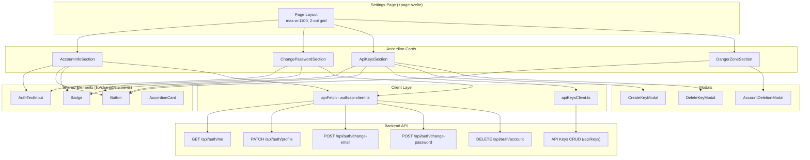
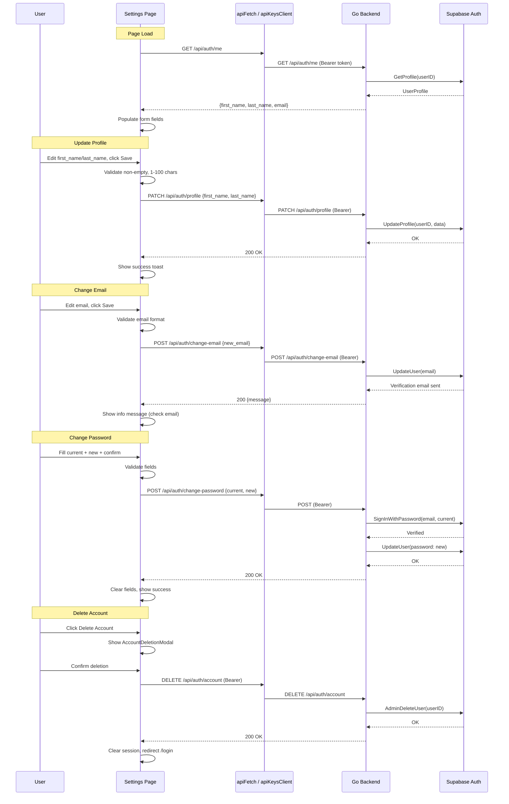

# Design Document: Settings Page Integration

## Overview

This design covers the full integration and refactoring of the MetaCleaner Settings page (`/settings`). The work includes:

1. **Code quality refactoring** — replacing inline markup with shared elements (`AuthTextInput`, `Badge`, `Button`) and extracting reusable patterns
2. **Responsive design enforcement** — two-column desktop grid (≥1024px), single-column stacked mobile (<1024px)
3. **UI cleanup** — removing back button, company field, last login indicator, and commenting out Affiliate Program
4. **API Keys CRUD integration** — moving full key management (list, create, revoke, delete) from standalone page into settings
5. **Account info backend connection** — fetching profile from `GET /api/auth/me`, updating name via profile PATCH, email change with verification flow
6. **Password change backend connection** — validating and submitting password change using authenticated access token
7. **Account deletion** — confirmation modal with backend DELETE call, session clear, and redirect

The frontend uses SvelteKit 2 + Svelte 5 runes, Tailwind CSS 4, and Paraglide i18n. The backend is a Go HTTP server with Supabase Auth for identity management.

## Architecture

### Component Architecture



### Data Flow



## Components and Interfaces

### Page Structure (`/settings/+page.svelte`)

The page renders as a full-width container (`max-w-[1100px]`, `px-6`) with a two-column grid on desktop and single-column on mobile. No header section with back button or last login indicator.

**Layout:**
```
Desktop (≥1024px):           Mobile (<1024px):
┌──────────┬──────────┐     ┌────────────────────┐
│ Account  │ API Keys │     │ Account Info       │
│ Info     │          │     ├────────────────────┤
├──────────┼──────────┤     │ Change Password    │
│ Change   │ Affiliate│     ├────────────────────┤
│ Password │ (hidden) │     │ API Keys           │
├──────────┼──────────┤     ├────────────────────┤
│ Danger   │          │     │ Affiliate (hidden) │
│ Zone     │          │     ├────────────────────┤
└──────────┴──────────┘     │ Danger Zone        │
                            └────────────────────┘
```

> **Note:** The Affiliate Program section is positioned below API Keys in the layout order. It is commented out in source code and not rendered to the user. Its position is reserved for future activation.

### Sections

| Section | Props | Responsibilities |
|---------|-------|-----------------|
| `AccountInfoSection` | `onSave`, `onEmailChange` | Fetch profile on mount, validate & submit name changes, handle email change flow |
| `ChangePasswordSection` | `onSave` | Validate current/new/confirm fields, submit password change |
| `ApiKeysSection` | none | List keys, create/revoke/delete with modals, empty state |
| `DangerZoneSection` | none | Account deletion button, opens confirmation modal |

### Modals

| Modal | Purpose |
|-------|---------|
| `CreateKeyModal` | Name input (1-100 chars, required) + optional note (max 500), submit creates key |
| `DeleteKeyModal` | Confirm key deletion with key name displayed |
| `AccountDeletionModal` | Permanent deletion warning, confirm/cancel, loading state, error display |

### API Client Extensions

**New functions in `apiFetch`-based client (`lib/auth/api-client.ts` or new `lib/clients/accountClient.ts`):**

```typescript
// Profile update (name fields only)
export async function updateProfile(data: { first_name: string; last_name: string }): Promise<void>;

// Email change (triggers verification email)
export async function changeEmail(newEmail: string): Promise<{ message: string }>;

// Password change (requires current password verification)
export async function changePassword(currentPassword: string, newPassword: string): Promise<void>;

// Account deletion
export async function deleteAccount(): Promise<void>;
```

### Backend Endpoints (New)

| Method | Path | Auth | Description |
|--------|------|------|-------------|
| PATCH | `/api/auth/profile` | Bearer | Update first_name, last_name in profiles table |
| POST | `/api/auth/change-email` | Bearer | Trigger Supabase email change (sends verification) |
| POST | `/api/auth/change-password` | Bearer | Verify current password, then update to new |
| DELETE | `/api/auth/account` | Bearer | Delete user from Supabase Auth + cascade data |

### Validation Rules

| Field | Rule | Error key |
|-------|------|-----------|
| First name | Non-empty after trim, 1-100 chars | `settings.account.errors.firstNameRequired` |
| Last name | Non-empty after trim, 1-100 chars | `settings.account.errors.lastNameRequired` |
| Email | Matches `^[^@\s]+@[^@\s]+\.[^@\s]+$` | `settings.account.errors.emailInvalid` |
| Current password | Non-empty | `settings.password.errors.currentRequired` |
| New password | 8-72 characters | `settings.password.errors.newLength` |
| Confirm password | Must match new password | `settings.password.errors.mismatch` |
| API key name | 1-100 chars, required | `settings.apiKeys.errors.nameRequired` |
| API key note | Max 500 chars | `settings.apiKeys.errors.noteTooLong` |

## Data Models

### Frontend Types

```typescript
// Profile data fetched from GET /api/auth/me
interface UserProfile {
  id: string;
  first_name: string;
  last_name: string;
  email: string;
  created_at?: string;
  updated_at?: string;
}

// Profile update request
interface UpdateProfileRequest {
  first_name: string;
  last_name: string;
}

// Email change request
interface ChangeEmailRequest {
  new_email: string;
}

// Password change request
interface ChangePasswordRequest {
  current_password: string;
  new_password: string;
}

// API Key (already exists in apiKeysClient.ts)
interface ApiKey {
  id: string;
  name: string;
  key_prefix: string;
  key_suffix: string;
  status: 'active' | 'revoked';
  note?: string;
  created_at: string;
  last_used_at: string | null;
  revoked_at: string | null;
}

// Form state for account info section
interface AccountInfoFormState {
  firstName: string;
  lastName: string;
  email: string;
  isSubmitting: boolean;
  errors: Record<string, string>;
  successMessage: string;
  infoMessage: string;  // for email change notification
}

// Form state for password change section
interface PasswordFormState {
  currentPassword: string;
  newPassword: string;
  confirmPassword: string;
  isSubmitting: boolean;
  errors: Record<string, string>;
  successMessage: string;
}
```

### Backend Types (Go)

```go
// UpdateProfileRequest — PATCH /api/auth/profile
type UpdateProfileRequest struct {
    FirstName string `json:"first_name"`
    LastName  string `json:"last_name"`
}

// ChangeEmailRequest — POST /api/auth/change-email
type ChangeEmailRequest struct {
    NewEmail string `json:"new_email"`
}

// ChangePasswordRequest — POST /api/auth/change-password
type ChangePasswordRequest struct {
    CurrentPassword string `json:"current_password"`
    NewPassword     string `json:"new_password"`
}
```


## Correctness Properties

*A property is a characteristic or behavior that should hold true across all valid executions of a system — essentially, a formal statement about what the system should do. Properties serve as the bridge between human-readable specifications and machine-verifiable correctness guarantees.*

### Property 1: API key name and note validation

*For any* string input as key name, the validation function SHALL accept names that are 1–100 characters after trimming and reject names that are empty, whitespace-only, or over 100 characters. *For any* string input as note, the validation function SHALL accept notes of 0–500 characters and reject notes over 500 characters.

**Validates: Requirements 4.2**

### Property 2: Account info field validation

*For any* string inputs as first name and last name, the validation function SHALL accept values that are non-empty after trimming whitespace and are between 1 and 100 characters, and SHALL reject values that are empty, whitespace-only, or exceed 100 characters. *For any* string input as email, the validation function SHALL accept values matching the pattern `^[^@\s]+@[^@\s]+\.[^@\s]+$` and reject all others.

**Validates: Requirements 5.2, 5.4**

### Property 3: Unchanged form does not trigger submission

*For any* profile data object fetched from the server, if the form state contains identical first_name, last_name, and email values (after trimming), the form submission handler SHALL not invoke the API client. If any field differs from the fetched data, the handler SHALL invoke the API client.

**Validates: Requirements 5.10**

### Property 4: Password change form validation

*For any* combination of current password, new password, and confirmation password strings: the validation function SHALL reject if current password is empty; SHALL reject if new password length (in Unicode code points) is less than 8 or greater than 72; SHALL reject if confirmation password does not equal new password; and SHALL accept only when all three checks pass simultaneously.

**Validates: Requirements 6.1, 6.2, 6.3**

## Error Handling

### Frontend Error Strategy

| Scenario | Behavior |
|----------|----------|
| Profile fetch fails (network/5xx) | Show error message in AccountInfoSection with retry button. Do not crash the page — other sections remain functional. |
| Profile update fails (400 validation) | Show inline field-level errors next to the corresponding inputs. Preserve user input. |
| Profile update fails (5xx/network) | Show generic error toast/inline message. Preserve input. |
| Email change fails | Show inline error near email field. Keep previous confirmed email displayed. |
| Password change fails (401 — wrong current) | Show inline error next to current password field. |
| Password change fails (5xx/network) | Show generic inline error. Preserve all entered values. |
| API key operation fails | Show inline error near the action that failed (create modal, list item). |
| Account deletion fails | Show error inside the modal. Keep modal open. Re-enable buttons. |

### Backend Error Strategy

| Endpoint | Error Code | HTTP Status | Condition |
|----------|-----------|-------------|-----------|
| PATCH /api/auth/profile | `VALIDATION_ERROR` | 400 | Empty name, name > 100 chars |
| PATCH /api/auth/profile | `AUTH_UNAUTHORIZED` | 401 | Invalid/expired token |
| POST /api/auth/change-email | `VALIDATION_ERROR` | 400 | Invalid email format |
| POST /api/auth/change-email | `AUTH_EMAIL_EXISTS` | 409 | Email already in use |
| POST /api/auth/change-password | `AUTH_INVALID_CREDENTIALS` | 401 | Current password wrong |
| POST /api/auth/change-password | `VALIDATION_ERROR` | 400 | New password < 8 or > 72 chars |
| DELETE /api/auth/account | `AUTH_UNAUTHORIZED` | 401 | Invalid/expired token |
| DELETE /api/auth/account | `AUTH_PROVIDER_UNAVAILABLE` | 503 | Supabase unavailable |

### Loading States

All form submissions use a consistent pattern:
1. Disable the submit button
2. Show a spinner icon inside/adjacent to the button
3. Disable cancel/close actions on modals
4. Re-enable on response (success or error)

## Testing Strategy

### Unit Tests (Vitest)

Focus on pure validation logic and state management:

- **Validation functions**: name validation, email validation, password validation, API key name/note validation
- **Form state comparison**: unchanged detection logic
- **Error message mapping**: backend error codes to localized i18n keys

### Property-Based Tests (Vitest + fast-check)

Each correctness property is implemented as a property-based test with minimum 100 iterations:

| Property | Test file | Generator strategy |
|----------|-----------|-------------------|
| Property 1: Key name/note validation | `AccountInfoSection.test.ts` | `fc.string()` for names/notes with varying lengths including empty, whitespace-only, boundary (100, 101, 500, 501) |
| Property 2: Account info validation | `AccountInfoSection.test.ts` | `fc.string()` for names; `fc.emailAddress()` + `fc.string()` for email validation |
| Property 3: Unchanged form detection | `AccountInfoSection.test.ts` | `fc.record({first_name: fc.string(), last_name: fc.string(), email: fc.emailAddress()})` for profile data |
| Property 4: Password validation | `ChangePasswordSection.test.ts` | `fc.string()` for all three fields with varying lengths |

**Configuration:**
- Library: `fast-check` (already used in the CLI project)
- Minimum iterations: 100 per property
- Tag format: `Feature: settings-page-integration, Property {N}: {title}`

### Integration Tests (Vitest browser mode)

Test component rendering with mocked API responses:

- AccountInfoSection: fetch → populate, submit → success/error, email change flow
- ChangePasswordSection: validation → submit → success/error
- ApiKeysSection: list → create → revoke → delete flows, empty state, error handling
- DangerZoneSection + AccountDeletionModal: open → confirm → success/error, cancel

### E2E Tests (Playwright)

- Responsive layout verification at 320px, 768px, 1024px, 1440px
- Two-column grid on desktop, single-column on mobile
- No horizontal overflow at any tested width
- Touch target sizes (44×44px minimum) on mobile
- Navigation: no /api-keys link in sidebar
- Removed elements: no back button, no company field, no last login, no affiliate section

### Test Organization

```
frontend/metacleaner-app/src/routes/settings/
├── __tests__/
│   ├── validation.test.ts              # Property tests: Properties 1-4
│   ├── AccountInfoSection.test.ts      # Integration tests
│   ├── ChangePasswordSection.test.ts   # Integration tests
│   ├── ApiKeysSection.test.ts          # Integration tests
│   └── DangerZoneSection.test.ts       # Integration tests
```
