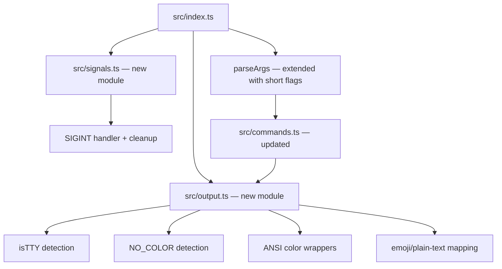
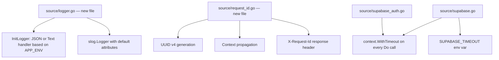

# Design Document: Steering Compliance Refactor

## Overview

This design covers the refactoring of the MetaCleaner CLI and Backend to comply with their respective steering files. The work spans two codebases:

1. **CLI** (`terminal/metacleaner-cli/`, TypeScript/Bun): Add short flag aliases, `NO_COLOR` support, TTY detection, ANSI colored output, SIGINT graceful handling, an `install.sh` script, and zsh completions.
2. **Backend** (`backend/metacleaner-server/`, Go 1.23): Replace `log` with structured `log/slog`, add request ID middleware, and add explicit `context.WithTimeout` on all Supabase HTTP calls.

The changes are additive refactors with no new features — they bring existing code into compliance with established coding standards.

## Architecture

### CLI Changes (TypeScript/Bun)

The CLI currently uses a hand-rolled argument parser in `src/index.ts` that recognizes only long flags (`--help`, `--version`, `--quiet`, etc.) and emits uncolored output with emoji to stdout/stderr. The refactor introduces:



**Key architectural decisions:**

- A new `src/output.ts` module centralizes all color/formatting logic. All existing formatters (`formatter.ts`, `progress.ts`) will delegate to it for color decisions.
- A new `src/signals.ts` module registers a SIGINT handler and exposes a cleanup registry for temporary files.
- Short flags are added directly to the existing `parseArgs` function — no new argument parsing library is needed.
- The `install.sh` and `completions/_metacleaner` files are static artifacts that live alongside `build.sh`.

### Backend Changes (Go 1.23)

The backend currently uses `log.Printf`/`log.Println`/`log.Fatalf` throughout. The refactor replaces these with `log/slog` (available since Go 1.21, native to the Go standard library):



**Key architectural decisions:**

- A new `source/logger.go` file initializes slog with the appropriate handler and sets it as the default logger. All existing `log.*` calls are mechanically replaced with `slog.*` equivalents.
- A new `source/request_id.go` file implements the request ID middleware. It injects a `requestId` attribute into the request-scoped logger stored in context.
- Supabase timeout is implemented by wrapping every `httpClient.Do(req)` call site with a derived context from `context.WithTimeout`. The timeout value is parsed from `SUPABASE_TIMEOUT` env var in `config.go`.
- No external UUID library is needed — `crypto/rand` + formatting is sufficient for UUID v4 generation, or the lightweight approach of encoding 16 random bytes in the standard UUID format.

## Components and Interfaces

### CLI: `src/output.ts` (New Module)

```typescript
export interface OutputConfig {
  noColor: boolean;   // NO_COLOR is set or stream is not TTY
  stdoutTTY: boolean; // process.stdout.isTTY
  stderrTTY: boolean; // process.stderr.isTTY
}

/** Detect output configuration from environment */
export function detectOutputConfig(): OutputConfig;

/** Check if colors should be used for a given stream */
export function shouldUseColor(stream: 'stdout' | 'stderr', config: OutputConfig): boolean;

/** ANSI color wrappers — return plain text when colors are disabled */
export function red(text: string, config: OutputConfig): string;
export function yellow(text: string, config: OutputConfig): string;
export function green(text: string, config: OutputConfig): string;
export function cyan(text: string, config: OutputConfig): string;

/** Emoji replacement — returns plain-text labels when NO_COLOR or non-TTY */
export function emoji(symbol: string, config: OutputConfig): string;
```

### CLI: `src/signals.ts` (New Module)

```typescript
export type CleanupFn = () => void | Promise<void>;

/** Register a temporary file or cleanup action */
export function registerCleanup(fn: CleanupFn): void;

/** Remove a previously registered cleanup */
export function unregisterCleanup(fn: CleanupFn): void;

/** Install SIGINT handler — runs all cleanups, writes "Interrupted." to stderr, exits 130 */
export function installSignalHandler(): void;
```

### CLI: Short Flag Changes (`src/index.ts`)

The `parseArgs` function is extended to recognize:
- `-h` → equivalent to `--help` (shows help and exits)
- `-v` → equivalent to `--version` (takes precedence, shows version and exits)
- `-q` → equivalent to `--quiet`

Unrecognized single-character flags (e.g., `-x`) are ignored, consistent with existing behavior for unknown long flags.

### CLI: `install.sh` (New File)

```bash
#!/bin/bash
set -euo pipefail
# 1. Check bin/metacleaner exists → error if not, suggest build.sh
# 2. Create ~/.local/bin/ if needed, copy binary with +x
# 3. Check completions/_metacleaner exists → warn and skip if missing
# 4. Create ~/.zsh/completions/ if needed, copy completion file
# 5. Print summary of installed paths, exit 0
```

### CLI: `completions/_metacleaner` (New File)

A zsh completion script using `_arguments` for subcommands and flags.

### Backend: `source/logger.go` (New File)

```go
package source

import (
    "context"
    "log/slog"
    "os"
)

type contextKey string

const loggerKey contextKey = "logger"

// InitLogger configures the default slog logger based on APP_ENV.
// Production: JSON handler at Info level.
// Development: Text handler at Debug level.
func InitLogger() {
    env := os.Getenv("APP_ENV")
    var handler slog.Handler
    if env == "production" {
        handler = slog.NewJSONHandler(os.Stdout, &slog.HandlerOptions{
            Level: slog.LevelInfo,
        })
    } else {
        handler = slog.NewTextHandler(os.Stdout, &slog.HandlerOptions{
            Level: slog.LevelDebug,
        })
    }
    slog.SetDefault(slog.New(handler))
}

// LoggerFromContext retrieves the request-scoped logger.
func LoggerFromContext(ctx context.Context) *slog.Logger {
    if l, ok := ctx.Value(loggerKey).(*slog.Logger); ok {
        return l
    }
    return slog.Default()
}

// ContextWithLogger stores a logger in the context.
func ContextWithLogger(ctx context.Context, l *slog.Logger) context.Context {
    return context.WithValue(ctx, loggerKey, l)
}
```

### Backend: `source/request_id.go` (New File)

```go
package source

import (
    "crypto/rand"
    "fmt"
    "log/slog"
    "net/http"
)

const RequestIDHeader = "X-Request-Id"

// GenerateRequestID produces a UUID v4 string.
func GenerateRequestID() string {
    b := make([]byte, 16)
    _, _ = rand.Read(b)
    b[6] = (b[6] & 0x0f) | 0x40 // version 4
    b[8] = (b[8] & 0x3f) | 0x80 // variant 10
    return fmt.Sprintf("%08x-%04x-%04x-%04x-%012x",
        b[0:4], b[4:6], b[6:8], b[8:10], b[10:16])
}

// RequestIDMiddleware generates or propagates a request ID and injects
// a request-scoped logger with the requestId attribute into context.
func RequestIDMiddleware(next http.Handler) http.Handler {
    return http.HandlerFunc(func(w http.ResponseWriter, r *http.Request) {
        requestID := r.Header.Get(RequestIDHeader)
        if requestID == "" {
            requestID = GenerateRequestID()
        }
        w.Header().Set(RequestIDHeader, requestID)

        logger := slog.Default().With(slog.String("requestId", requestID))
        ctx := ContextWithLogger(r.Context(), logger)
        next.ServeHTTP(w, r.WithContext(ctx))
    })
}
```

### Backend: Supabase Timeout Changes

In `source/config.go`, add:
```go
SupabaseTimeout time.Duration // default 10s, from SUPABASE_TIMEOUT env
```

In `source/supabase.go` and `source/supabase_auth.go`, wrap every `httpClient.Do(req)` call:
```go
func (c *SupabaseClient) doWithTimeout(ctx context.Context, req *http.Request) (*http.Response, error) {
    timeoutCtx, cancel := context.WithTimeout(ctx, c.timeout)
    defer cancel()
    return c.httpClient.Do(req.WithContext(timeoutCtx))
}
```

## Data Models

### CLI: OutputConfig

| Field | Type | Description |
|-------|------|-------------|
| `noColor` | `boolean` | `true` when `NO_COLOR` env is set (any value including empty) |
| `stdoutTTY` | `boolean` | `true` when stdout is connected to a terminal |
| `stderrTTY` | `boolean` | `true` when stderr is connected to a terminal |

### Backend: Config Additions

| Field | Type | Default | Env Var |
|-------|------|---------|---------|
| `SupabaseTimeout` | `time.Duration` | `10 * time.Second` | `SUPABASE_TIMEOUT` |

### Backend: Context Values

| Key | Type | Description |
|-----|------|-------------|
| `loggerKey` | `*slog.Logger` | Request-scoped logger with `requestId` attribute |

No new database tables or schema changes are required. The `APP_ENV` and `SUPABASE_TIMEOUT` environment variables are added to `.env.example`.


## Correctness Properties

*A property is a characteristic or behavior that should hold true across all valid executions of a system — essentially, a formal statement about what the system should do. Properties serve as the bridge between human-readable specifications and machine-verifiable correctness guarantees.*

### Property 1: Short flag equivalence

*For any* valid argument array, parsing with `-h` in place of a command SHALL produce the same result as parsing with the first positional argument set to `help`, and parsing with `-q` anywhere SHALL produce the same `quiet: true` option as parsing with `--quiet` in the same position.

**Validates: Requirements 1.1, 1.3**

### Property 2: `-v` flag precedence

*For any* argument array containing `-v` at any position (regardless of other commands, flags, or file arguments present), parsing SHALL always produce `command: 'version'` as the result.

**Validates: Requirements 1.2**

### Property 3: Mutual exclusivity detection

*For any* argument array containing both `-q` (or `--quiet`) and `--verbose` at any positions, the parser SHALL detect the conflict and signal an error (exit code 2), regardless of order or intervening arguments.

**Validates: Requirements 1.4**

### Property 4: Unknown short flags are ignored

*For any* single ASCII character not in the recognized set `{h, v, q}`, when passed as `-X` in any argument array, parsing SHALL succeed without error and the unrecognized flag SHALL not alter any parsed option values compared to parsing the same array without it.

**Validates: Requirements 1.5**

### Property 5: Color suppression when disabled

*For any* string input and any `OutputConfig` where color is disabled (either `noColor` is `true`, OR the target stream's TTY flag is `false`), applying any color wrapper function (`red`, `yellow`, `green`, `cyan`) SHALL return a string containing zero ANSI escape sequences (no occurrences of `\x1b[`).

**Validates: Requirements 2.1, 2.4, 3.2, 3.3, 3.4, 4.5**

### Property 6: Correct ANSI wrapping when enabled

*For any* non-empty string input and an `OutputConfig` where color is enabled (`noColor` is `false` AND the target stream TTY flag is `true`), applying a color wrapper function SHALL produce output matching the pattern `\x1b[{code}m` + original text + `\x1b[0m`, where `{code}` is `31` for red, `33` for yellow, `32` for green, and `36` for cyan.

**Validates: Requirements 2.3, 4.1, 4.2, 4.3, 4.4**

### Property 7: Emoji replacement when colors disabled

*For any* emoji symbol in the known emoji set, calling the `emoji()` function with an `OutputConfig` where `noColor` is `true` OR `stdoutTTY` is `false` SHALL return a string containing only printable ASCII characters (no Unicode codepoints above U+007E).

**Validates: Requirements 2.2**

### Property 8: Structured log JSON format in production

*For any* log message string emitted via the Logger with `APP_ENV=production`, the output line SHALL be valid JSON containing at minimum the keys `time` (ISO 8601 timestamp), `level` (one of `DEBUG`, `INFO`, `WARN`, `ERROR`), and `msg`.

**Validates: Requirements 8.2**

### Property 9: Request ID in response header

*For any* HTTP request processed by the Request_ID_Middleware (with no incoming `X-Request-Id` header), the response SHALL contain an `X-Request-Id` header whose value matches UUID v4 format: `^[0-9a-f]{8}-[0-9a-f]{4}-4[0-9a-f]{3}-[89ab][0-9a-f]{3}-[0-9a-f]{12}$`.

**Validates: Requirements 9.1, 9.3**

### Property 10: Request ID passthrough

*For any* non-empty string provided as the `X-Request-Id` header on an incoming HTTP request, the Request_ID_Middleware SHALL echo that exact value in the `X-Request-Id` response header without modification.

**Validates: Requirements 9.5**

### Property 11: Request ID propagation to logs

*For any* HTTP request processed through the Request_ID_Middleware, all log entries emitted during that request's handling SHALL include a `requestId` field whose value equals the request's assigned ID (generated or passthrough).

**Validates: Requirements 8.5, 9.4**

### Property 12: Supabase timeout parsing

*For any* value of the `SUPABASE_TIMEOUT` environment variable, the parsed timeout SHALL equal `N` seconds if the value is a string representation of a positive integer `N`, and SHALL equal `10` seconds otherwise (empty string, non-numeric, zero, or negative).

**Validates: Requirements 10.2, 10.3, 10.4**

## Error Handling

### CLI Error Handling

| Scenario | Behavior |
|----------|----------|
| Unknown short flag (e.g., `-x`) | Silently ignored, parsing continues |
| `-q` + `--verbose` conflict | Write error to stderr, exit code 2 |
| SIGINT during idle | Write "Interrupted." to stderr, exit 130 |
| SIGINT during HTTP request | Abort request, clean temp files, write "Interrupted." to stderr, exit 130 |
| `install.sh` with no binary | Print error instructing to run `build.sh`, exit 2 |
| `install.sh` with no completions file | Print warning, skip completions, install binary normally, exit 0 |

### Backend Error Handling

| Scenario | Behavior |
|----------|----------|
| `SUPABASE_TIMEOUT` invalid value | Silently use default 10s |
| Supabase call exceeds timeout | Return `context.DeadlineExceeded` error to caller (existing error-response handling applies) |
| `APP_ENV` not set | Default to development mode (text handler, debug level) |
| Missing `X-Request-Id` header | Generate new UUID v4 (not an error) |
| Logger initialization failure | Not possible — slog handlers always succeed on construction |

### Sensitive Data Protection

The logger MUST NOT log:
- Passwords (from registration/login request bodies)
- Access tokens / refresh tokens
- API keys (`SUPABASE_API_KEY`, `SUPABASE_SERVICE_ROLE_KEY`)
- JWT secrets (`SUPABASE_JWT_SECRET`)

This is enforced by never passing these values to `slog.Info`/`slog.Error`/etc. calls. Request bodies containing credentials are processed but never logged.

## Testing Strategy

### CLI Tests (TypeScript, Vitest + fast-check)

**Property-based tests** (minimum 100 iterations each):
- Properties 1–7 (argument parsing and output formatting) are pure functions ideal for PBT
- Use `fast-check` arbitraries to generate random argument arrays and strings
- Tag format: `Feature: steering-compliance-refactor, Property {N}: {title}`

**Example-based unit tests:**
- SIGINT handler behavior (requires process spawning or mocking)
- Progress indicator suppression when stderr is not TTY
- `install.sh` behavior (shell script execution tests)
- Zsh completion file content validation

**Integration tests:**
- End-to-end CLI invocation with `-h`, `-v`, `-q` flags
- `NO_COLOR=1 metacleaner scan ...` output verification
- Piped output verification (`metacleaner scan ... | cat`)

### Backend Tests (Go, `go test` + `pgregory.net/rapid`)

**Property-based tests** (minimum 100 iterations each):
- Properties 8–12 (logger format, request ID, timeout parsing)
- Use `rapid` for generating random strings, integers, and HTTP requests
- Tag format: `Feature: steering-compliance-refactor, Property {N}: {title}`

**Example-based unit tests:**
- Logger level suppression in production (debug → suppressed)
- Logger text format in development mode
- Request ID context propagation to downstream handlers
- Sensitive data exclusion from logs

**Integration tests:**
- Full HTTP request through middleware chain → verify X-Request-Id in response
- Supabase client with mock slow server → verify timeout behavior
- Supabase client with `SUPABASE_TIMEOUT=5` → verify 5s deadline

### Test File Locations

| Test | Location |
|------|----------|
| CLI property tests | `terminal/metacleaner-cli/tests/output.test.ts`, `tests/parseArgs.test.ts` |
| CLI integration tests | `terminal/metacleaner-cli/tests/integration.test.ts` |
| Backend property tests | `backend/metacleaner-server/tests/logger_test.go`, `tests/request_id_test.go`, `tests/config_test.go` |
| Backend integration tests | `backend/metacleaner-server/tests/middleware_integration_test.go` |

### PBT Library Configuration

- **CLI**: `fast-check` (already in devDependencies) — `fc.assert(fc.property(...), { numRuns: 100 })`
- **Backend**: `pgregory.net/rapid` (already in go.mod) — `rapid.Check(t, func(rt *rapid.T) { ... })`
