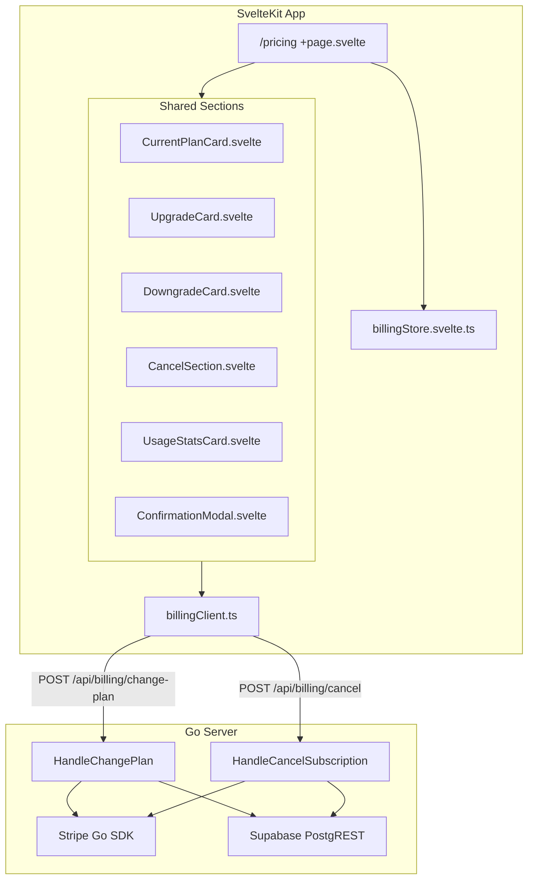
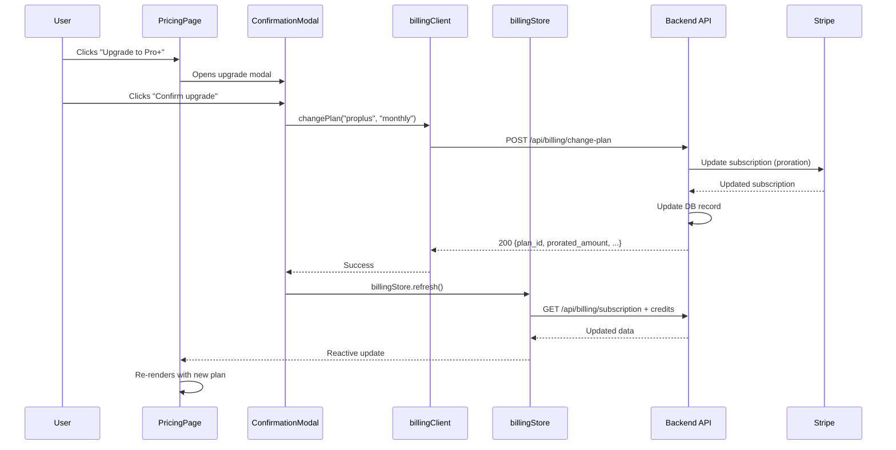

# Design Document: Subscription Management

## Overview

This feature extends the `/pricing` page in the MetaCleaner app to support subscription management for active subscribers. The page conditionally renders either the existing plan selection grid (for non-subscribers) or a new Subscription Management UI (for subscribers). The management UI displays the current plan with credit usage, upgrade/downgrade options, cancellation controls, and usage statistics.

The design introduces new frontend components in `src/lib/shared/sections/`, extends `billingClient.ts` with `changePlan` and `cancelSubscription` methods, and adds two backend Go endpoints (`POST /api/billing/change-plan` and `POST /api/billing/cancel`) that interact with the Stripe API to process plan changes.

## Architecture



### Decision: Conditional Rendering at Route Level

The `/pricing` route component checks `billingStore.isPaidPlan` to decide which UI to render. This keeps the logic centralized and avoids nested routing or separate pages, since the URL remains `/pricing` for both states.

### Decision: Shared Section Components (not route-local)

The subscription management components go in `src/lib/shared/sections/` rather than `src/routes/pricing/sections/` because:
- They may be referenced from settings or account pages in the future
- They follow the same pattern as `SummaryStatsRow` which already lives there
- The Confirmation Modal is a general-purpose component usable across features

### Decision: Stripe Proration for Upgrades, End-of-Period for Downgrades

- **Upgrades**: Immediate switch with Stripe-calculated proration — the user gets access to the higher plan instantly
- **Downgrades**: Scheduled at period end — the user retains full access to their current plan until the billing cycle completes
- This matches user expectations and Stripe's native subscription update behavior

## Components and Interfaces

### Frontend Component Tree

```
/pricing +page.svelte
├── [if !isPaidPlan] PricingHeaderSection + PricingPlansSection (existing)
├── [if isPaidPlan] Subscription Management UI
│   ├── SubscriptionHeader (inline in page)
│   ├── Grid (lg:grid-cols-5)
│   │   ├── Left Column (lg:col-span-3)
│   │   │   ├── CurrentPlanCard
│   │   │   └── CancelSection
│   │   └── Right Column (lg:col-span-2)
│   │       ├── UpgradeCard (if available)
│   │       ├── DowngradeCard (if available)
│   │       └── UsageStatsCard
│   └── ConfirmationModal (portal, conditionally rendered)
└── [if isLoading && credits === null] Skeleton state
```

### Component Props Interfaces

```typescript
// CurrentPlanCard.svelte
interface CurrentPlanCardProps {
  planId: string;
  planStatus: string;
  billingPeriod: 'monthly' | 'yearly' | null;
  price: string;
  monthlyAllowance: number;
  creditsUsed: number;
  creditsRemaining: number;
  renewalDate: string | null;
  features: string[];
  paymentMethod: string | null;    // e.g. "Visa •••• 4242"
  nextPaymentDate: string | null;
}

// UpgradeCard.svelte
interface UpgradeCardProps {
  targetPlanId: string;
  targetPlanName: string;
  targetPrice: string;
  differentialFeatures: string[];  // features gained
  onUpgrade: () => void;
}

// DowngradeCard.svelte
interface DowngradeCardProps {
  targetPlanId: string;
  targetPlanName: string;
  targetPrice: string;
  featuresLost: string[];
  onDowngrade: () => void;
}

// CancelSection.svelte
interface CancelSectionProps {
  periodEndDate: string;
  onCancel: () => void;
}

// UsageStatsCard.svelte
interface UsageStatsCardProps {
  creditsConsumed: number;
  creditsRemaining: number;
  monthlyAllowance: number;
  renewalDate: string;
}

// ConfirmationModal.svelte
interface ConfirmationModalProps {
  title: string;
  content: import('svelte').Snippet;
  confirmLabel: string;
  cancelLabel: string;
  confirmStyle: 'primary' | 'danger' | 'secondary';
  isLoading: boolean;
  error: string | null;
  onConfirm: () => void;
  onCancel: () => void;
}
```

### billingClient.ts Extension

```typescript
// New methods added to the existing billingClient object

interface ChangePlanResponse {
  plan_id: string;
  billing_period: 'monthly' | 'yearly';
  status: string;
  current_period_end: string;
  prorated_amount?: number;        // present on upgrades
  scheduled_change_date?: string;  // present on downgrades
}

export const billingClient = {
  // ... existing methods (createCheckoutSession, getSubscription)

  async changePlan(
    planId: string,
    billingPeriod: 'monthly' | 'yearly'
  ): Promise<ChangePlanResponse> {
    const res = await fetch(buildApiUrl('/api/billing/change-plan'), {
      method: 'POST',
      headers: {
        'Content-Type': 'application/json',
        Authorization: `Bearer ${authStore.accessToken}`
      },
      body: JSON.stringify({ plan_id: planId, billing_period: billingPeriod })
    });
    if (!res.ok) {
      const body = await res.json().catch(() => ({ message: res.statusText }));
      throw new Error((body as { message?: string }).message || res.statusText);
    }
    return res.json() as Promise<ChangePlanResponse>;
  },

  async cancelSubscription(): Promise<{ current_period_end: string }> {
    const res = await fetch(buildApiUrl('/api/billing/cancel'), {
      method: 'POST',
      headers: {
        'Content-Type': 'application/json',
        Authorization: `Bearer ${authStore.accessToken}`
      }
    });
    if (!res.ok) {
      const body = await res.json().catch(() => ({ message: res.statusText }));
      throw new Error((body as { message?: string }).message || res.statusText);
    }
    return res.json() as Promise<{ current_period_end: string }>;
  }
};
```

### billingStore.svelte.ts — Additional Derived State

The existing billing store already provides `isPaidPlan`, `planId`, `planStatus`, `credits`, `monthlyAllowance`, `isLoading`, and `hasError`. No new state fields are needed. The components derive all display values from existing store properties:

- `creditsUsed = monthlyAllowance - (subscriptionCredits + purchasedCredits)` (clamped to 0)
- `creditsRemaining = subscriptionCredits + purchasedCredits`

The `billingPeriod` and `currentPeriodEnd` are already available from the subscription response stored in `authStore.subscription`.

### Backend Endpoints

#### POST /api/billing/change-plan

```go
// Request body
type ChangePlanRequest struct {
    PlanID        string `json:"plan_id"`        // "pro" | "proplus"
    BillingPeriod string `json:"billing_period"` // "monthly" | "yearly"
}

// Response body (200 OK)
type ChangePlanResponse struct {
    PlanID              string  `json:"plan_id"`
    BillingPeriod       string  `json:"billing_period"`
    Status              string  `json:"status"`
    CurrentPeriodEnd    string  `json:"current_period_end"`
    ProratedAmount      *int64  `json:"prorated_amount,omitempty"`
    ScheduledChangeDate *string `json:"scheduled_change_date,omitempty"`
}
```

**Logic:**
1. Validate JWT/API key auth
2. Validate request body (plan_id ∈ {"pro", "proplus"}, billing_period ∈ {"monthly", "yearly"})
3. Fetch user's current subscription from DB
4. If no active subscription → 400 `NO_ACTIVE_SUBSCRIPTION`
5. If same plan + period → 409 `BILLING_CONFLICT`
6. Determine if upgrade (higher price) or downgrade (lower price)
7. **Upgrade**: Call `stripe.Subscription.Update()` with `ProrationBehavior: "create_prorations"` and immediate item swap
8. **Downgrade**: Call `stripe.Subscription.Update()` with `ProrationBehavior: "none"` and `BillingCycleAnchor: "unchanged"`, setting the schedule to swap at period end via `cancel_at_period_end` + new subscription creation, OR use Stripe's `schedule` API
9. Update subscription record in DB
10. Return response

**Design decision — Stripe downgrade approach**: Use `stripe.SubscriptionSchedule` to schedule the plan change at the end of the current period. This is cleaner than cancel-and-recreate because it preserves the customer's billing history and avoids race conditions with webhooks.

#### POST /api/billing/cancel

```go
// Response body (200 OK)
type CancelResponse struct {
    CurrentPeriodEnd string `json:"current_period_end"`
}
```

**Logic:**
1. Validate JWT auth
2. Fetch user's current subscription from DB
3. If no active subscription → 400 `NO_ACTIVE_SUBSCRIPTION`
4. If already cancelling/cancelled → 400 `ALREADY_CANCELLED`
5. Call `stripe.Subscription.Update()` with `CancelAtPeriodEnd: true`
6. Update subscription status in DB to "cancelling"
7. Return `current_period_end` timestamp

### Responsive Layout Strategy

```
Desktop (≥ 1024px / lg breakpoint):
┌─────────────────────────────────────────────────────┐
│ Page Header                                         │
├────────────────────────────┬────────────────────────┤
│ Current Plan Card (3/5)    │ Upgrade Card (2/5)     │
│                            ├────────────────────────┤
│                            │ Downgrade Card         │
├────────────────────────────┤────────────────────────┤
│ Cancel Section             │ Usage Stats Card       │
└────────────────────────────┴────────────────────────┘

Mobile (< 1024px):
┌──────────────────────┐
│ Page Header          │
├──────────────────────┤
│ Current Plan Card    │
├──────────────────────┤
│ Upgrade Card         │
├──────────────────────┤
│ Downgrade Card       │
├──────────────────────┤
│ Usage Stats Card     │
├──────────────────────┤
│ Cancel Section       │
└──────────────────────┘
```

Grid implementation:
```svelte
<div class="grid grid-cols-1 gap-4 lg:grid-cols-5 lg:gap-6">
  <div class="flex flex-col gap-4 lg:col-span-3 lg:gap-5">
    <CurrentPlanCard ... />
    <CancelSection ... />
  </div>
  <div class="flex flex-col gap-4 lg:col-span-2 lg:gap-5">
    <UpgradeCard ... />
    <DowngradeCard ... />
    <UsageStatsCard ... />
  </div>
</div>
```

On mobile the grid collapses to a single column. The section order on mobile (Current → Upgrade → Downgrade → Stats → Cancel) differs from the DOM order because CSS `order` utility classes reorder sections for the stacked mobile layout.

### Confirmation Modal — Desktop vs Mobile

```svelte
<!-- ConfirmationModal.svelte -->
<!-- Desktop: centered dialog -->
<div class="fixed inset-0 z-50 hidden items-center justify-center lg:flex">
  <div class="w-full max-w-[480px] rounded-2xl bg-navy-card border border-gray-700 p-6">
    <!-- modal content -->
  </div>
</div>

<!-- Mobile: bottom sheet -->
<div class="fixed inset-0 z-50 flex items-end justify-center lg:hidden">
  <div class="w-full max-w-lg rounded-t-2xl bg-navy-card border-t border-gray-800 p-6 pb-10
              animate-slide-up">
    <!-- modal content -->
  </div>
</div>
```

Animation keyframes defined in `layout.css`:
- Desktop: `animate-fade-in` (opacity 0→1, 200ms ease)
- Mobile: `animate-slide-up` (translateY(100%)→0, 300ms ease)

Both variants:
- Render a semi-transparent backdrop that closes the modal on click/tap
- Respect `prefers-reduced-motion` by disabling animations

## Data Models

### Frontend Types (additions to `src/lib/types/billing.ts`)

```typescript
// Extends existing SubscriptionStatus interface
export interface SubscriptionStatus {
  plan_id: string;
  status: string;
  billing_period: 'monthly' | 'yearly' | null;
  current_period_end: string | null;
  subscription_credits: number;
  purchased_credits: number;
  total_credits: number;
}

// New response type for change-plan endpoint
export interface ChangePlanResponse {
  plan_id: string;
  billing_period: 'monthly' | 'yearly';
  status: string;
  current_period_end: string;
  prorated_amount?: number;
  scheduled_change_date?: string;
}

// New response type for cancel endpoint
export interface CancelResponse {
  current_period_end: string;
}
```

### Backend Types (additions to `source/billing_handlers.go`)

```go
type ChangePlanRequest struct {
    PlanID        string `json:"plan_id"`
    BillingPeriod string `json:"billing_period"`
}

type ChangePlanResponse struct {
    PlanID              string  `json:"plan_id"`
    BillingPeriod       string  `json:"billing_period"`
    Status              string  `json:"status"`
    CurrentPeriodEnd    string  `json:"current_period_end"`
    ProratedAmount      *int64  `json:"prorated_amount,omitempty"`
    ScheduledChangeDate *string `json:"scheduled_change_date,omitempty"`
}

type CancelResponse struct {
    CurrentPeriodEnd string `json:"current_period_end"`
}
```

### Plan Hierarchy

Plan ordering for upgrade/downgrade determination:

```typescript
const PLAN_HIERARCHY: Record<string, number> = {
  free: 0,
  pro: 1,
  proplus: 2
};
```

- If `PLAN_HIERARCHY[target] > PLAN_HIERARCHY[current]` → upgrade (immediate, proration)
- If `PLAN_HIERARCHY[target] < PLAN_HIERARCHY[current]` → downgrade (end of period)

### Data Flow



## Correctness Properties

*A property is a characteristic or behavior that should hold true across all valid executions of a system — essentially, a formal statement about what the system should do. Properties serve as the bridge between human-readable specifications and machine-verifiable correctness guarantees.*

### Property 1: Conditional Page Rendering

*For any* billing store state, the pricing page SHALL render the Subscription Management UI if and only if `isPaidPlan` is true (planStatus ∈ {"active", "trialing"} AND planId ∈ {"pro", "proplus"}), and SHALL render the plan selection grid otherwise.

**Validates: Requirements 1.1, 1.2, 11.4, 11.5**

### Property 2: Credit Usage Bar Percentage Computation

*For any* non-negative integers `used` and `allowance`, the credit usage bar width percentage SHALL equal `Math.min(used / allowance, 1) * 100` when `allowance > 0`, and SHALL equal `0` when `allowance === 0`, with the result always in the range [0, 100].

**Validates: Requirements 2.2**

### Property 3: Currency Formatting by Locale

*For any* numeric amount and locale ∈ {"en", "cs"}, the formatted currency string SHALL place the € symbol before the amount with a period decimal separator for English (e.g., "€5.99"), and SHALL place the amount before the € symbol with a comma decimal separator for Czech (e.g., "5,99 €").

**Validates: Requirements 10.2**

### Property 4: Date Formatting by Locale

*For any* valid Date and locale ∈ {"en", "cs"}, the formatted date string SHALL use dot separators in DD.MM.YYYY format for Czech and slash separators in MM/DD/YYYY format for English.

**Validates: Requirements 10.3**

### Property 5: Cancel Section Visibility

*For any* billing store state, the Cancel Section SHALL be visible if and only if planStatus ∈ {"active", "trialing"} AND planId ∈ {"pro", "proplus"}. It SHALL NOT be visible when planStatus is "free", "cancelled", or planId is "free".

**Validates: Requirements 5.1, 5.9**

### Property 6: Usage Stats Computation

*For any* non-negative integers `subscriptionCredits`, `purchasedCredits`, and `monthlyAllowance`, the usage stats SHALL display: `creditsConsumed = Math.max(0, monthlyAllowance - (subscriptionCredits + purchasedCredits))`, `creditsRemaining = subscriptionCredits + purchasedCredits`, and `totalAllowance = monthlyAllowance`.

**Validates: Requirements 6.1**

### Property 7: Change-Plan Upgrade Applies Immediately with Proration

*For any* valid upgrade request (target plan has higher hierarchy rank than current plan), the backend SHALL instruct Stripe to apply the change immediately with proration and SHALL return a response containing a non-null `prorated_amount` field.

**Validates: Requirements 8.2**

### Property 8: Change-Plan Downgrade Schedules at Period End

*For any* valid downgrade request (target plan has lower hierarchy rank than current plan), the backend SHALL instruct Stripe to schedule the change at the end of the current billing period and SHALL return a response containing a non-null `scheduled_change_date` field.

**Validates: Requirements 8.3**

### Property 9: Change-Plan Input Validation

*For any* request body where `plan_id` ∉ {"pro", "proplus"} OR `billing_period` ∉ {"monthly", "yearly"} OR either field is missing, the backend SHALL return HTTP 400 with an error response in the standard ErrorResponse format.

**Validates: Requirements 8.4**

### Property 10: Change-Plan Same-Plan Conflict

*For any* change-plan request where the `plan_id` and `billing_period` match the user's current subscription values, the backend SHALL return HTTP 409 with error code "BILLING_CONFLICT".

**Validates: Requirements 8.6**

### Property 11: Billing Client Error Response Parsing

*For any* HTTP response with status ≥ 300 from the billing endpoints: if the response body is valid JSON containing a `message` field, the client SHALL throw an Error with that message; if the body cannot be parsed as JSON or lacks a `message` field, the client SHALL throw an Error containing the HTTP status text.

**Validates: Requirements 12.3, 12.4**

## Error Handling

### Frontend Error States

| Error Scenario | Handling |
|---|---|
| Billing store fails to load | Show last cached values + warning indicator; offer retry button |
| Change-plan API returns 4xx/5xx | Display localized error in modal; keep modal open for retry |
| Cancel API returns 4xx/5xx | Display localized error in modal; re-enable buttons for retry |
| Network timeout | Show connection error message with retry action |
| Stripe checkout redirect fails | Display inline error on pricing page (existing pattern) |

### Backend Error Responses

| HTTP Status | Error Code | When |
|---|---|---|
| 400 | `BILLING_INVALID_PLAN` | Invalid plan_id or billing_period |
| 400 | `NO_ACTIVE_SUBSCRIPTION` | User has no active subscription to modify/cancel |
| 400 | `ALREADY_CANCELLED` | Subscription already scheduled for cancellation |
| 409 | `BILLING_CONFLICT` | Target plan/period matches current subscription |
| 502 | `BILLING_STRIPE_ERROR` | Stripe API call failed or unreachable |

### Loading States

- **Initial page load**: Full skeleton matching the two-column layout dimensions
- **Modal confirm action**: Button enters loading state (spinner + disabled), other buttons disabled
- **Post-action refresh**: No visible loading — data updates reactively via store refresh

### Timeout Handling

- Frontend fetch calls use a 15-second timeout for billing operations
- If timeout elapses, show error in modal: "Request timed out. Please try again."
- Backend Stripe calls use the configured HTTP client timeout (10s default)

## Testing Strategy

### Unit Tests (Vitest)

- **Credit usage percentage computation**: Verify the clamping and zero-allowance edge cases
- **Currency formatting utility**: Test en/cs locale formatting rules
- **Date formatting utility**: Test en/cs locale date output
- **Plan hierarchy comparison**: Verify upgrade/downgrade detection logic
- **billingClient methods**: Mock fetch, verify request shape and error handling

### Property-Based Tests (Vitest + fast-check)

Property-based testing is appropriate for this feature because several acceptance criteria define universal properties over input spaces (numeric values, locale combinations, plan states).

**Library**: `fast-check` (already used in the CLI workspace; consistent choice)

**Configuration**: Minimum 100 iterations per property test.

**Properties to implement:**
1. Credit usage bar computation (Property 2)
2. Currency formatting correctness (Property 3)
3. Date formatting correctness (Property 4)
4. Conditional rendering logic (Property 1) — test the boolean derivation
5. Cancel section visibility logic (Property 5) — test the boolean derivation
6. Usage stats computation (Property 6)
7. Billing client error parsing (Property 11)

**Tag format**: `// Feature: subscription-management, Property N: <description>`

### Backend Tests (Go `testing` + `pgregory.net/rapid`)

- **Input validation** (Property 9): Generate random invalid request bodies, verify 400 responses
- **Same-plan conflict** (Property 10): Generate matching plan/period pairs, verify 409
- **Upgrade/downgrade routing** (Properties 7, 8): Generate plan transitions, verify correct Stripe call type (with mocked Stripe client)

### Integration Tests

- Full upgrade flow: authenticate → change plan → verify DB update
- Full cancel flow: authenticate → cancel → verify subscription status update
- Webhook handling: Stripe events correctly update subscription state

### Component Tests (Storybook + Vitest Browser)

- ConfirmationModal renders desktop dialog vs mobile bottom sheet
- CurrentPlanCard displays all fields correctly
- UpgradeCard/DowngradeCard conditional rendering based on current plan
- CancelSection visibility based on subscription state
- Skeleton loading states
