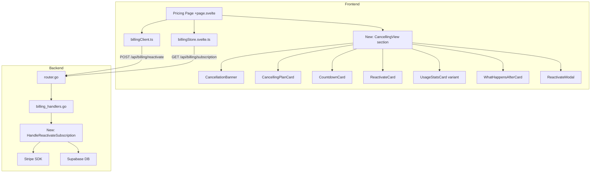
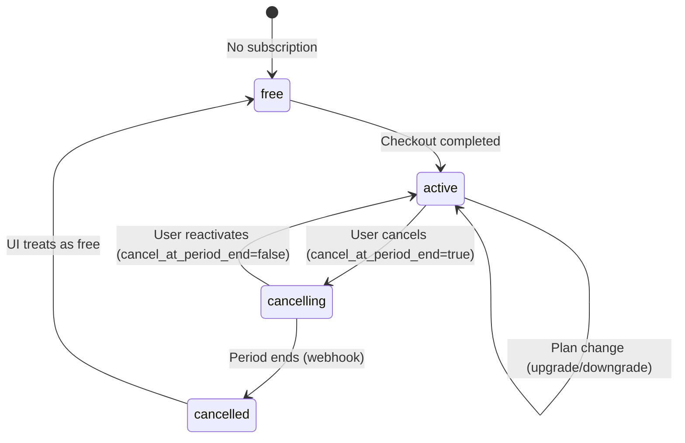

# Design Document: Subscription Management — Ending Subscription State

## Overview

This feature implements the "ending subscription" intermediate state in the MetaCleaner app. When a user cancels, the subscription transitions to `cancelling` status — a grace period where paid features remain active until `current_period_end`. The system currently mishandles this state: the billing store incorrectly classifies it as free, and no dedicated UI exists.

The design covers four areas:
1. **Billing store fix** — add `isCancellingPlan` derived property and correct the `isFreeUser` logic
2. **Frontend UI** — new "ending subscription" view with banner, countdown, plan card, reactivation CTA, usage stats, and "what happens after" sections
3. **Backend endpoint** — `POST /api/billing/reactivate` to reverse a Stripe cancellation
4. **i18n** — new translation keys for both English and Czech

### Design Rationale

The cancelling state is distinct from both "active" and "free" — users still have paid access but their subscription is winding down. The UI must clearly communicate this liminal state (orange theming, countdown urgency, reactivation CTA) while preserving the existing subscription management architecture.

## Architecture

The feature fits cleanly into the existing architecture layers:



**Key decisions:**
- The cancelling view is a **third branch** in the pricing page's conditional rendering (alongside the active management UI and the pricing grid)
- New UI components are created as sections in `src/lib/shared/sections/` since they're specific to the pricing page but could be reused if a settings billing view is added later
- The reactivation endpoint mirrors the existing cancel endpoint pattern (factory handler, Stripe SDK call, DB update)

## Components and Interfaces

### 1. Billing Store Changes (`billingStore.svelte.ts`)

```typescript
// New derived property
const isCancellingPlan = $derived(planStatus === 'cancelling');

// Fixed: exclude 'cancelling' from free user detection
const isFreeUser = $derived(
  planId === 'free' || planStatus === 'cancelled' || planStatus === 'free'
  // 'cancelling' is intentionally NOT here — user still has paid access
);

// isPaidPlan remains unchanged — 'cancelling' is not 'active'/'trialing'
// so isPaidPlan = false for cancelling users (correct: they can't upgrade/downgrade)
```

Exposed via the store's return object:
```typescript
get isCancellingPlan() { return isCancellingPlan; }
```

### 2. Pricing Page Routing Logic

The pricing page gains a third rendering branch:

```svelte
{#if showSkeleton}
  <!-- skeleton -->
{:else if billingStore.hasError && billingStore.credits === null}
  <!-- error state -->
{:else if billingStore.isCancellingPlan}
  <!-- NEW: Ending subscription view -->
  <CancellingView ... />
{:else if showManagementUI}
  <!-- Active subscription management -->
{:else}
  <!-- Pricing grid for free users -->
{/if}
```

### 3. New Frontend Components

| Component | Location | Props |
|-----------|----------|-------|
| `CancellingView` | `src/lib/shared/sections/CancellingView.svelte` | Wrapper orchestrating all cancelling sub-sections |
| `CancellationBanner` | `src/lib/shared/sections/CancellationBanner.svelte` | `periodEndDate: string`, `onReactivate: () => void` |
| `CancellingPlanCard` | `src/lib/shared/sections/CancellingPlanCard.svelte` | `planId, price, monthlyAllowance, creditsUsed, creditsRemaining, periodEndDate, features` |
| `CountdownCard` | `src/lib/shared/sections/CountdownCard.svelte` | `periodEndDate: string` |
| `ReactivateCard` | `src/lib/shared/sections/ReactivateCard.svelte` | `planId, price, billingPeriod, periodEndDate, onReactivate: () => void` |
| `WhatHappensAfterCard` | `src/lib/shared/sections/WhatHappensAfterCard.svelte` | `periodEndDate: string, creditsRemaining: number` |
| `ReactivateModal` | `src/lib/shared/sections/ReactivateModal.svelte` | `planId, price, billingPeriod, periodEndDate, onConfirm, onCancel, isLoading, error` |

### 4. Billing Client Extension

```typescript
// New method in billingClient.ts
async reactivateSubscription(): Promise<ReactivateResponse> {
  const res = await fetch(buildApiUrl('/api/billing/reactivate'), {
    method: 'POST',
    headers: {
      'Content-Type': 'application/json',
      Authorization: `Bearer ${authStore.accessToken}`
    }
  });
  if (!res.ok) {
    const body = await res.json().catch(() => ({ message: res.statusText }));
    throw new Error((body as { message?: string }).message || res.statusText);
  }
  return res.json() as Promise<ReactivateResponse>;
}
```

New type in `src/lib/types/billing.ts`:
```typescript
export interface ReactivateResponse {
  plan_id: string;
  status: string;
  current_period_end: string;
}
```

### 5. Backend Reactivation Handler

```go
// New error code constant
const ErrNoCancellingSubscription = "NO_CANCELLING_SUBSCRIPTION"

// ReactivateResponse is the response body for POST /api/billing/reactivate.
type ReactivateResponse struct {
    PlanID           string `json:"plan_id"`
    Status           string `json:"status"`
    CurrentPeriodEnd string `json:"current_period_end"`
}

// HandleReactivateSubscription handles POST /api/billing/reactivate.
// It reverses a cancellation by setting cancel_at_period_end: false on Stripe.
func HandleReactivateSubscription(cfg Config, db *SupabaseClient) http.HandlerFunc {
    return func(w http.ResponseWriter, r *http.Request) {
        // 1. Get authenticated user ID
        // 2. Fetch subscription from DB
        // 3. Validate status == 'cancelling'
        // 4. Call Stripe: subscription.Update with CancelAtPeriodEnd: false
        // 5. Update DB status back to 'active'
        // 6. Return ReactivateResponse
    }
}
```

Route registration in `router.go`:
```go
mux.Handle("POST /api/billing/reactivate", rateLimited(HandleReactivateSubscription(cfg, db)))
```

## Data Models

### Subscription Status State Machine



### Frontend State Mapping

| `planStatus` | `isFreeUser` | `isPaidPlan` | `isCancellingPlan` | UI View |
|---|---|---|---|---|
| `'free'` | `true` | `false` | `false` | Pricing grid |
| `'active'` | `false` | `true` | `false` | Subscription management |
| `'trialing'` | `false` | `true` | `false` | Subscription management |
| `'cancelling'` | `false` | `false` | `true` | **Ending subscription view** |
| `'cancelled'` | `true` | `false` | `false` | Pricing grid |

### Reactivation API Contract

**Request:** `POST /api/billing/reactivate`
- Headers: `Authorization: Bearer <jwt>`
- Body: empty (no request body needed)

**Success Response (200):**
```json
{
  "plan_id": "pro",
  "status": "active",
  "current_period_end": "2025-02-01T23:59:00Z"
}
```

**Error Responses:**
| Status | Error Code | Condition |
|--------|-----------|-----------|
| 400 | `NO_CANCELLING_SUBSCRIPTION` | No subscription in `cancelling` state |
| 401 | `AUTH_UNAUTHORIZED` | Missing or invalid auth token |
| 502 | `BILLING_STRIPE_ERROR` | Stripe API call failed |

### Countdown Calculation

The countdown component computes remaining time client-side:

```typescript
// Derived from current_period_end
const remaining = $derived.by(() => {
  const end = new Date(periodEndDate).getTime();
  const now = Date.now();
  const diff = Math.max(0, end - now);
  return {
    days: Math.floor(diff / 86_400_000),
    hours: Math.floor((diff % 86_400_000) / 3_600_000),
    minutes: Math.floor((diff % 3_600_000) / 60_000)
  };
});
```

Updated every minute via `setInterval` with cleanup on unmount.


## Correctness Properties

*A property is a characteristic or behavior that should hold true across all valid executions of a system — essentially, a formal statement about what the system should do. Properties serve as the bridge between human-readable specifications and machine-verifiable correctness guarantees.*

### Property 1: Cancelling status is not classified as free

*For any* plan ID (including 'pro', 'proplus', 'free', or any string), when the plan status is `'cancelling'`, the billing store's `isFreeUser` derived property SHALL return `false`.

**Validates: Requirements 1.1**

### Property 2: Monthly allowance preserved during cancellation

*For any* plan ID in `['pro', 'proplus']` with plan status `'cancelling'`, the billing store's `monthlyAllowance` SHALL equal the configured allowance for that plan ID (i.e., `PLAN_CONFIG[planId].monthlyAllowance`).

**Validates: Requirements 1.4**

### Property 3: Countdown time decomposition is correct

*For any* future date (period end) and any current timestamp before it, decomposing the difference into days, hours, and minutes SHALL satisfy: `days * 86400000 + hours * 3600000 + minutes * 60000` is within 60000ms of the actual millisecond difference (accounting for truncation to minutes).

**Validates: Requirements 5.1, 5.4**

### Property 4: Progress bar ratio is bounded and monotonic

*For any* three timestamps (cancellation time ≤ now ≤ period end), the progress ratio SHALL be in the range `[0, 1]` and SHALL equal `(now - cancellationTime) / (periodEnd - cancellationTime)`. When now equals cancellationTime, progress is 0. When now equals periodEnd, progress is 1.

**Validates: Requirements 5.2**

### Property 5: Reactivation calls Stripe with cancel_at_period_end=false

*For any* authenticated user with a subscription in `'cancelling'` status, calling the reactivation endpoint SHALL invoke the Stripe subscription update with `cancel_at_period_end: false` for the user's Stripe subscription ID.

**Validates: Requirements 10.1**

### Property 6: Successful reactivation restores active state

*For any* cancelling subscription, when the Stripe update succeeds, the endpoint SHALL update the database status to `'active'` AND return a response containing `plan_id` matching the subscription's plan, `status: "active"`, and a valid `current_period_end` timestamp.

**Validates: Requirements 10.2, 10.3**

### Property 7: Reactivation rejected for non-cancelling subscriptions

*For any* subscription status that is NOT `'cancelling'` (including `'active'`, `'trialing'`, `'cancelled'`, `'free'`, or no subscription), calling the reactivation endpoint SHALL return HTTP 400 with error code `NO_CANCELLING_SUBSCRIPTION` and SHALL NOT call the Stripe API.

**Validates: Requirements 10.4**

### Property 8: Stripe failure prevents database modification

*For any* cancelling subscription, if the Stripe API call fails (any error), the reactivation endpoint SHALL return HTTP 502 with error code `BILLING_STRIPE_ERROR` and SHALL NOT modify the database subscription status.

**Validates: Requirements 10.5**

## Error Handling

### Frontend Errors

| Scenario | Handling |
|----------|----------|
| Billing store refresh fails while on cancelling view | Show stale data with yellow warning badge (existing pattern) |
| Reactivation API call fails (network error) | Display inline error in modal; modal stays open; user can retry |
| Reactivation API returns 400 (race condition — already reactivated) | Refresh billing store; if now active, close modal and show management UI |
| Reactivation API returns 502 (Stripe error) | Show "Something went wrong" error in modal with retry option |
| Countdown reaches zero while user is on page | Show 0 for all units; keep view (backend webhook handles actual transition) |

### Backend Errors

| Scenario | HTTP Status | Error Code | Behavior |
|----------|-------------|-----------|----------|
| No auth token | 401 | `AUTH_UNAUTHORIZED` | Standard auth middleware rejection |
| No subscription found | 400 | `NO_CANCELLING_SUBSCRIPTION` | User has no subscription at all |
| Subscription not in cancelling state | 400 | `NO_CANCELLING_SUBSCRIPTION` | Subscription exists but wrong status |
| Stripe API failure | 502 | `BILLING_STRIPE_ERROR` | Database NOT modified |
| Database update failure (after Stripe success) | 500 | `DATABASE_ERROR` | Stripe already updated — inconsistency logged for manual resolution |
| Stripe config missing | 503 | `BILLING_CONFIG_ERROR` | Service misconfigured |

### Consistency Considerations

The reactivation operation is not atomic across Stripe + DB. If Stripe succeeds but the DB update fails:
- The Stripe subscription is now active (cancel_at_period_end=false)
- The DB still says 'cancelling'
- On next billing store refresh, `GET /api/billing/subscription` returns 'cancelling' (stale DB)
- Resolution: The existing Stripe webhook handler for `customer.subscription.updated` will eventually sync the status. Additionally, the error is logged at ERROR level for manual intervention if needed.

## Testing Strategy

### Unit Tests (Vitest)

**Billing store logic:**
- Test `isFreeUser`, `isPaidPlan`, `isCancellingPlan` for all status values
- Test `monthlyAllowance` derivation for each planId with cancelling status

**Countdown calculation:**
- Test time decomposition for various future dates
- Test edge case: period end in the past → all zeros
- Test progress ratio boundary values

**Billing client:**
- Test `reactivateSubscription()` calls correct endpoint with auth header
- Test error response parsing

### Property Tests (Vitest + fast-check)

Property-based testing is appropriate for this feature because:
- The billing store classification logic is a pure function of status/planId inputs
- The countdown calculation is a pure math function of timestamps
- The backend handler has clear universal properties about state transitions

**Library:** `fast-check` (already used in the CLI project, consistent with monorepo)

**Configuration:**
- Minimum 100 iterations per property
- Tag format: `Feature: subscription-management, Property {N}: {title}`

**Properties to implement:**
1. Store classification (Properties 1–2): Generate random planId/status combinations, verify derived values
2. Countdown math (Properties 3–4): Generate random timestamp pairs, verify decomposition and ratio
3. Backend handler (Properties 5–8): Generate random subscription states, mock Stripe, verify behavior

### Integration Tests (Go `testing`)

**Backend reactivation handler:**
- Happy path: cancelling → Stripe success → 200 with active status
- Invalid state: active/free subscription → 400
- Stripe failure: mock error → 502, DB unchanged
- Missing auth: → 401

### Component Tests (Vitest browser mode)

- `CancellationBanner` renders with correct elements and calls onReactivate
- `CountdownCard` displays correct countdown values
- `ReactivateModal` shows loading/error states correctly
- `CancellingPlanCard` displays plan data with expiring styling
- `WhatHappensAfterCard` shows lost/retained items; accordion on mobile

### E2E Tests (Playwright)

- Full flow: mock subscription API to return cancelling → verify ending subscription view renders
- Reactivation flow: click reactivate → confirm modal → verify transition to active view
