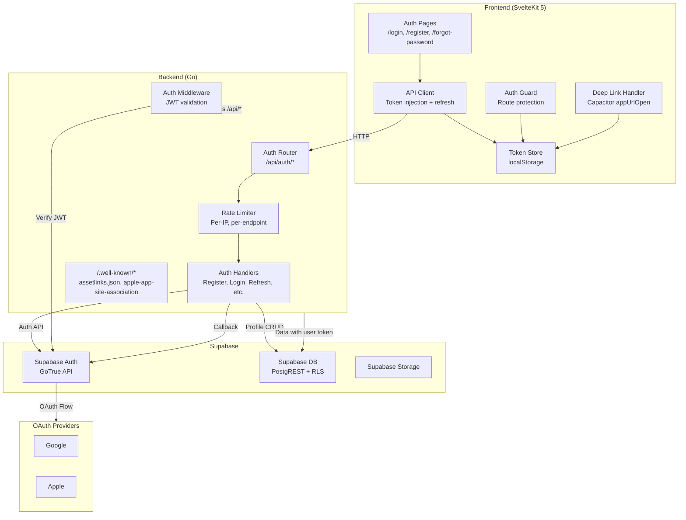
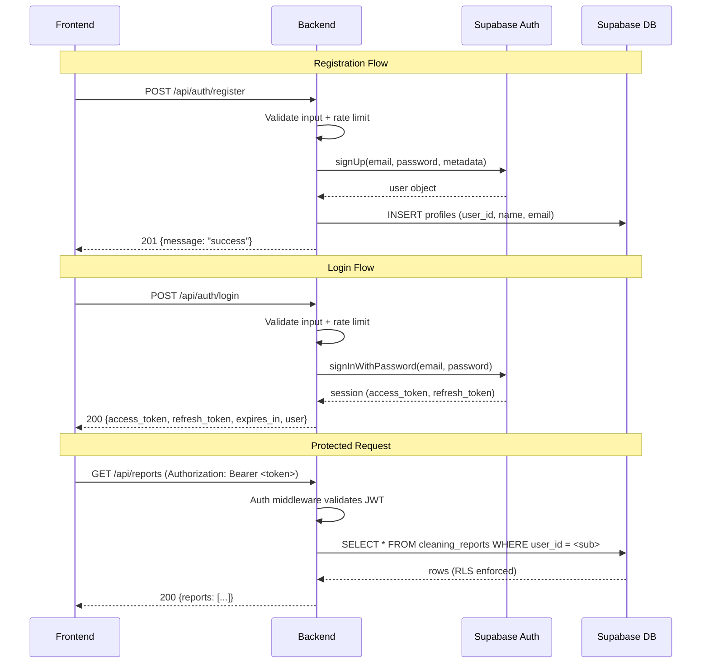

# Design Document: User Authentication

## Overview

This design implements user authentication for MetaCleaner, spanning the Go backend (auth API endpoints proxying to Supabase Auth) and the SvelteKit 5 frontend (auth pages, token management, route guards). The system supports email/password registration, OAuth (Google/Apple), magic link authentication, and integrates with Capacitor for mobile deep links.

### Key Design Decisions

1. **Supabase as auth provider** — Supabase Auth handles user storage, email confirmation, password resets, OAuth flows, and magic links. The Go backend acts as a thin proxy layer that validates input, applies rate limits, and forwards requests to Supabase Auth REST API.

2. **Backend-mediated auth** — Rather than having the frontend call Supabase directly, all auth operations go through the Go backend. This allows server-side rate limiting, consistent error handling, user profile creation on registration, and token forwarding for RLS.

3. **JWT-based auth middleware** — The backend validates JWTs using Supabase's JWT secret. Protected endpoints require a valid, non-expired Access_Token with the user's ID in the `sub` claim.

4. **localStorage for token persistence** — Tokens are stored in localStorage with a `mc_` prefix, enabling persistence across page reloads and tab sharing on the same origin.

5. **Redirect-based OAuth/Magic Link callbacks** — Both OAuth and magic link callbacks redirect to the frontend with tokens as URL query parameters. The frontend extracts, stores, and cleans them from the URL. Deep links intercept these same URLs on mobile.

---

## Architecture



### Request Flow



---

## Components and Interfaces

### Backend Components

#### 1. Auth Handlers (`source/auth_handlers.go`)

Handles all `/api/auth/*` endpoints:

| Endpoint | Method | Description |
|----------|--------|-------------|
| `/api/auth/register` | POST | Create user account + profile |
| `/api/auth/login` | POST | Authenticate, return tokens |
| `/api/auth/logout` | POST | Invalidate session |
| `/api/auth/refresh` | POST | Refresh access token |
| `/api/auth/forgot-password` | POST | Send reset code |
| `/api/auth/verify-reset-code` | POST | Verify code, return temp token |
| `/api/auth/reset-password` | POST | Set new password |
| `/api/auth/me` | GET | Get user profile |
| `/api/auth/magic-link` | POST | Send magic link email |
| `/api/auth/magic-link/callback` | GET | Handle magic link click |
| `/api/auth/oauth/{provider}` | GET | Initiate OAuth flow |
| `/api/auth/oauth/callback` | GET | Handle OAuth callback |

#### 2. Auth Middleware (`source/auth_middleware.go`)

```go
// AuthMiddleware validates JWT on protected endpoints
type AuthMiddleware struct {
    jwtSecret []byte
    supabaseURL string
}

// Authenticate extracts and validates the Bearer token,
// returning the user ID from the sub claim
func (m *AuthMiddleware) Authenticate(r *http.Request) (string, error)

// Middleware returns an http.Handler wrapper that enforces authentication
func (m *AuthMiddleware) Middleware(next http.Handler) http.Handler
```

Exempt paths: `/api/auth/*`, `/api/health`, `/.well-known/*`

#### 3. Auth Rate Limiter (`source/auth_rate_limiter.go`)

Separate from the existing upload rate limiter. Applies per-IP limits:
- `/api/auth/login`: 5 req/min
- `/api/auth/register`: 5 req/min
- `/api/auth/forgot-password`: 5 req/min
- `/api/auth/verify-reset-code`: 5 req/min
- `/api/auth/magic-link`: 3 req/email/10 min (tracked by email + IP)

#### 4. Supabase Auth Client (`source/supabase_auth.go`)

```go
// SupabaseAuthClient handles Supabase GoTrue API interactions
type SupabaseAuthClient struct {
    httpClient  *http.Client
    baseURL     string       // SUPABASE_URL
    apiKey      string       // SUPABASE_API_KEY (anon key)
    serviceKey  string       // SUPABASE_SERVICE_ROLE_KEY
    jwtSecret   []byte       // SUPABASE_JWT_SECRET
}

func (c *SupabaseAuthClient) SignUp(ctx context.Context, email, password string, metadata map[string]string) (*AuthUser, error)
func (c *SupabaseAuthClient) SignInWithPassword(ctx context.Context, email, password string) (*AuthSession, error)
func (c *SupabaseAuthClient) SignInWithOtp(ctx context.Context, email string) error
func (c *SupabaseAuthClient) RefreshToken(ctx context.Context, refreshToken string) (*AuthSession, error)
func (c *SupabaseAuthClient) SignOut(ctx context.Context, accessToken string) error
func (c *SupabaseAuthClient) ResetPasswordForEmail(ctx context.Context, email string) error
func (c *SupabaseAuthClient) VerifyOTP(ctx context.Context, email, code string) (*AuthSession, error)
func (c *SupabaseAuthClient) UpdateUser(ctx context.Context, accessToken string, updates map[string]interface{}) error
func (c *SupabaseAuthClient) GetOAuthURL(provider, redirectURL string) string
func (c *SupabaseAuthClient) ExchangeCodeForSession(ctx context.Context, code string) (*AuthSession, error)
func (c *SupabaseAuthClient) GetUser(ctx context.Context, accessToken string) (*AuthUser, error)
```

#### 5. Well-Known Endpoints (`source/well_known.go`)

Serves static JSON for mobile app link verification:
- `GET /.well-known/assetlinks.json` — Android App Links
- `GET /.well-known/apple-app-site-association` — iOS Universal Links

### Frontend Components

#### 1. Auth Store (`src/lib/auth/auth.svelte.ts`)

Svelte 5 runes-based reactive auth state:

```typescript
interface AuthState {
    accessToken: string | null;
    refreshToken: string | null;
    user: UserProfile | null;
    isAuthenticated: boolean;
    isLoading: boolean;
}

// Exported reactive state and methods
export const auth: {
    state: AuthState;
    login(email: string, password: string): Promise<void>;
    register(data: RegisterData): Promise<void>;
    logout(): Promise<void>;
    refresh(): Promise<void>;
    setTokensFromCallback(accessToken: string, refreshToken: string, expiresIn: number): void;
}
```

#### 2. API Client (`src/lib/auth/api-client.ts`)

Wraps `fetch` with automatic token injection and refresh:

```typescript
interface APIClient {
    fetch(url: string, options?: RequestInit): Promise<Response>;
}
```

Features:
- Injects `Authorization: Bearer <token>` on protected requests
- Triggers proactive refresh when token expires within 60s
- Queues concurrent requests during refresh (single-flight pattern)
- Clears tokens and redirects on 401 after failed refresh

#### 3. Auth Guard (`src/lib/auth/auth-guard.ts`)

SvelteKit load function guard:
- Protected routes: redirect to `/login` if no valid token
- Auth routes (`/login`, `/register`, `/forgot-password`): redirect to `/` if authenticated

#### 4. Auth Pages

| Route | Component | Description |
|-------|-----------|-------------|
| `/login` | `+page.svelte` | Email/password, OAuth buttons, magic link |
| `/register` | `+page.svelte` | Registration form with validation |
| `/forgot-password` | `+page.svelte` | Multi-step reset (email → code → new password) |

#### 5. Deep Link Handler (`src/lib/auth/deep-link.ts`)

Capacitor `App.addListener('appUrlOpen', ...)` handler that:
- Intercepts OAuth and magic link callback URLs
- Extracts tokens from query parameters
- Stores tokens and navigates to main page
- Handles error parameters

---

## Data Models

### Database Schema

#### `profiles` table

| Column | Type | Constraints | Default |
|--------|------|-------------|---------|
| id | UUID | PK, FK → auth.users(id) | — |
| first_name | TEXT | NOT NULL | — |
| last_name | TEXT | NOT NULL | — |
| email | TEXT | NOT NULL | — |
| subscription_type | TEXT | NOT NULL, CHECK (free/pro/premium) | 'free' |
| credits | INTEGER | NOT NULL | 3 |
| created_at | TIMESTAMPTZ | NOT NULL | now() |
| updated_at | TIMESTAMPTZ | NOT NULL | now() |

#### Modified existing tables (add `user_id`)

| Table | New Column | Type | Constraints |
|-------|-----------|------|-------------|
| cleaning_jobs | user_id | UUID | NOT NULL, FK → auth.users(id) |
| job_files | user_id | UUID | NOT NULL, FK → auth.users(id) |
| cleaning_reports | user_id | UUID | NOT NULL, FK → auth.users(id) |

#### RLS Policies

```sql
-- Enable RLS
ALTER TABLE profiles ENABLE ROW LEVEL SECURITY;
ALTER TABLE cleaning_jobs ENABLE ROW LEVEL SECURITY;
ALTER TABLE job_files ENABLE ROW LEVEL SECURITY;
ALTER TABLE cleaning_reports ENABLE ROW LEVEL SECURITY;

-- Profiles: users can only read/update their own profile
CREATE POLICY profiles_select ON profiles FOR SELECT USING (id = auth.uid());
CREATE POLICY profiles_update ON profiles FOR UPDATE USING (id = auth.uid());

-- Cleaning jobs: users can only CRUD their own jobs
CREATE POLICY jobs_select ON cleaning_jobs FOR SELECT USING (user_id = auth.uid());
CREATE POLICY jobs_insert ON cleaning_jobs FOR INSERT WITH CHECK (user_id = auth.uid());
CREATE POLICY jobs_update ON cleaning_jobs FOR UPDATE USING (user_id = auth.uid());
CREATE POLICY jobs_delete ON cleaning_jobs FOR DELETE USING (user_id = auth.uid());

-- Same pattern for job_files and cleaning_reports
```

### TypeScript Models (Frontend)

```typescript
interface UserProfile {
    id: string;
    first_name: string;
    last_name: string;
    email: string;
    subscription_type: 'free' | 'pro' | 'premium';
    credits: number;
    created_at: string;
    updated_at: string;
}

interface AuthTokens {
    access_token: string;
    refresh_token: string;
    expires_in: number;
}

interface LoginResponse extends AuthTokens {
    user: { id: string; email: string };
}
```

### Go Models (Backend)

```go
type AuthSession struct {
    AccessToken  string `json:"access_token"`
    RefreshToken string `json:"refresh_token"`
    ExpiresIn    int    `json:"expires_in"`
    User         AuthUser `json:"user"`
}

type AuthUser struct {
    ID    string `json:"id"`
    Email string `json:"email"`
    UserMetadata map[string]interface{} `json:"user_metadata"`
}

type Profile struct {
    ID               string    `json:"id"`
    FirstName        string    `json:"first_name"`
    LastName         string    `json:"last_name"`
    Email            string    `json:"email"`
    SubscriptionType string    `json:"subscription_type"`
    Credits          int       `json:"credits"`
    CreatedAt        time.Time `json:"created_at"`
    UpdatedAt        time.Time `json:"updated_at"`
}
```

### Configuration (new env vars)

| Variable | Description | Required |
|----------|-------------|----------|
| `SUPABASE_JWT_SECRET` | JWT secret for token validation | Yes |
| `SUPABASE_SERVICE_ROLE_KEY` | Service role key for admin operations | Yes |
| `OAUTH_CALLBACK_URL` | Full callback URL for OAuth | Yes |
| `MAGIC_LINK_CALLBACK_URL` | Full callback URL for magic links | Yes |
| `FRONTEND_URL` | Frontend base URL for redirects | Yes |

---

## Correctness Properties

*A property is a characteristic or behavior that should hold true across all valid executions of a system — essentially, a formal statement about what the system should do. Properties serve as the bridge between human-readable specifications and machine-verifiable correctness guarantees.*

### Property 1: Input validation rejects invalid payloads

*For any* registration or password reset request where the email does not match `local-part@domain.tld` format, OR the password length is outside the allowed range (8–72 for registration, 8–128 for reset), OR required name fields contain only whitespace, the Auth_API SHALL return HTTP 400 and NOT create any user account or modify any password.

**Validates: Requirements 1.3, 1.4, 1.9, 5.3, 5.7, 17.11**

### Property 2: Anti-enumeration consistency

*For any* forgot-password request, the HTTP response status and body SHALL be identical (HTTP 200, same JSON structure) regardless of whether the submitted email is registered or unregistered. Similarly, *for any* failed login attempt, the error message SHALL be identical regardless of whether the email exists in the system.

**Validates: Requirements 2.2, 5.2**

### Property 3: Auth middleware rejects unauthenticated requests

*For any* request to a protected endpoint (all `/api/*` paths except `/api/auth/*` and `/api/health`) that lacks a valid, non-expired Access_Token with a correct signature, the Auth_Middleware SHALL return HTTP 401 and SHALL NOT execute the handler logic or return any data.

**Validates: Requirements 6.1, 6.2, 6.3, 6.6**

### Property 4: Data isolation by user

*For any* two distinct authenticated users A and B, when user A queries any data endpoint (jobs, files, reports, profile), the response SHALL contain exclusively data where `user_id` matches user A's ID. Conversely, if user A requests a specific resource owned by user B, the response SHALL be HTTP 404.

**Validates: Requirements 7.2, 7.6, 13.4, 13.7, 16.9**

### Property 5: Error response format consistency

*For any* error response from any Auth_API endpoint, the JSON body SHALL contain exactly the fields `error` (string code), `message` (string description), and `timestamp` (ISO 8601 string), with no additional or missing fields.

**Validates: Requirements 11.2**

### Property 6: Concurrent refresh deduplication

*For any* set of N concurrent API requests triggered while the Access_Token is expired, the API client SHALL issue exactly 1 refresh request and resolve all N pending requests with the new Access_Token once the refresh completes.

**Validates: Requirements 12.7**

### Property 7: Trial credits assigned exactly once

*For any* user, regardless of registration method (email/password, OAuth, or magic link), the `credits` field in the `profiles` table SHALL be set to 3 exactly once at account creation time. Subsequent logins, token refreshes, or re-authentication SHALL NOT modify the `credits` value.

**Validates: Requirements 16.6**

---

## Error Handling

### Backend Error Responses

All auth errors follow the existing error format:

```json
{
    "error": "AUTH_INVALID_CREDENTIALS",
    "message": "Invalid email or password",
    "timestamp": "2024-01-15T10:30:00Z"
}
```

#### Error Codes

| Code | HTTP Status | Description |
|------|-------------|-------------|
| `AUTH_INVALID_REQUEST` | 400 | Missing/invalid fields, malformed JSON |
| `AUTH_INVALID_EMAIL` | 400 | Email format validation failed |
| `AUTH_INVALID_PASSWORD` | 400 | Password length outside range |
| `AUTH_INVALID_CREDENTIALS` | 401 | Wrong email/password (generic) |
| `AUTH_TOKEN_EXPIRED` | 401 | Access token expired |
| `AUTH_TOKEN_INVALID` | 401 | Token malformed or bad signature |
| `AUTH_UNAUTHORIZED` | 401 | No token provided |
| `AUTH_EMAIL_NOT_CONFIRMED` | 403 | Email not yet verified |
| `AUTH_EMAIL_EXISTS` | 409 | Email already registered |
| `AUTH_RATE_LIMIT` | 429 | Rate limit exceeded |
| `AUTH_SERVICE_UNAVAILABLE` | 503 | Supabase unreachable |
| `AUTH_RESET_CODE_INVALID` | 400 | Invalid/expired reset code |
| `AUTH_OAUTH_FAILED` | 400 | OAuth flow error |
| `AUTH_PROVIDER_UNSUPPORTED` | 400 | Invalid OAuth provider |

### Frontend Error Handling

- API errors display inline below the relevant form field or section
- Network errors trigger a toast notification with retry option
- 401 responses from protected endpoints trigger token refresh; if refresh fails, redirect to `/login`
- OAuth/magic link callback errors display on the login page via query parameter

### Supabase Unavailability

When Supabase returns a 5xx or connection timeout:
- Backend returns HTTP 503 with `AUTH_SERVICE_UNAVAILABLE`
- Frontend displays "Service temporarily unavailable, please try again later"
- No retry logic on the backend (client can retry)

---

## Testing Strategy

### Unit Tests (Backend — Go)

Using Go's standard `testing` package:

- **Auth handler tests**: Mock `SupabaseAuthClient`, test each endpoint's input validation, error responses, and success paths
- **Auth middleware tests**: Test JWT validation with valid/expired/malformed/wrong-signature tokens
- **Rate limiter tests**: Verify per-IP limits, Retry-After header, limit reset timing
- **Input validation tests**: Email format, password length, required fields

### Unit Tests (Frontend — Vitest)

- **Auth store tests**: Token management, state transitions
- **API client tests**: Token injection, refresh flow, request queuing
- **Auth guard tests**: Redirect logic for protected/auth routes
- **Form validation tests**: Email, password, name validation

### Property-Based Tests

Using `fast-check` (already in devDependencies) for the frontend and `pgregory.net/rapid` (already in go.mod) for the backend.

**Configuration**: Minimum 100 iterations per property test.

**Backend properties (rapid)**:
- Property 1: Input validation — generate random invalid emails, passwords, names → verify rejection
- Property 3: Auth middleware — generate random non-JWT strings → verify 401
- Property 5: Error response format — trigger various errors → verify consistent JSON structure

**Frontend properties (fast-check)**:
- Property 2: Anti-enumeration — generate emails → verify identical response shape
- Property 6: Concurrent refresh — generate N concurrent requests → verify single refresh call

**Tag format**: `Feature: user-authentication, Property {number}: {property_text}`

### Integration Tests

- Full registration → confirmation → login flow (against Supabase test project)
- OAuth flow with mocked provider responses
- Magic link flow with mocked email delivery
- RLS enforcement: create data as user A, attempt access as user B
- Rate limiting: verify 429 after exceeding limits

### Smoke Tests

- All auth endpoints registered and responding
- RLS enabled on all tables (query `pg_policies`)
- `profiles` table schema matches spec
- `/.well-known/assetlinks.json` returns valid JSON
