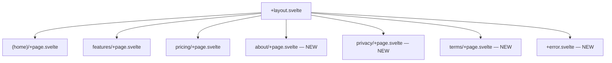
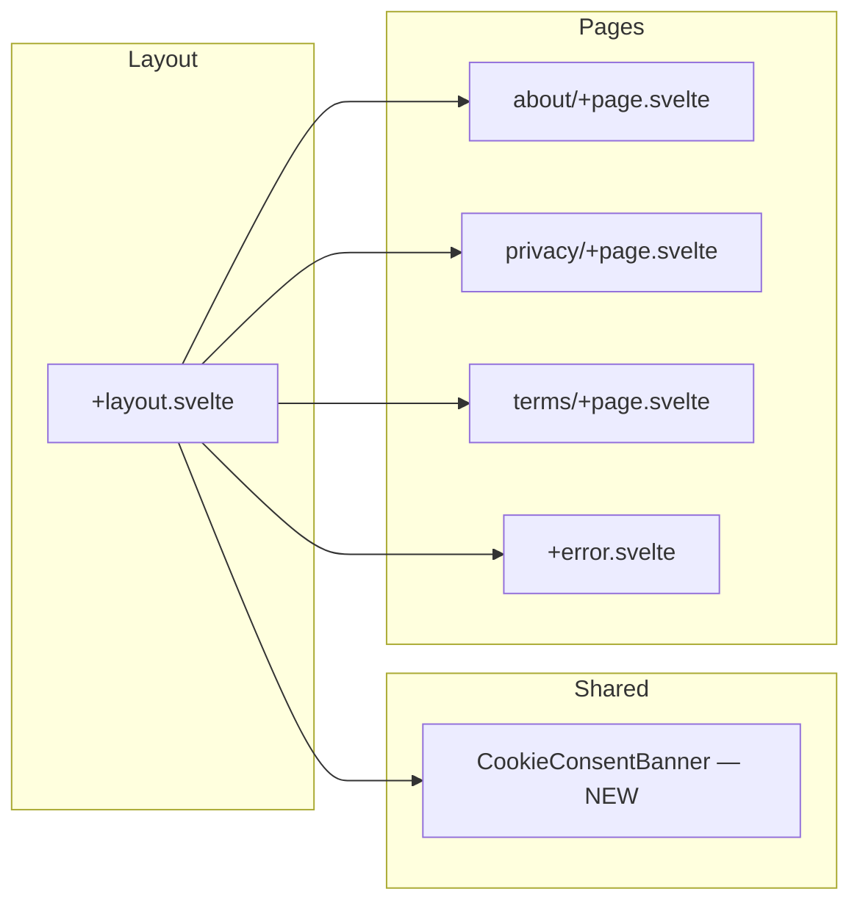

# Design Document: Web Content Overhaul

## Overview

This design covers a comprehensive content and structural overhaul of the metacleaner-web marketing site. The changes include:

- Three new informational/legal pages (About, Privacy Policy, Terms of Use)
- GDPR cookie consent banner
- Footer cleanup (remove dead links, social icons; dynamic year)
- Content corrections for processing claims (scan=local, clean=server)
- Removal of non-existent app download references
- CTA button width fix
- Custom 404 error page
- Dead code cleanup

All changes follow existing patterns: Svelte 5 runes, Paraglide i18n (EN + CS), Tailwind CSS 4 with dark navy theme, and the established 3-tier component hierarchy.

## Architecture

### Route Additions



New routes follow the same flat pattern as existing ones (no route groups). Each new page shares the global layout (navbar + footer) via `+layout.svelte`.

### Component Architecture



### Design Decisions

| Decision | Rationale |
|----------|-----------|
| New pages as flat routes (not route groups) | About, Privacy, Terms are standalone pages with no sub-routes |
| Cookie consent as shared component in layout | Needs to appear on every page, managed at layout level |
| localStorage for consent storage | Simple, client-side-only approach; no server needed |
| Legal page content in i18n messages | Maintains bilingual support; content editable without code changes |
| `+error.svelte` for 404 | SvelteKit's built-in error page mechanism; works with SPA fallback |
| No separate sections/ folder for simple pages | About/Privacy/Terms are single-section pages; no need for section composition |

## Components and Interfaces

### New Components

#### 1. CookieConsentBanner (`src/lib/components/shared/CookieConsentBanner.svelte`)

A fixed-bottom bar that appears on first visit when no consent preference is stored.

```typescript
interface Props {
  // No props — self-contained, reads/writes localStorage
}

// Internal state
let visible: boolean; // $state — derived from localStorage check
let consent: 'accepted' | 'rejected' | null; // read from localStorage
```

**Behavior:**
- On mount: check `localStorage.getItem('cookie_consent')` 
- If null → show banner
- Accept button: `localStorage.setItem('cookie_consent', 'accepted')`, hide with 300ms transition
- Reject button: `localStorage.setItem('cookie_consent', 'rejected')`, hide with 300ms transition
- Includes link to `/privacy`
- All text via `m.cookie_*()` Paraglide messages
- Keyboard accessible (focusable buttons, proper tab order)
- `position: fixed; bottom: 0` — does not overlap header or block scrolling

**localStorage key:** `cookie_consent`  
**Values:** `'accepted'` | `'rejected'`

#### 2. About Page (`src/routes/about/+page.svelte`)

Single-page component with:
- `<svelte:head>` for SEO (title + meta description)
- Page heading using SectionHeading or equivalent h1 styling
- Company description section
- Contact section (email display)
- All content from i18n messages (`about_*` keys)

#### 3. Privacy Policy Page (`src/routes/privacy/+page.svelte`)

Single-page component with:
- `<svelte:head>` for SEO
- Page heading (h1)
- Structured content with multiple h2 sub-sections
- Legal prose formatted with `@tailwindcss/typography` (`prose` class with dark mode overrides)
- All content from i18n messages (`privacy_*` keys)

#### 4. Terms of Use Page (`src/routes/terms/+page.svelte`)

Same pattern as Privacy Policy:
- `<svelte:head>` for SEO
- Page heading (h1) + h2 sub-sections
- `prose` class for legal content formatting
- All content from i18n messages (`terms_*` keys)

#### 5. Custom 404 Error Page (`src/routes/+error.svelte`)

SvelteKit error page with:
- Large "404" number as focal element (gradient text or glow effect)
- Subtitle message explaining page not found
- CTA button linking to home `/`
- Decorative gradient glow orb (using existing `bg-brand-blue/10 blur-glow` pattern)
- Dark navy theme with brand accents
- SEO `<title>` tag
- All text via i18n messages (`error_404_*` keys)

### Modified Components

#### SiteFooter (`src/lib/shared/sections/SiteFooter.svelte`)

Changes:
1. **Remove** social icon links (Twitter, GitHub, LinkedIn) from both desktop and mobile layouts
2. **Remove** "Cookies" link from Legal column
3. **Update** Company column "About us" link href from `#` to `/about`
4. **Update** Legal column links: Privacy → `/privacy`, Terms → `/terms`
5. **Update** mobile links: Privacy → `/privacy`, Terms → `/terms`, About → `/about`
6. **Replace** hardcoded copyright text with dynamic year: `new Date().getFullYear()`
7. **Update** `footer_tagline` i18n message to distinguish scan vs clean

#### HeroSection (`src/routes/(home)/sections/HeroSection.svelte`)

Changes:
1. **Remove** the secondary "Download App" CTA button entirely
2. **Remove** the wrapper `<div>` around the primary button (no longer needs flex row)
3. **Update** `home_hero_badge` i18n message to clarify scan=local, clean=server

#### +layout.svelte

Changes:
1. **Add** `CookieConsentBanner` component import and render (after SiteFooter, inside the flex column)
2. **Extend** `activePage` derived to handle new routes (`/about`, `/privacy`, `/terms`)

#### FeaturesCtaSection (`src/routes/features/sections/FeaturesCtaSection.svelte`)

Changes:
1. **Remove** `fullWidth` prop or ensure it's not set (it's already `size="sm"` without `fullWidth`)
2. The current implementation already renders the button without full-width — verify it's centered (wrap in `flex justify-center` if needed)

### Components to Remove (Dead Code)

- `SocialIconLink.svelte` + `SocialIconLink.stories.svelte` (no longer referenced after footer cleanup)
- FAQ entry 7 i18n keys (`home_faq_7_question`, `home_faq_7_answer`)
- `cta_download_app` i18n key

## Data Models

### i18n Message Keys — Additions

```
// Cookie Consent Banner
cookie_banner_text
cookie_banner_accept
cookie_banner_reject
cookie_banner_privacy_link

// About Page
meta_about_title
meta_about_description
about_heading
about_description_p1
about_description_p2
about_contact_heading
about_contact_email_label
about_contact_email

// Privacy Policy Page
meta_privacy_title
meta_privacy_description
privacy_heading
privacy_intro
privacy_section1_title
privacy_section1_content
privacy_section2_title
privacy_section2_content
privacy_section3_title
privacy_section3_content
privacy_section4_title
privacy_section4_content
privacy_section5_title
privacy_section5_content

// Terms of Use Page
meta_terms_title
meta_terms_description
terms_heading
terms_intro
terms_section1_title
terms_section1_content
terms_section2_title
terms_section2_content
terms_section3_title
terms_section3_content
terms_section4_title
terms_section4_content
terms_section5_title
terms_section5_content

// 404 Error Page
error_404_title
error_404_heading
error_404_message
error_404_cta

// Navigation (footer link)
footer_link_about (already exists, href changes)
```

### i18n Message Keys — Modifications

| Key | Current Value | New Value |
|-----|---------------|-----------|
| `home_hero_badge` | "100% local processing" | "Local scanning · Server-side cleaning" |
| `footer_tagline` | "Protect your privacy by removing hidden metadata from your files. 100% local processing." | "Protect your privacy by removing hidden metadata from your files. Scanning is local, cleaning is server-side." |
| `home_upload_local_note` | "Files are processed locally. Never uploaded." | "Scanning is local. Cleaning requires upload — files are deleted after processing." |
| `home_step1_desc` | "Drag and drop photos or videos into the app. All files are processed on your device. Your data never leaves your device." | "Drag and drop photos or videos into the app. Metadata analysis happens locally in your browser." |
| `home_step1_desc_mobile` | "Tap or drag photos. Everything is processed on your device." | "Tap or drag photos. Scanning happens locally in your browser." |
| `home_faq_1_answer` | "No. MetaCleaner processes all files exclusively locally..." | "Metadata scanning and analysis are performed locally in your browser — files are never uploaded for scanning. Metadata cleaning requires uploading files to our server for processing. Uploaded files are automatically deleted after cleaning is complete." |
| `footer_copyright` | "© 2024 MetaCleaner. All rights reserved." | "© {year} MetaCleaner. All rights reserved." (dynamic via JS) |

### i18n Message Keys — Removals

- `cta_download_app`
- `home_faq_7_question`
- `home_faq_7_answer`
- `footer_legal_cookies`

### localStorage Schema

| Key | Type | Values | Purpose |
|-----|------|--------|---------|
| `cookie_consent` | string | `'accepted'` \| `'rejected'` | Cookie consent preference |

## Correctness Properties

### Property 1: Cookie consent round-trip persistence

*For any* consent value (accepted or rejected), writing it to localStorage and reading it back SHALL return the same value, and the banner visibility SHALL be the inverse of whether a consent value exists.

**Validates: Requirements 4.1, 4.2, 4.3**

Note: This is the only aspect of this feature with meaningful input variation. The remainder of the feature (static pages, i18n content, dead code removal, UI modifications) consists of deterministic rendering and configuration changes best verified through example-based unit tests and E2E tests rather than property-based testing.

## Error Handling

### Cookie Consent — localStorage Unavailable

If `localStorage` is unavailable (private browsing on some browsers, storage full):
- Wrap `localStorage.getItem/setItem` in try/catch
- If read fails → treat as no consent stored → show banner
- If write fails → hide banner visually but don't persist (banner reappears on next visit)
- No tracking scripts execute regardless

### 404 Error Page

- SvelteKit's `+error.svelte` automatically receives the error via `$page.error`
- The page checks `$page.status === 404` to display the custom 404 content
- For non-404 errors, display a generic "Something went wrong" message with the same home link
- The SPA fallback (nginx `try_files`) ensures unknown routes load `index.html`, and SvelteKit's client router triggers the error page

### New Page Routes — Missing Messages

If an i18n key is missing (e.g., during development), the `t()` helper already returns the key string as fallback and logs a console warning. No additional error handling needed.

## Testing Strategy

### Why Property-Based Testing Does NOT Apply

This feature consists of:
- Static page creation (HTML/CSS rendering)
- i18n message additions (string content)
- UI component modifications (remove/add elements)
- localStorage read/write (simple boolean state)
- Dead code removal

None of these involve pure functions with varying inputs, parsers, serializers, or algorithmic logic. All requirements are best tested with example-based tests and E2E tests.

### Unit Tests (Vitest)

| Test | What it verifies |
|------|-----------------|
| Cookie consent localStorage logic | Read/write behavior, null handling, try/catch fallback |
| FAQ repository excludes entry 7 | `getFaq()` returns 7 items (not 8), none with id '7' |
| Dynamic copyright year | Footer renders current year |
| Footer link structure | Legal column has exactly Privacy + Terms (no Cookies) |

### E2E Tests (Playwright)

| Test | What it verifies |
|------|-----------------|
| About page renders | Navigate to `/about`, verify heading, description, contact email visible |
| Privacy page renders | Navigate to `/privacy`, verify heading and sub-sections |
| Terms page renders | Navigate to `/terms`, verify heading and sub-sections |
| 404 page renders | Navigate to `/nonexistent`, verify 404 content and home link |
| Cookie banner appears on first visit | Clear localStorage, load page, banner is visible |
| Cookie banner dismiss (accept) | Click accept, banner disappears, localStorage set |
| Cookie banner dismiss (reject) | Click reject, banner disappears, localStorage set |
| Cookie banner hidden on return visit | Set localStorage, load page, banner not visible |
| Footer links work | Click Privacy/Terms/About in footer, correct pages load |
| Footer has no social icons | Assert no Twitter/GitHub/LinkedIn icon links in footer |
| Footer has no Cookies link | Assert "Cookies" text not present in Legal column |
| Hero section has no Download App button | Assert only "Try for Free" button visible |
| Processing claims are accurate | Verify hero badge, upload card note, FAQ answer contain "local scanning" language |
| CTA button is auto-width and centered | Features CTA section button is not full-width |

### Visual Testing (Stories)

New stories to add:
- `CookieConsentBanner.stories.svelte` — visible state, hidden state
- About/Privacy/Terms page screenshots (optional, via Playwright visual comparison)

### Test Configuration

```bash
bun run test:unit      # Vitest — unit tests (single run)
bun run test:e2e       # Playwright — E2E tests
```

No property-based testing library is needed for this feature.
