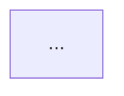

# Kiro Spec — Complete Reference Guide

> This document describes everything needed to create, read, modify, and understand Kiro specification files. Any agent (Claude, Codex, Gemini, etc.) that reads this guide can produce identical Kiro specs from scratch or modify existing ones correctly.

---

## 1. What Is a Kiro Spec?

A Kiro spec is a structured feature specification that lives inside the `.kiro/specs/` directory of a project. It is the primary artifact of Kiro's **Spec session type** — a disciplined, iterative approach to building features.

A spec decomposes a feature into three progressive layers:

1. **Requirements** — what the feature must do (user-facing behavior)
2. **Design** — how the feature will be built (architecture, components, data models)
3. **Tasks** — the ordered implementation steps (a checklist for the agent)

Each layer is a separate Markdown file inside a dedicated folder. Together they form a complete blueprint that an agent can execute autonomously.

---

## 2. Directory Structure

```
.kiro/
└── specs/
    └── <feature-slug>/
        ├── requirements.md
        ├── design.md
        └── tasks.md
```

- `<feature-slug>` is a lowercase, hyphen-separated name describing the feature (e.g., `user-authentication`, `api-keys-management`, `metadata-inspect-cli`).
- All three files are always present together. A spec without all three files is incomplete.
- Multiple specs can coexist in `.kiro/specs/` — each in its own subdirectory.
- Specs are independent of each other unless they share referenced types or components.

---

## 3. The Three Files

### 3.1 `requirements.md`

**Purpose:** Defines what the feature must do in terms of user behavior and system rules. Written before the design.

**Structure:**

```markdown
# Requirements Document

## Introduction

<2–4 paragraph description of the feature context, what problem it solves, what systems are involved, and what the implementation scope is. Includes the project location when relevant.>

## Glossary

- **Term**: Definition. Used to establish consistent vocabulary for the rest of the document.
- ...

## Requirements

### Requirement N: <Requirement Title>

**User Story:** As a <role>, I want <goal>, so that <reason>.

#### Acceptance Criteria

1. WHEN <trigger>, THE <system> SHALL <behavior>
2. IF <condition>, THEN THE <system> SHALL <behavior>
3. WHILE <state>, THE <system> SHALL <behavior>
...
```

**Rules for requirements.md:**

- The document title is always `# Requirements Document`.
- The **Introduction** sets scope. It names the specific services/files affected. It mentions project-relative paths (e.g., `terminal/metacleaner-cli/`) when the feature targets a specific location.
- The **Glossary** defines every domain-specific term used in the acceptance criteria. Terms are written in `UpperCamelCase` or `Snake_Case` with underscores (e.g., `Auth_API`, `Risk_Score`, `Backend_Server`). This consistent casing makes it immediately obvious in acceptance criteria when a defined term is being used.
- Each **Requirement** has a sequential number and a clear title (e.g., `Requirement 1: File Metadata Scanning`).
- Every requirement has a **User Story** following the format: `As a <role>, I want <goal>, so that <reason>.`
- **Acceptance Criteria** use a structured conditional language:
  - `WHEN <trigger>, THE <system> SHALL <action>` — normal behavior when a condition is met
  - `IF <condition>, THEN THE <system> SHALL <action>` — conditional or edge-case behavior
  - `WHILE <state>, THE <system> SHALL <action>` — continuous behavior during a state
- Acceptance criteria are numbered sequentially within each requirement (1, 2, 3...).
- Glossary terms are referenced verbatim in acceptance criteria (e.g., `THE Auth_API SHALL`, `THE Scanner SHALL`).
- Requirements are numbered sequentially across the entire document (Requirement 1, 2, 3...).
- Each requirement covers one cohesive area of functionality (e.g., one UI page, one API endpoint group, one command).
- Acceptance criteria reference specific UI pages, API paths, configuration values, or file paths when precision is needed.
- There is no explicit "out of scope" section — scope is defined by what is included.

---

### 3.2 `design.md`

**Purpose:** Defines how the feature will be built — architecture, components, data models, interfaces, and correctness properties. Written after requirements, before tasks.

**Structure:**

```markdown
# Design Document: <feature-slug>

## Overview

<2–4 paragraph summary of the design approach. Names key design decisions and explains why they were made. May include a Mermaid diagram showing the high-level structure.>



## Architecture

<Detailed architecture section. May include sequence diagrams, flowcharts, or state diagrams. Explains the request/data flow through the system.>

### <Sub-section title>

...

## Components and Interfaces

<The core of the design. One subsection per major component with TypeScript interfaces, Go structs, function signatures, and behavioral contracts.>

### 1. <Component Name> (`<file path>`)

<Description + code block with interfaces/types/function signatures>

...

## Data Models

<Database schemas, key data structures, state machines, enum values, and any mapping tables.>

## Correctness Properties

<Optional but present in complex features. Formal universal properties that property-based tests will verify.>

### Property N: <Property Title>

*For any* <input condition>, <system> SHALL <invariant>.

**Validates: Requirements <N.M, N.M, ...>**

...

## Error Handling

<How errors are categorized, what HTTP codes or exit codes are returned, how errors are surfaced to the user.>

## Testing Strategy

<Overview of test layers: unit, property-based, integration, E2E. Lists which testing library is used for each layer. May reference specific test file paths.>
```

**Rules for design.md:**

- The document title is always `# Design Document: <feature-slug>`.
- The **Overview** briefly re-states the feature, then focuses on key design decisions. It uses a `**Key design decisions:**` bullet list to call out the 3–5 most important architectural choices (e.g., "Bun workspace link: Scanner logic is imported directly — no code duplication").
- **Architecture** diagrams use Mermaid syntax. Sequence diagrams (`sequenceDiagram`) show the flow between user, client, server, and external systems. Flowcharts (`flowchart TD` or `graph LR`) show component relationships. State diagrams (`stateDiagram-v2`) show lifecycle state machines.
- **Project Structure** is shown as a code block (not a list), using a tree format with inline comments for each file explaining its purpose. This mirrors the actual file system layout.
- **Components and Interfaces** is the largest section. Components are numbered sequentially. Each component includes:
  - A heading with the component name and file path in backticks
  - A prose description of the component's responsibility
  - Code blocks showing TypeScript interfaces, Go structs, or function signatures (never full implementation)
- Interface/struct definitions use the actual language syntax (TypeScript `interface`, Go `type ... struct`, etc.) and are complete enough to implement from.
- **Data Models** shows database DDL (SQL CREATE TABLE statements with constraints and indexes), key format specifications (tables with component/value/length columns), and state machines.
- **Correctness Properties** (when present) follow a precise format:
  - Italicize "*For any*" to introduce the universally quantified variable
  - State what SHALL hold true — phrased as an invariant, not a test step
  - End with `**Validates: Requirements N.M, N.M**` linking back to requirements.md
  - Properties are pre-declarations of what property-based tests will verify — they bridge spec and test code
- **Error Handling** uses a table with columns: Category/Code, HTTP Status/Exit Code, Trigger/Condition, Behavior.
- **Testing Strategy** names the testing library for each layer and describes the scope of each layer. It may list specific property tags used in test code (e.g., `Feature: api-keys-management, Property 1: Key Generation Format Correctness`).

---

### 3.3 `tasks.md`

**Purpose:** A hierarchical, ordered implementation checklist. The agent works through this list top-to-bottom to implement the feature. Written after the design.

**Structure:**

```markdown
# Implementation Plan: <feature-slug or Feature Name>

## Overview

<3–5 sentences summarizing what is being built, which files/services are involved, and which testing approach is used.>

## Tasks

- [ ] 1. <Top-level task title>
  - [ ] 1.1 <Sub-task title>
    - <Bullet describing what to create/modify — specific file paths, function names, behaviors>
    - <Another bullet for detail>
    - _Requirements: N.M, N.M_

  - [ ] 1.2 <Sub-task title>
    - ...
    - _Requirements: N.M_

- [x] 2. <Completed top-level task title>
  - [x] 2.1 <Completed sub-task>
    - ...

- [ ] 3. Checkpoint — <description>
  - <Single bullet: what to verify>

## Notes

- <Bullet list of important conventions, caveats, or non-obvious decisions for the implementer>
```

**Rules for tasks.md:**

- The document title is always `# Implementation Plan: <name>`.
- The **Overview** restates the implementation goal in concrete terms: what is being built, where it lives, and what the testing approach is.
- Tasks use **GFM checkboxes**: `- [ ]` for pending, `- [x]` for completed. Completed tasks use `[x]`. In-progress tasks use `[ ]`.
- Tasks have exactly **two levels of nesting**:
  - Level 1: top-level group (e.g., `1. Set up project structure`)
  - Level 2: specific sub-tasks (e.g., `1.1 Create CLI package.json`)
  - Level 2 sub-tasks contain bullet points (not checkboxes) describing implementation details
- Every sub-task ends with `_Requirements: N.M, N.M_` in italics, listing the requirement IDs from `requirements.md` that the task fulfills.
- Sub-task bullet points describe **what to do**, not how the code works. They name specific file paths, function names, expected behavior, and values. They are detailed enough for an agent to act on without reading the design document.
- **Checkpoint tasks** appear periodically (e.g., after a backend phase, after a frontend phase) as a dedicated top-level task with a simple instruction: "Ensure all tests pass, ask the user if questions arise."
- Optional sub-tasks are marked with an asterisk suffix: `- [ ] 4.2*` or `- [x]* 4.2`. The Notes section explains: "Tasks marked with `*` are optional and can be skipped for faster MVP."
- Test tasks are interleaved with implementation tasks, not all grouped at the end. Each test task immediately follows the implementation task it validates.
- Test sub-tasks include a `**Property N: <title>**` bold header (matching a property from design.md) followed by a description of what the property test verifies and a `**Validates: Requirements N.M**` line.
- A **Task Dependency Graph** may appear as a JSON block in the Notes section for complex multi-service features, showing which tasks can run in parallel:

```json
{
  "waves": [
    { "id": 0, "tasks": ["1.1", "1.4"] },
    { "id": 1, "tasks": ["1.2", "1.3", "4.1"] }
  ]
}
```

- The **Notes** section at the end captures gotchas, conventions, and decisions the implementer must know: which shell to use, how tests are run, known quirks, and what was intentionally excluded.

---

## 4. Naming and Language Conventions

### Feature Slug

The folder name under `.kiro/specs/` uses `lowercase-kebab-case`. It should be concise but descriptive:
- `user-authentication`
- `metadata-inspect-cli`
- `api-keys-management`
- `credits-and-subscription-overview`
- `responsive-web-refactor`

### Document Language

All three spec files are written in **English**. This applies to all prose, section headings, acceptance criteria, design descriptions, and code comments inside code blocks.

### Requirement IDs

Requirements are referenced using `N.M` notation where `N` is the requirement number and `M` is the acceptance criteria number within that requirement. Example: `Requirements 1.2, 3.4, 7.1` means Requirement 1 criteria 2, Requirement 3 criteria 4, Requirement 7 criteria 1.

### Terminology Consistency

Terms defined in the Glossary appear verbatim in ALL THREE files. If `Auth_API` is defined in requirements.md, it appears as `Auth_API` in design.md and `Auth_API` in tasks.md — never `auth API`, `authentication API`, or any variation.

---

## 5. Relationships Between the Three Files

The three files form a traceability chain:

```
requirements.md → design.md → tasks.md
      ↑                ↑            ↑
  "What"            "How"       "Steps"
```

- Every design decision in design.md should be traceable to at least one requirement.
- Every sub-task in tasks.md must reference at least one requirement via `_Requirements: N.M_`.
- Correctness Properties in design.md reference specific requirements: `**Validates: Requirements N.M**`.
- Test tasks in tasks.md reference the corresponding Property: `**Property N: <title>** → **Validates: Requirements N.M**`.

This chain means: given a failing test, you can trace back to the property, then to the requirement, and understand exactly why the test exists.

---

## 6. Task Completion Tracking

Task checkboxes represent real implementation state. An agent that implements a task marks it as `[x]`. This state persists across sessions — if an agent resumes work on a spec, it reads the checkboxes to know what has already been done.

Convention: never mark a task as complete unless its implementation is in the codebase and its tests pass (if applicable).

---

## 7. Scope Patterns

Different feature types follow predictable patterns for how requirements are organized:

### Full-Stack Feature (frontend + backend)

Requirements are grouped by layer:
1. Backend API endpoints (one requirement per logical group)
2. Frontend pages (one requirement per page or flow)
3. Data/database concerns (RLS, schema, etc.)
4. Cross-cutting concerns (error handling, rate limiting, etc.)

### CLI Tool

Requirements are grouped by command:
1. One requirement per command (`scan`, `clean`, `compare`)
2. One requirement for global flags
3. One requirement for output formats
4. One requirement for exit codes
5. One requirement for file format support

### UI Refactor / Design Fix

Requirements are grouped by component or page:
1. One requirement per page or component being changed
2. Explicit references to design mockup file paths (e.g., `.design/page-desktop.html`)
3. Acceptance criteria describe visual properties and interactions precisely

---

## 8. Design.md Section Depth Guide

Not every section appears in every spec. Use this guide:

| Section | When to include |
|---|---|
| Overview | Always |
| Architecture (diagrams) | When there are 3+ components interacting |
| Project Structure (tree) | When creating a new project/directory from scratch |
| Technology Choices (table) | When multiple viable alternatives exist and the choice needs justification |
| Components and Interfaces | Always — the core of the design |
| Data Models | When the feature involves a database schema, key format, or state machine |
| Correctness Properties | When the feature has behaviors that should hold universally (good candidates for property-based tests) |
| Error Handling | Always for backend services and CLIs; for frontend-only features, may be brief |
| Testing Strategy | Always |

---

## 9. Acceptance Criteria Language Reference

The acceptance criteria language is deliberately structured and constrained. Here is the full vocabulary:

| Pattern | Meaning |
|---|---|
| `WHEN <trigger>, THE <system> SHALL <action>` | Normal expected behavior on a specific event |
| `IF <condition>, THEN THE <system> SHALL <action>` | Conditional behavior (edge case, error, optional path) |
| `WHILE <state>, THE <system> SHALL <action>` | Continuous behavior during a sustained state |
| `THE <system> SHALL <action>` | Unconditional invariant (no trigger needed) |

Key rules:
- `SHALL` (not "should", "must", "will") — the only modal verb for obligations.
- `THE <system>` — always names the system component: `THE Frontend`, `THE Auth_API`, `THE Backend`, `THE CLI`, `THE Auth_Middleware`. Uses the Glossary term.
- Criteria do NOT say "the user sees" or "the developer can" — they state what the system does in response.
- Each criterion is a single, testable statement. Compound criteria (connected by "and") are split into separate numbered items.

---

## 10. Complete Example — Minimal Spec

Below is a complete, minimal but correct example of all three files for a hypothetical feature.

### `.kiro/specs/health-check-endpoint/requirements.md`

```markdown
# Requirements Document

## Introduction

A health check HTTP endpoint for the Go backend server. It allows load balancers, monitoring tools, and the `metacleaner-cli` to verify that the backend is running and ready to accept requests without authentication.

## Glossary

- **Backend**: The Go HTTP server at `backend/metacleaner-server/`
- **Health_Endpoint**: The HTTP endpoint at `GET /api/health`
- **Dependency_Check**: An optional sub-check that verifies a critical dependency (database, cache) is reachable

## Requirements

### Requirement 1: Basic Health Response

**User Story:** As a DevOps engineer, I want a health check endpoint, so that I can monitor service availability without authentication.

#### Acceptance Criteria

1. WHEN a GET request is received at `/api/health`, THE Health_Endpoint SHALL return HTTP 200 with a JSON body `{"status": "ok"}`
2. THE Health_Endpoint SHALL NOT require authentication
3. WHEN THE Backend is shutting down gracefully, THE Health_Endpoint SHALL return HTTP 503 with `{"status": "shutting_down"}`

### Requirement 2: Response Time

**User Story:** As a load balancer operator, I want the health check to respond quickly, so that slow health checks do not cause false-positive failures.

#### Acceptance Criteria

1. THE Health_Endpoint SHALL respond within 100 milliseconds under normal conditions
2. THE Health_Endpoint SHALL NOT perform any database queries or external calls
```

### `.kiro/specs/health-check-endpoint/design.md`

```markdown
# Design Document: health-check-endpoint

## Overview

The health check endpoint is a single lightweight HTTP handler registered at `GET /api/health`. It is exempt from auth middleware and returns a static JSON response. No external calls are made.

**Key design decisions:**
- **Static response only**: No DB or cache checks — keeps response time under 10ms
- **Shutdown-aware**: Checks a shared `shuttingDown` flag set during graceful shutdown

## Components and Interfaces

### 1. Health Handler (`source/handlers.go`)

```go
func HandleHealth(shuttingDown *atomic.Bool) http.HandlerFunc {
    return func(w http.ResponseWriter, r *http.Request) {
        w.Header().Set("Content-Type", "application/json")
        if shuttingDown.Load() {
            w.WriteHeader(http.StatusServiceUnavailable)
            json.NewEncoder(w).Encode(map[string]string{"status": "shutting_down"})
            return
        }
        w.WriteHeader(http.StatusOK)
        json.NewEncoder(w).Encode(map[string]string{"status": "ok"})
    }
}
```

## Correctness Properties

### Property 1: Unauthenticated access always succeeds when healthy

*For any* GET request to `/api/health` with any Authorization header value (including missing, invalid, and expired tokens), when the server is not shutting down, THE Health_Endpoint SHALL return HTTP 200.

**Validates: Requirements 1.1, 1.2**

## Testing Strategy

Unit tests (Go `testing`): verify 200 when healthy, 503 when shutting down, correct JSON body in both cases.
```

### `.kiro/specs/health-check-endpoint/tasks.md`

```markdown
# Implementation Plan: health-check-endpoint

## Overview

Add a `GET /api/health` endpoint to the Go backend. The handler is static (no DB), exempt from auth middleware, and shutdown-aware via an atomic flag.

## Tasks

- [ ] 1. Implement health handler
  - [ ] 1.1 Add HandleHealth function to `source/handlers.go`
    - Accept `*atomic.Bool` for shutdown flag
    - Return 200 `{"status":"ok"}` when not shutting down
    - Return 503 `{"status":"shutting_down"}` when flag is set
    - Set Content-Type: application/json
    - _Requirements: 1.1, 1.3_

  - [ ] 1.2 Register route in `source/router.go`
    - Add `mux.Handle("GET /api/health", HandleHealth(shuttingDown))` before auth middleware wraps other routes
    - Verify the route is not wrapped by auth middleware
    - _Requirements: 1.2_

- [ ] 2. Write tests
  - [ ]* 2.1 Write unit tests for HandleHealth
    - Test: GET /api/health with shuttingDown=false → 200, body={"status":"ok"}
    - Test: GET /api/health with shuttingDown=true → 503, body={"status":"shutting_down"}
    - Test: GET /api/health with no Authorization header → 200 (no auth required)
    - _Requirements: 1.1, 1.2, 1.3_

- [ ] 3. Checkpoint — Ensure all tests pass
  - Ensure `go test ./tests/ -v` passes without errors

## Notes

- Tasks marked with `*` are optional
- The shutdown flag is initialized as `&atomic.Bool{}` in `source/main.go` and set to `true` in the SIGTERM handler
```

---

## 11. Common Mistakes to Avoid

**In requirements.md:**
- Do not mix "how" into "what". Acceptance criteria describe observable behavior, not implementation details. Bad: "THE Backend SHALL use bcrypt with cost factor 12". Good: "THE Backend SHALL hash the password before storage".
- Do not skip the Glossary. Every capitalized term used in criteria must be defined.
- Do not write criteria that cannot be tested. Each criterion should have an observable outcome.

**In design.md:**
- Do not write full function implementations in code blocks — write signatures and contracts only.
- Do not omit file paths in component headings. The path is how the agent knows where to create/modify code.
- Do not invent new component names for things that already exist in the project — reference existing files and components.

**In tasks.md:**
- Do not create tasks without requirement references. Every `_Requirements: N.M_` is mandatory.
- Do not write tasks that are too vague: "Implement the feature" is not a task. "Implement `HandleCreateAPIKey` in `source/apikey_handlers.go` — validate name length, generate key via `generateAPIKey()`, insert into Supabase, return 201 with `CreateAPIKeyResponse`" is a task.
- Do not put all tests in a single final task. Interleave test tasks with implementation tasks.
- Do not forget checkpoints. A complex spec should have 2–3 checkpoints at natural phase boundaries.

---

## 12. Integration with Steering Files

Kiro specs exist alongside steering files (`.kiro/steering/*.md`). Steering files define global project conventions (tech stack, naming rules, code style). Specs reference these conventions implicitly — they do not repeat them.

When writing a spec:
- Reference design mockup files by path (e.g., `.design/page-desktop.html`) — they are declared in the relevant steering file
- Use the component names defined in steering files (e.g., `Button`, `Card`, `Badge`) without re-explaining them
- Follow the tech stack defined in steering (e.g., if steering says "SvelteKit + Tailwind + Paraglide", the spec does not re-justify this choice)

A spec is written assuming the reader (or agent) has already loaded the relevant steering files.

---

## 13. File Reference Syntax

Spec files can include references to other files using the `#[[file:...]]` syntax:

```markdown
See the API spec: #[[file:openapi.yaml]]
```

This causes Kiro to inline the referenced file's content when the spec is loaded into context. Useful for:
- Referencing OpenAPI specs in a backend API design
- Referencing database schemas
- Referencing design mockup content

---

## 14. Quick-Start Template

To create a new spec from scratch, follow this sequence:

1. Create `.kiro/specs/<feature-slug>/`
2. Write `requirements.md`:
   - Introduction (scope + context)
   - Glossary (all domain terms)
   - Requirements 1–N with acceptance criteria
3. Write `design.md`:
   - Overview with key design decisions
   - Architecture diagrams (if multi-component)
   - Project structure (if new project)
   - Components and Interfaces (all major components)
   - Data Models (schema, types, state machines)
   - Correctness Properties (if property-based tests will be written)
   - Error Handling table
   - Testing Strategy
4. Write `tasks.md`:
   - Overview
   - Tasks (hierarchical, with requirement references)
   - Checkpoints
   - Notes

The three files are always written in this order: requirements → design → tasks.
