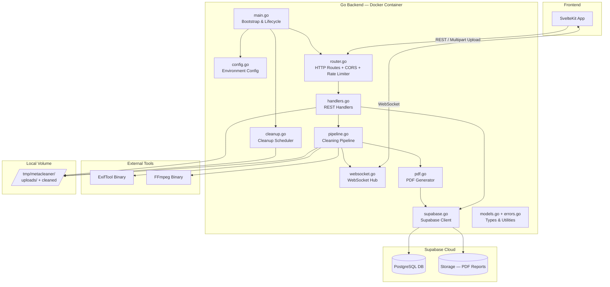
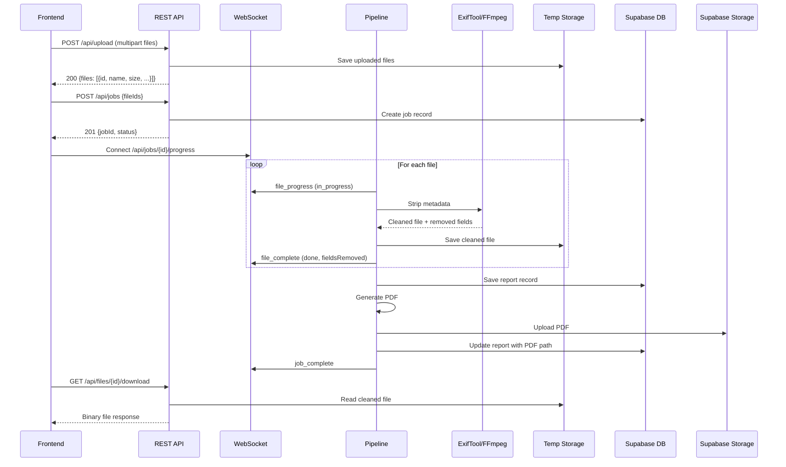

# MetaCleaner Backend — Documentation

## Table of Contents

1. [Architecture](#architecture)
2. [Environment Variables](#environment-variables)
3. [Project Structure](#project-structure)
4. [Database Migration](#database-migration)
5. [API Reference](#api-reference)
6. [WebSocket Protocol](#websocket-protocol)
7. [Error Response Format](#error-response-format)
8. [Testing](#testing)
9. [Troubleshooting](#troubleshooting)

---

## Architecture

### Component Diagram



### Data Flow



### Storage Boundaries

| Data | Location | Lifetime |
|---|---|---|
| Original uploaded files | Local temp (`/tmp/metacleaner/uploads/`) | Retention period (default 1h) |
| Cleaned files | Local temp (`/tmp/metacleaner/cleaned/`) | Retention period (default 1h) |
| PDF reports | Supabase Storage (bucket `cleaning-reports`) | Permanent |
| Job records | Supabase DB (`cleaning_jobs`, `job_files`) | Permanent |
| Report metadata | Supabase DB (`cleaning_reports`) | Permanent |

---

## Environment Variables

All variables are read at startup. `SUPABASE_URL` and `SUPABASE_API_KEY` are required; the server exits with a non-zero code if they are missing.

| Variable | Default | Description |
|---|---|---|
| `PORT` | `8080` | TCP port the HTTP server listens on |
| `FRONTEND_ORIGIN` | _(empty — allows all)_ | Allowed CORS origin, e.g. `https://metacleaner.app` |
| `MAX_FILE_SIZE` | `524288000` (500 MB) | Maximum accepted file size per upload in bytes |
| `RETENTION_PERIOD` | `1h` | How long files are kept before deletion. Go duration format: `30m`, `2h`, `24h` |
| `TEMP_STORAGE_PATH` | `/tmp/metacleaner` | Root directory for temporary file storage |
| `SUPABASE_URL` | _(required)_ | Supabase project URL, e.g. `https://abc.supabase.co` |
| `SUPABASE_API_KEY` | _(required)_ | Supabase service role key (not the anon key) |
| `RATE_LIMIT_RPM` | `60` | Maximum upload requests per minute per IP |

---

## Project Structure

```
backend/metacleaner-server/
├── cmd/
│   └── main.go              # Entry point (package main) — calls source.Run()
├── source/
│   ├── main.go              # Run() — startup, validation, server lifecycle
│   ├── config.go            # Config struct, LoadConfig()
│   ├── errors.go            # Error codes, ErrorResponse, WriteError()
│   ├── models.go            # All structs + pure utility functions
│   ├── router.go            # HTTP mux, CORS middleware, rate limiter
│   ├── handlers.go          # HTTP handlers (upload, jobs, download, reports, health)
│   ├── pipeline.go          # CleaningPipeline — ExifTool/FFmpeg subprocess orchestration
│   ├── websocket.go         # WebSocketHub — per-job connection management
│   ├── supabase.go          # SupabaseClient — PostgREST + Storage HTTP calls
│   ├── pdf.go               # PDF report generation (signintech/gopdf)
│   └── cleanup.go           # CleanupScheduler — periodic temp file deletion
├── tests/
│   ├── handlers_test.go          # Upload handler tests
│   ├── handlers_jobs_test.go     # Job creation tests
│   ├── handlers_download_test.go # Download handler tests
│   ├── handlers_reports_test.go  # Reports endpoint tests
│   ├── pipeline_integration_test.go # Pipeline subprocess tests
│   ├── cleanup_test.go           # Cleanup scheduler tests
│   ├── models_test.go            # Property tests: validation, progress, summary
│   ├── pipeline_test.go          # Property tests: tool selection, categorization
│   └── errors_test.go            # Property tests: error format
├── scripts/
│   └── migration.sql        # Idempotent SQL schema for Supabase
├── go.mod                   # Go module (metacleaner-server)
├── go.sum                   # Dependency checksums
├── .env.example             # Environment variable template
├── .dockerignore            # Docker build exclusions
├── Dockerfile               # Multi-stage: golang:1.23 builder + debian-slim runtime
├── start-docker.sh          # Build + run Docker container locally
├── fly.toml                 # Fly.io configuration (port, env, health check, volume)
└── fly-setup.sh             # Create Fly.io app + push secrets
```

---

## Database Migration

Run `scripts/migration.sql` once against your Supabase project. The script is idempotent (`CREATE TABLE IF NOT EXISTS`).

**Via Supabase Dashboard:**

1. Open [supabase.com/dashboard](https://supabase.com/dashboard) → your project
2. Navigate to **SQL Editor**
3. Paste contents of `scripts/migration.sql`
4. Click **Run**

**Tables created:**

| Table | Description |
|---|---|
| `cleaning_jobs` | One row per cleaning job; tracks status, file counts, timing |
| `job_files` | One row per file in a job; metadata breakdown as JSONB |
| `cleaning_reports` | Summary report per completed job; PDF path, chart data, tags |

**Also creates:** You need to manually create a Storage bucket named `cleaning-reports` in Supabase Dashboard → Storage → New Bucket.

---

## API Reference

Base URL: `http://localhost:8080` (local) or your Fly.io app URL.

All endpoints return `Content-Type: application/json` except file downloads and WebSocket.

### POST /api/upload

Upload files for cleaning. Rate limited (`RATE_LIMIT_RPM` per minute per IP).

**Request:** `multipart/form-data` with field `files`

**Supported formats:** JPEG, PNG, HEIC, HEIF, AVIF, TIFF, DNG, WebP, GIF, MP4, MOV, AVI, MKV, WebM, WMV, FLV, 3GP, MPEG, OGV, MTS

**Response 200:**
```json
{
  "files": [
    {
      "id": "f-a1b2c3d4",
      "name": "photo.jpg",
      "size": 3355443,
      "extension": "JPG",
      "type": "image",
      "format": "jpeg"
    }
  ]
}
```

| Error | Status | Condition |
|---|---|---|
| `FILE_TOO_LARGE` | 413 | File exceeds MAX_FILE_SIZE |
| `UNSUPPORTED_FORMAT` | 415 | Extension not supported |
| `RATE_LIMIT_EXCEEDED` | 429 | Rate limit hit (check `Retry-After` header) |
| `INSUFFICIENT_STORAGE` | 507 | Disk write failure |

---

### POST /api/jobs

Create a cleaning job for uploaded files.

**Request:**
```json
{ "fileIds": ["f-a1b2c3d4", "f-e5f6g7h8"] }
```

**Response 201:**
```json
{
  "jobId": "uuid",
  "status": "processing",
  "totalFiles": 2,
  "createdAt": "2025-06-02T10:22:00Z"
}
```

| Error | Status | Condition |
|---|---|---|
| `INVALID_REQUEST` | 400 | Empty or missing fileIds |
| `FILE_NOT_FOUND` | 404 | File ID not in temp storage |

---

### GET /api/jobs/{id}

Get job status.

**Response 200:**
```json
{
  "jobId": "uuid",
  "status": "completed",
  "totalFiles": 4,
  "filesCompleted": 4,
  "fieldsRemoved": 87,
  "gpsLocationsRemoved": 3,
  "totalTimeSeconds": 28,
  "createdAt": "2025-06-02T10:22:00Z",
  "completedAt": "2025-06-02T10:22:28Z"
}
```

---

### GET /api/files/{id}/download

Download cleaned file.

**Response 200:** Binary file with `Content-Type` and `Content-Disposition: attachment` headers.

| Error | Status | Condition |
|---|---|---|
| `FILE_NOT_FOUND` | 404 | Not found or expired |
| `FILE_NOT_READY` | 409 | Still processing |

---

### GET /api/reports

List all reports with summary stats.

**Response 200:**
```json
{
  "summary": {
    "totalReports": 12,
    "fieldsRemoved": 1248,
    "filesProcessed": 47,
    "gpsRemoved": 31
  },
  "reports": [...]
}
```

---

### GET /api/reports/{id}

Full report detail with per-file metadata breakdown.

---

### GET /api/reports/{id}/pdf

**Response 302:** Redirect to Supabase Storage signed URL for the PDF.

---

### GET /api/health

**Response 200:**
```json
{
  "status": "healthy",
  "exiftool": true,
  "ffmpeg": true,
  "database": true,
  "diskSpace": { "available": "4.2 GB", "total": "10 GB" }
}
```

---

## WebSocket Protocol

Connect to `ws://host/api/jobs/{jobId}/progress` after creating a job.

### Message types (Server → Client)

| Type | Key fields | When sent |
|---|---|---|
| `file_progress` | `fileId`, `status: "in_progress"`, `progress` | File starts processing |
| `file_complete` | `fileId`, `status: "done"`, `fieldsRemoved`, `gpsRemoved` | File finished |
| `file_error` | `fileId`, `status: "error"`, `errorCode`, `message` | File failed |
| `job_progress` | `overallProgress`, `filesCompleted`, `totalFiles`, `timeRemainingSeconds` | After each file |
| `job_complete` | `jobId`, `filesProcessed`, `fieldsRemoved`, `totalTimeSeconds`, `reportId` | All done |

### Lifecycle

1. Client opens WebSocket after receiving jobId
2. Server streams progress events
3. Server sends `job_complete` and closes connection
4. If client disconnects, job continues uninterrupted

---

## Error Response Format

```json
{
  "error": "FILE_TOO_LARGE",
  "message": "File exceeds maximum allowed size of 500 MB",
  "timestamp": "2025-06-02T10:22:00Z"
}
```

| Code | Status | Description |
|---|---|---|
| `FILE_TOO_LARGE` | 413 | Upload exceeds MAX_FILE_SIZE |
| `UNSUPPORTED_FORMAT` | 415 | Extension not supported |
| `INSUFFICIENT_STORAGE` | 507 | Disk write failure |
| `FILE_NOT_FOUND` | 404 | File not found or expired |
| `FILE_NOT_READY` | 409 | File still processing |
| `JOB_NOT_FOUND` | 404 | Job ID not found |
| `REPORT_NOT_FOUND` | 404 | Report ID not found |
| `INVALID_REQUEST` | 400 | Malformed request |
| `DATABASE_ERROR` | 503 | Supabase query failed |
| `RATE_LIMIT_EXCEEDED` | 429 | Upload rate limit exceeded |

---

## Testing

From the `backend/metacleaner-server/` directory:

```bash
# Run all tests
go test ./tests/ -v

# Run specific test
go test ./tests/ -run TestHandleUploadMultiFile

# Run only property-based tests
go test ./tests/ -run TestProperty

# Run with race detector
go test -race ./tests/
```

### Test coverage

| File | Coverage |
|---|---|
| `handlers_test.go` | Upload: multi-file, oversized, unsupported format, disk failure |
| `handlers_jobs_test.go` | Job creation: valid IDs, missing IDs, empty array |
| `handlers_download_test.go` | Download: completed, in-progress, expired |
| `handlers_reports_test.go` | Reports list, detail, PDF redirect |
| `pipeline_integration_test.go` | ExifTool/FFmpeg subprocess failure handling |
| `cleanup_test.go` | Expired file deletion, non-expired retention |
| `models_test.go` | Property: file size, format, progress, summary |
| `pipeline_test.go` | Property: tool selection, categorization |
| `errors_test.go` | Property: error response format |

---

## Troubleshooting

### ExifTool not found at startup

```
startup: exiftool not available: ...
```

Install ExifTool:
- macOS: `brew install exiftool`
- Ubuntu/Debian: `apt-get install libimage-exiftool-perl`
- Docker: included in image automatically

### FFmpeg not found at startup

```
startup: ffmpeg not available: ...
```

Install FFmpeg:
- macOS: `brew install ffmpeg`
- Ubuntu/Debian: `apt-get install ffmpeg`
- Docker: included in image automatically

### Supabase connection failure

```
startup: Supabase not reachable: ...
```

Check:
1. `SUPABASE_URL` is correct (e.g. `https://abc.supabase.co`)
2. `SUPABASE_API_KEY` is the **service role** key
3. Project is not paused (free-tier pauses after inactivity)
4. Migration has been applied (`scripts/migration.sql`)

### PDF stuck in "pending" status

The Supabase Storage bucket `cleaning-reports` must exist. Create it via Dashboard → Storage → New Bucket.

### Rate limit exceeded (429)

Wait 60 seconds or increase `RATE_LIMIT_RPM` in `.env`:
```
RATE_LIMIT_RPM=60
```

### Docker build fails

Regenerate lockfile:
```bash
go mod tidy
```
Then rebuild:
```bash
docker build -t metacleaner-server .
```
