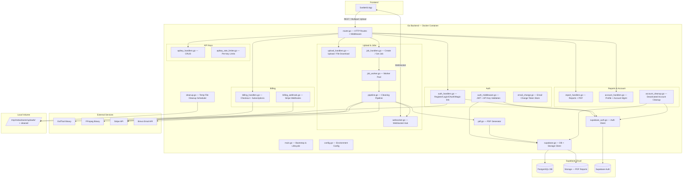
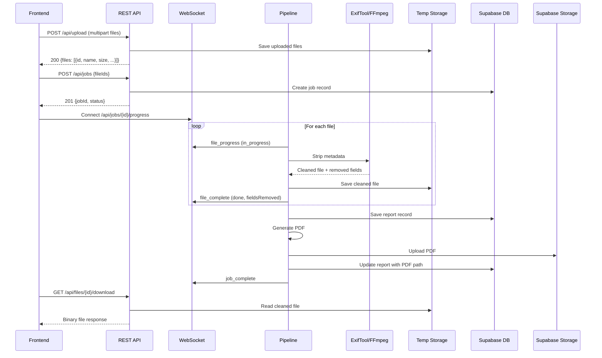

# MetaCleaner Backend — Documentation

## Table of Contents

1. [Architecture](#architecture)
2. [Environment Variables](#environment-variables)
3. [Project Structure](#project-structure)
4. [Database Migration](#database-migration)
5. [Deployment](#deployment)
6. [API Reference](#api-reference)
7. [WebSocket Protocol](#websocket-protocol)
8. [Error Response Format](#error-response-format)
9. [Testing](#testing)
10. [Troubleshooting](#troubleshooting)

---

## Architecture

### Component Diagram



### Data Flow



### Storage Boundaries

| Data | Location | Lifetime |
|---|---|---|
| Original uploaded files | Local temp (`/tmp/metacleaner/uploads/`) | Retention period (default 1h) |
| Cleaned files | Local temp (`/tmp/metacleaner/cleaned/`) | Retention period (default 1h) |
| PDF reports | Supabase Storage (bucket `cleaning-reports`) | Permanent |
| Job records | Supabase DB (`cleaning_jobs`, `job_files`) | Permanent |
| Report metadata | Supabase DB (`cleaning_reports`) | Permanent |

---

## Environment Variables

All variables are read at startup. `SUPABASE_URL` and `SUPABASE_API_KEY` are required; the server exits with a non-zero code if they are missing.

### Core

| Variable | Default | Description |
|---|---|---|
| `PORT` | `8080` | TCP port the HTTP server listens on |
| `APP_ENV` | _(empty)_ | `production` → JSON logs at Info level; `development` → text logs at Debug level |
| `FRONTEND_ORIGIN` | _(empty — allows all)_ | Allowed CORS origin, e.g. `https://metacleaner.app` |
| `FRONTEND_URL` | _(empty)_ | Base URL of the frontend app; used in OAuth and magic-link redirects |
| `MAX_FILE_SIZE` | `524288000` (500 MB) | Maximum accepted file size per upload in bytes |
| `RETENTION_PERIOD` | `1h` | How long temp files are kept before deletion. Go duration format: `30m`, `2h` |
| `TEMP_STORAGE_PATH` | `/tmp/metacleaner` | Root directory for temporary file storage |
| `RATE_LIMIT_RPM` | `10` | Maximum upload requests per minute per IP |
| `MAX_CONCURRENT_JOBS` | `3` | Maximum number of cleaning jobs running simultaneously |

### Supabase

| Variable | Default | Description |
|---|---|---|
| `SUPABASE_URL` | _(required)_ | Supabase project URL, e.g. `https://abc.supabase.co` |
| `SUPABASE_API_KEY` | _(required)_ | Supabase anon (public) key — find it in Settings → API |
| `SUPABASE_SERVICE_ROLE_KEY` | _(empty)_ | Supabase service role key — used for DB operations to bypass RLS (recommended for production) |
| `SUPABASE_JWT_SECRET` | _(empty)_ | Supabase JWT secret — required for local JWT verification in auth middleware |
| `SUPABASE_TIMEOUT` | `30` | Timeout in seconds for outbound Supabase HTTP calls |

### Auth

| Variable | Default | Description |
|---|---|---|
| `OAUTH_CALLBACK_URL` | _(empty)_ | Backend OAuth callback URL, e.g. `https://app.fly.dev/api/auth/oauth/callback` |
| `MAGIC_LINK_CALLBACK_URL` | _(empty)_ | Backend magic-link callback URL, e.g. `https://app.fly.dev/api/auth/magic-link/callback` |

### Mobile deep links (optional)

| Variable | Default | Description |
|---|---|---|
| `ANDROID_CERT_FINGERPRINT` | _(empty)_ | SHA-256 fingerprint of the Android signing certificate (colon-separated hex pairs) |
| `APPLE_TEAM_ID` | _(empty)_ | Apple Developer Team ID (10-character alphanumeric string) |

### Stripe billing

| Variable | Default | Description |
|---|---|---|
| `STRIPE_SECRET_KEY` | _(empty)_ | Stripe secret key (`sk_test_*` for dev, `sk_live_*` for production) |
| `STRIPE_WEBHOOK_SECRET` | _(empty)_ | Stripe webhook signing secret (`whsec_*`) |
| `STRIPE_PRICE_PRO_MONTH` | _(empty)_ | Stripe Price ID for Pro monthly plan |
| `STRIPE_PRICE_PRO_YEAR` | _(empty)_ | Stripe Price ID for Pro annual plan |
| `STRIPE_PRICE_PROPLUS_MONTH` | _(empty)_ | Stripe Price ID for Pro+ monthly plan |
| `STRIPE_PRICE_PROPLUS_YEAR` | _(empty)_ | Stripe Price ID for Pro+ annual plan |
| `STRIPE_PRICE_CREDIT_PACK` | _(empty)_ | Stripe Price ID for credit pack one-time purchase |

### Email (Brevo)

| Variable | Default | Description |
|---|---|---|
| `BREVO_API_KEY` | _(empty)_ | Brevo transactional email API key — required for email-change verification |
| `BREVO_SENDER_EMAIL` | `noreply@metacleaner.app` | From address for outbound emails |

---

## Project Structure

```
backend/metacleaner-server/
├── cmd/
│   └── main.go                  # Entry point (package main) — calls source.Run()
├── source/
│   ├── main.go                  # Run() — startup, validation, server lifecycle
│   ├── config.go                # Config struct, LoadConfig()
│   ├── errors.go                # Error codes, ErrorResponse, WriteError()
│   ├── models.go                # Shared structs + pure utility functions
│   ├── logger.go                # InitLogger(), LoggerFromContext() — structured slog setup
│   ├── request_id.go            # RequestIDMiddleware — attaches X-Request-ID to each request
│   ├── middleware.go             # corsMiddleware, securityHeadersMiddleware
│   ├── router.go                # HTTP mux, all routes registered
│   │
│   ├── auth_middleware.go       # JWT + API key authentication middleware
│   ├── auth_handlers.go         # Register, login, logout, refresh, OAuth, magic-link, password reset
│   ├── auth_models.go           # Auth request/response structs
│   ├── auth_rate_limiter.go     # Rate limiter for auth endpoints
│   ├── account_handlers.go      # HandleUpdateProfile, HandleChangePassword, HandleDeleteAccount
│   ├── account_cleanup.go       # AccountCleanupScheduler — hard-deletes accounts deactivated 30+ days
│   ├── email_change.go          # Email change verification token store (tokens stored in Supabase DB)
│   │
│   ├── upload_handlers.go       # HandleUpload, HandleFileDownload
│   ├── job_handlers.go          # HandleCreateJob, HandleGetJob
│   ├── job_worker.go            # JobWorkerPool — limits concurrent pipeline executions
│   ├── pipeline.go              # CleaningPipeline — ExifTool/FFmpeg subprocess orchestration
│   ├── pipeline_exiftool.go     # ExifTool-specific cleaning and metadata extraction
│   ├── pipeline_ffmpeg.go       # FFmpeg-specific cleaning and metadata extraction
│   ├── websocket.go             # WebSocketHub — per-job WebSocket connection management
│   ├── pdf.go                   # PDF report generation (signintech/gopdf)
│   │
│   ├── report_handlers.go       # HandleListReports, HandleGetReport, HandleGetReportPDF (+ public variants)
│   ├── health_handlers.go       # HandleHealth — checks tools, DB, disk space
│   ├── well_known.go            # /.well-known/assetlinks.json, /apple-app-site-association
│   │
│   ├── billing_handlers.go      # Stripe checkout, subscription management
│   ├── billing_webhook.go       # Stripe webhook event processing
│   │
│   ├── apikey_handlers.go       # API key CRUD handlers (create, list, delete, revoke, activate)
│   ├── apikey_models.go         # APIKey struct and related types
│   ├── apikey_rate_limiter.go   # Per-API-key rate limiter
│   │
│   ├── supabase.go              # SupabaseClient — PostgREST + Storage HTTP calls
│   ├── supabase_auth.go         # SupabaseAuthClient — Supabase Auth API calls
│   ├── supabase_apikeys.go      # API key DB operations
│   ├── supabase_billing.go      # Billing DB operations (subscriptions, credits)
│   └── cleanup.go               # CleanupScheduler — periodic temp file deletion
├── tests/
│   ├── handlers_test.go               # Upload handler tests
│   ├── handlers_jobs_test.go          # Job creation tests
│   ├── handlers_download_test.go      # File + job download tests
│   ├── handlers_reports_test.go       # Reports list, detail, PDF redirect
│   ├── handlers_fileid_validation_test.go # File ID format validation
│   ├── auth_handlers_test.go          # Auth endpoint tests
│   ├── auth_middleware_test.go        # JWT + API key middleware tests
│   ├── auth_rate_limiter_test.go      # Auth rate limiter tests
│   ├── auth_property_*.go             # Property tests: credentials, error format, middleware, input validation
│   ├── account_handlers_test.go       # Profile + account management tests
│   ├── account_cleanup_test.go        # Account cleanup scheduler tests
│   ├── account_property_test.go       # Account property tests
│   ├── billing_handlers_test.go       # Billing endpoint tests
│   ├── billing_webhook_test.go        # Stripe webhook tests
│   ├── apikey_handlers_test.go        # API key CRUD tests
│   ├── apikey_rate_limiter_test.go    # API key rate limiter tests
│   ├── supabase_apikeys_test.go       # Supabase API key data layer tests
│   ├── supabase_billing_test.go       # Supabase billing data layer tests
│   ├── supabase_test.go               # Supabase client tests
│   ├── pipeline_integration_test.go   # ExifTool/FFmpeg subprocess failure handling
│   ├── pipeline_test.go               # Property tests: tool selection, categorization
│   ├── job_worker_test.go             # Worker pool tests
│   ├── cleanup_test.go                # Temp file cleanup scheduler tests
│   ├── health_handlers_test.go        # Health endpoint tests
│   ├── well_known_test.go             # /.well-known endpoint tests
│   ├── websocket_test.go              # WebSocket hub tests
│   ├── cors_test.go                   # CORS middleware tests
│   ├── security_test.go               # Security headers tests
│   ├── rate_limiter_test.go           # Upload rate limiter tests
│   ├── request_id_test.go             # Request ID middleware tests
│   ├── config_test.go                 # Config loading tests
│   ├── logger_test.go                 # Logger tests
│   ├── pdf_test.go                    # PDF generation tests
│   ├── models_test.go                 # Property tests: file size, format, progress, summary
│   └── errors_test.go                 # Property tests: error response format
├── migrations/
│   └── 001_full_schema.sql      # Idempotent SQL schema for Supabase
├── scripts/
│   ├── build.sh                 # Build binary
│   ├── deploy.sh                # Deploy to Fly.io (reads .env-prod by default)
│   ├── start-docker.sh          # Build + run Docker container locally
│   ├── stop-docker.sh           # Stop local Docker container
│   └── stripe-webhook.sh        # Start Stripe webhook listener for local dev
├── go.mod                       # Go module (metacleaner-server)
├── go.sum                       # Dependency checksums
├── .env.example                 # Environment variable template
├── .dockerignore                # Docker build exclusions
├── Dockerfile                   # Multi-stage: golang:1.23 builder + debian-slim runtime
└── fly.toml                     # Fly.io configuration (port, env, health check, volume)
```

---

## Database Migration

Run `migrations/001_full_schema.sql` once against your Supabase project. The script is idempotent (`CREATE TABLE IF NOT EXISTS`).

**Via Supabase Dashboard:**

1. Open [supabase.com/dashboard](https://supabase.com/dashboard) → your project
2. Navigate to **SQL Editor**
3. Paste contents of `migrations/001_full_schema.sql`
4. Click **Run**

**Tables created:**

| Table | Description |
|---|---|
| `cleaning_jobs` | One row per cleaning job; tracks status, file counts, timing |
| `job_files` | One row per file in a job; metadata breakdown as JSONB |
| `cleaning_reports` | Summary report per completed job; PDF path, chart data, tags |

**Also create manually:** A Storage bucket named `cleaning-reports` in Supabase Dashboard → Storage → New Bucket.

---

## Deployment

### Fly.io

1. Authenticate with Fly.io:

```bash
flyctl auth login
```

2. Create a `.env-prod` file with production values (the deploy script reads it by default):

```bash
cp .env.example .env-prod
# edit .env-prod with production values
```

3. Run the deployment script (creates the app if it doesn't exist, sets secrets, deploys):

```bash
scripts/deploy.sh
```

To use a different env file:

```bash
scripts/deploy.sh --env staging
# reads .env-staging
```

Useful Fly.io commands:

```bash
fly logs --app metacleaner-server     # View logs
fly status --app metacleaner-server   # Check status
fly ssh console --app metacleaner-server  # SSH into container
```

### Docker (manual)

```bash
docker build -t metacleaner-server .
docker run -p 8080:8080 --env-file .env metacleaner-server
```

---

## API Reference

Base URL: `http://localhost:8080` (local) or your Fly.io app URL.

All endpoints return `Content-Type: application/json` except file downloads and WebSocket.

**Authentication:** Protected endpoints require a `Bearer <access_token>` header or an `X-API-Key: <key>` header.

---

### Auth

#### POST /api/auth/register

Create a new account. Sends a confirmation email via Supabase.

**Request:**
```json
{ "email": "user@example.com", "password": "secret123", "first_name": "Jane", "last_name": "Doe" }
```

**Response 201:** `{ "message": "Registration successful. Please check your email to confirm your account." }`

| Error | Status | Condition |
|---|---|---|
| `AUTH_INVALID_REQUEST` | 400 | Missing or invalid fields |
| `AUTH_INVALID_EMAIL` | 400 | Malformed email |
| `AUTH_INVALID_PASSWORD` | 400 | Password outside 8–72 characters |
| `AUTH_EMAIL_EXISTS` | 409 | Email already registered |

---

#### POST /api/auth/login

Sign in with email and password. Returns a JWT session.

**Request:** `{ "email": "...", "password": "..." }`

**Response 200:** `{ "access_token": "...", "refresh_token": "...", "expires_in": 3600, "user": { "id": "uuid", "email": "..." } }`

---

#### POST /api/auth/logout

Invalidate the current session. Requires `Authorization: Bearer <token>`.

**Response 200:** `{ "message": "Logged out successfully" }`

---

#### POST /api/auth/refresh

Exchange a refresh token for a new session.

**Request:** `{ "refresh_token": "..." }`

**Response 200:** Same shape as login response.

---

#### GET /api/auth/me

Return the authenticated user's profile. Auto-provisions a profile for first-time magic-link users.

**Response 200:** `{ "id": "uuid", "email": "...", "first_name": "...", "last_name": "...", ... }`

---

#### PATCH /api/auth/profile

Update the authenticated user's `first_name` and `last_name` (1–100 characters each).

**Request:** `{ "first_name": "Jane", "last_name": "Smith" }`

**Response 200:** Updated profile object.

---

#### POST /api/auth/change-email

Initiate an email address change. Sends a verification link to the new address via Brevo.

**Request:** `{ "new_email": "new@example.com" }`

**Response 200:** `{ "message": "..." }`

---

#### GET /api/auth/confirm-email-change

Confirm an email change by clicking the link in the verification email (token passed as query param).

**Response 302:** Redirect to frontend with success or error.

---

#### POST /api/auth/change-password

Change the authenticated user's password.

**Request:** `{ "current_password": "...", "new_password": "..." }`

**Response 200:** `{ "message": "Password changed successfully." }`

---

#### DELETE /api/auth/account

Deactivate the account (marks it for deletion; auto-deleted after 30 days). Logging in within that window reactivates the account.

**Response 200:** `{ "message": "..." }`

---

#### POST /api/auth/forgot-password

Send a password-reset code to the given email. Always returns 200 for valid email format to prevent enumeration.

**Request:** `{ "email": "user@example.com" }`

**Response 200:** `{ "message": "If an account with that email exists, a password reset code has been sent." }`

---

#### POST /api/auth/verify-reset-code

Verify the OTP code from the reset email. Returns a short-lived access token.

**Request:** `{ "email": "user@example.com", "code": "123456" }`

**Response 200:** `{ "access_token": "..." }`

---

#### POST /api/auth/reset-password

Set a new password using the token from `verify-reset-code`.

**Request:** `{ "password": "newpassword" }` + `Authorization: Bearer <reset-token>`

**Response 200:** `{ "message": "Password has been reset successfully." }`

---

#### GET /api/auth/oauth/{provider}

Initiate OAuth login. Supported providers: `google`, `apple`. Redirects to Supabase OAuth authorize URL using PKCE.

---

#### GET /api/auth/oauth/callback

OAuth callback. Exchanges the authorization code for a session and redirects to the frontend with tokens.

---

#### POST /api/auth/magic-link

Send a magic-link login email. Always returns 200 for valid email format.

**Request:** `{ "email": "user@example.com" }`

---

#### GET /api/auth/magic-link/callback

Supabase redirects here after the user clicks a magic link or email confirmation link. Redirects to the frontend with tokens.

---

### Upload & Files

#### POST /api/upload

Upload files for cleaning. Rate limited (`RATE_LIMIT_RPM` per minute per IP).

**Request:** `multipart/form-data` with field `files`

**Supported formats:** JPEG, PNG, HEIC, HEIF, AVIF, TIFF, DNG, WebP, GIF, MP4, MOV, AVI, MKV, WebM, WMV, FLV, 3GP, MPEG, OGV, MTS

**Response 200:**
```json
{
  "files": [
    { "id": "f-a1b2c3d4", "name": "photo.jpg", "size": 3355443, "extension": "JPG", "type": "image", "format": "jpeg" }
  ]
}
```

| Error | Status | Condition |
|---|---|---|
| `FILE_TOO_LARGE` | 413 | File exceeds `MAX_FILE_SIZE` |
| `UNSUPPORTED_FORMAT` | 415 | Extension not supported |
| `RATE_LIMIT_EXCEEDED` | 429 | Rate limit hit (check `Retry-After` header) |
| `INSUFFICIENT_STORAGE` | 507 | Disk write failure |

---

#### GET /api/files/{id}/download

Download a cleaned file.

**Response 200:** Binary file with `Content-Type` and `Content-Disposition: attachment` headers.

| Error | Status | Condition |
|---|---|---|
| `FILE_NOT_FOUND` | 404 | Not found or expired |
| `FILE_NOT_READY` | 409 | Still processing |

---

### Jobs

#### POST /api/jobs

Create a cleaning job for uploaded files.

**Request:** `{ "fileIds": ["f-a1b2c3d4", "f-e5f6g7h8"] }`

**Response 201:**
```json
{ "jobId": "uuid", "status": "processing", "totalFiles": 2, "createdAt": "2025-06-02T10:22:00Z" }
```

| Error | Status | Condition |
|---|---|---|
| `INVALID_REQUEST` | 400 | Empty or missing fileIds |
| `FILE_NOT_FOUND` | 404 | File ID not in temp storage |

---

#### GET /api/jobs/{id}

Get job status.

**Response 200:**
```json
{
  "jobId": "uuid",
  "status": "completed",
  "totalFiles": 4,
  "filesCompleted": 4,
  "fieldsRemoved": 87,
  "gpsLocationsRemoved": 3,
  "totalTimeSeconds": 28,
  "createdAt": "2025-06-02T10:22:00Z",
  "completedAt": "2025-06-02T10:22:28Z"
}
```

---

#### GET /api/jobs/{id}/download

Download the zip archive of all cleaned files for a job. Rate limited.

**Response 200:** Binary zip file.

| Error | Status | Condition |
|---|---|---|
| `JOB_NOT_FOUND` | 404 | Job not found |
| `FILE_NOT_READY` | 409 | Job still processing |

---

#### GET /api/jobs/{id}/progress

WebSocket endpoint — see [WebSocket Protocol](#websocket-protocol).

---

### Reports

#### GET /api/reports

List all reports with summary stats. Requires authentication.

**Response 200:**
```json
{
  "summary": { "totalReports": 12, "fieldsRemoved": 1248, "filesProcessed": 47, "gpsRemoved": 31 },
  "reports": [...]
}
```

---

#### GET /api/reports/{id}

Full report detail with per-file metadata breakdown. Requires authentication.

---

#### GET /api/reports/{id}/pdf

**Response 302:** Redirect to a Supabase Storage signed URL for the PDF. Requires authentication.

---

#### GET /api/public/reports/{id}

Public report detail — no authentication required. Returns the same shape as `GET /api/reports/{id}`.

---

#### GET /api/public/reports/{id}/pdf

**Response 302:** Public PDF redirect — no authentication required.

---

### Account

#### GET /api/account

Return combined account data: profile, subscription status, and credit balance. Rate limited.

**Response 200:** `{ "profile": {...}, "subscription": {...}, "credits": {...} }`

---

### Billing

All billing endpoints require authentication.

#### POST /api/billing/checkout

Create a Stripe Checkout session for a subscription or credit pack purchase.

**Request:** `{ "plan_id": "pro", "billing_period": "month" }`

**Response 200:** `{ "url": "https://checkout.stripe.com/...", "session_id": "cs_..." }`

| Error | Status | Condition |
|---|---|---|
| `BILLING_INVALID_PLAN` | 400 | Unknown plan or billing period |
| `BILLING_CONFLICT` | 409 | Already subscribed to this plan |

---

#### POST /api/billing/webhook

Stripe webhook receiver. Verifies signature using `STRIPE_WEBHOOK_SECRET`. **Not authenticated via JWT.**

---

#### GET /api/billing/subscription

Return the authenticated user's active subscription.

**Response 200:** `{ "plan_id": "pro", "status": "active", "billing_period": "month", "current_period_end": "..." }`

---

#### GET /api/billing/credits

Return the authenticated user's credit balance.

**Response 200:** `{ "trial_credits": 3, "paid_credits": 0 }`

---

#### POST /api/billing/change-plan

Change the subscription plan (upgrade or downgrade). Rate limited.

**Request:** `{ "plan_id": "proplus", "billing_period": "year" }`

---

#### POST /api/billing/cancel

Cancel the active subscription at period end. Rate limited.

---

#### POST /api/billing/cancel-downgrade

Cancel a previously scheduled downgrade. Rate limited.

---

#### POST /api/billing/reactivate

Reactivate a cancelled subscription before it expires. Rate limited.

---

### API Keys

All API key endpoints require authentication.

#### POST /api/keys

Create a new API key.

**Response 201:** `{ "id": "uuid", "key": "mc_...", "name": "...", "created_at": "..." }`

The `key` value is only returned once at creation time.

---

#### GET /api/keys

List all API keys for the authenticated user.

**Response 200:** `{ "keys": [{ "id": "uuid", "name": "...", "last_used_at": "...", "revoked": false, ... }] }`

---

#### DELETE /api/keys/{id}

Permanently delete an API key.

**Response 204**

---

#### PATCH /api/keys/{id}/revoke

Revoke an API key (disables it without deleting).

**Response 200**

---

#### PATCH /api/keys/{id}/activate

Re-activate a previously revoked API key.

**Response 200**

---

### Other

#### GET /api/health

**Response 200:**
```json
{
  "status": "healthy",
  "exiftool": true,
  "ffmpeg": true,
  "database": true,
  "diskSpace": { "available": "4.2 GB", "total": "10 GB" }
}
```

`status` is `"healthy"` when all checks pass, `"degraded"` otherwise.

---

#### GET /.well-known/assetlinks.json

Android App Links verification. Requires `ANDROID_CERT_FINGERPRINT` to be set.

---

#### GET /.well-known/apple-app-site-association

iOS Universal Links verification. Requires `APPLE_TEAM_ID` to be set.

---

## WebSocket Protocol

Connect to `ws://host/api/jobs/{jobId}/progress` after creating a job.

### Message types (Server → Client)

| Type | Key fields | When sent |
|---|---|---|
| `file_progress` | `fileId`, `status: "in_progress"`, `progress` | File starts processing |
| `file_complete` | `fileId`, `status: "done"`, `fieldsRemoved`, `gpsRemoved` | File finished |
| `file_error` | `fileId`, `status: "error"`, `errorCode`, `message` | File failed |
| `job_progress` | `overallProgress`, `filesCompleted`, `totalFiles`, `timeRemainingSeconds` | After each file |
| `job_complete` | `jobId`, `filesProcessed`, `fieldsRemoved`, `totalTimeSeconds`, `reportId` | All done |

### Lifecycle

1. Client opens WebSocket after receiving `jobId`
2. Server streams progress events
3. Server sends `job_complete` and closes connection
4. If client disconnects, job continues uninterrupted

---

## Error Response Format

```json
{
  "error": "FILE_TOO_LARGE",
  "message": "File exceeds maximum allowed size of 500 MB",
  "timestamp": "2025-06-02T10:22:00Z"
}
```

| Code | Status | Description |
|---|---|---|
| `FILE_TOO_LARGE` | 413 | Upload exceeds `MAX_FILE_SIZE` |
| `UNSUPPORTED_FORMAT` | 415 | Extension not supported |
| `INSUFFICIENT_STORAGE` | 507 | Disk write failure |
| `FILE_NOT_FOUND` | 404 | File not found or expired |
| `FILE_NOT_READY` | 409 | File still processing |
| `JOB_NOT_FOUND` | 404 | Job ID not found |
| `REPORT_NOT_FOUND` | 404 | Report ID not found |
| `INVALID_REQUEST` | 400 | Malformed request |
| `DATABASE_ERROR` | 503 | Supabase query failed |
| `RATE_LIMIT_EXCEEDED` | 429 | Upload rate limit exceeded |
| `AUTH_UNAUTHORIZED` | 401 | Missing or invalid auth token |
| `AUTH_TOKEN_EXPIRED` | 401 | JWT has expired |
| `AUTH_TOKEN_INVALID` | 401 | JWT is malformed or signature invalid |
| `AUTH_INVALID_CREDENTIALS` | 401 | Wrong email or password |
| `AUTH_EMAIL_EXISTS` | 409 | Email already registered |
| `AUTH_EMAIL_NOT_CONFIRMED` | 403 | Email confirmation required before login |
| `BILLING_INVALID_PLAN` | 400 | Unknown plan or billing period |
| `BILLING_CONFLICT` | 409 | Already subscribed to this plan |
| `BILLING_STRIPE_ERROR` | 502 | Stripe API error |

---

## Testing

From the `backend/metacleaner-server/` directory:

```bash
# Run all tests (tests/ package)
go test ./tests/ -v

# Run tests in source/ package (includes email_change, supabase_auth_url, format_helpers)
go test ./source/ -v

# Run a specific test
go test ./tests/ -run TestHandleUploadMultiFile

# Run only property-based tests
go test ./tests/ -run TestProperty

# Run with race detector
go test -race ./tests/

# Run all tests in both packages
go test ./... -v
```

### Test coverage

| Category | Test files |
|---|---|
| Upload & files | `handlers_test.go`, `handlers_download_test.go`, `handlers_fileid_validation_test.go` |
| Jobs | `handlers_jobs_test.go`, `job_worker_test.go` |
| Reports | `handlers_reports_test.go` |
| Auth | `auth_handlers_test.go`, `auth_middleware_test.go`, `auth_rate_limiter_test.go`, `auth_property_*.go` |
| Account | `account_handlers_test.go`, `account_cleanup_test.go`, `account_property_test.go` |
| Billing | `billing_handlers_test.go`, `billing_webhook_test.go`, `supabase_billing_test.go` |
| API keys | `apikey_handlers_test.go`, `apikey_rate_limiter_test.go`, `supabase_apikeys_test.go` |
| Pipeline | `pipeline_test.go`, `pipeline_integration_test.go` |
| Infrastructure | `cleanup_test.go`, `health_handlers_test.go`, `websocket_test.go`, `well_known_test.go`, `cors_test.go`, `security_test.go`, `rate_limiter_test.go`, `request_id_test.go` |
| Data layer | `supabase_test.go`, `config_test.go`, `logger_test.go`, `pdf_test.go` |
| Property tests | `models_test.go`, `errors_test.go`, `pipeline_test.go` |

---

## Troubleshooting

### ExifTool not found at startup

```
startup: exiftool not available: ...
```

Install ExifTool:
- macOS: `brew install exiftool`
- Ubuntu/Debian: `apt-get install libimage-exiftool-perl`
- Docker: included in image automatically

### FFmpeg not found at startup

```
startup: ffmpeg not available: ...
```

Install FFmpeg:
- macOS: `brew install ffmpeg`
- Ubuntu/Debian: `apt-get install ffmpeg`
- Docker: included in image automatically

### Supabase connection failure

```
startup: Supabase not reachable: ...
```

Check:
1. `SUPABASE_URL` is correct (e.g. `https://abc.supabase.co`)
2. `SUPABASE_API_KEY` is the **anon (public)** key — find it in Settings → API → `anon public`
3. `SUPABASE_SERVICE_ROLE_KEY` is the **service role** key — required for DB operations in production
4. Project is not paused (free-tier pauses after inactivity)
5. Migration has been applied (`migrations/001_full_schema.sql`)

### Auth JWT validation fails

Check that `SUPABASE_JWT_SECRET` matches the JWT secret in your Supabase project (Settings → API → JWT Settings → JWT Secret).

### PDF stuck in "pending" status

The Supabase Storage bucket `cleaning-reports` must exist. Create it via Dashboard → Storage → New Bucket.

### Rate limit exceeded (429)

Wait 60 seconds or increase `RATE_LIMIT_RPM` in `.env`:
```
RATE_LIMIT_RPM=60
```

### Stripe webhook signature verification fails

For local development, run the Stripe CLI listener:
```bash
scripts/stripe-webhook.sh
```
Copy the `whsec_*` output into `STRIPE_WEBHOOK_SECRET` in your `.env`.

### Docker build fails

Regenerate lockfile:
```bash
go mod tidy
```
Then rebuild:
```bash
docker build -t metacleaner-server .
```
